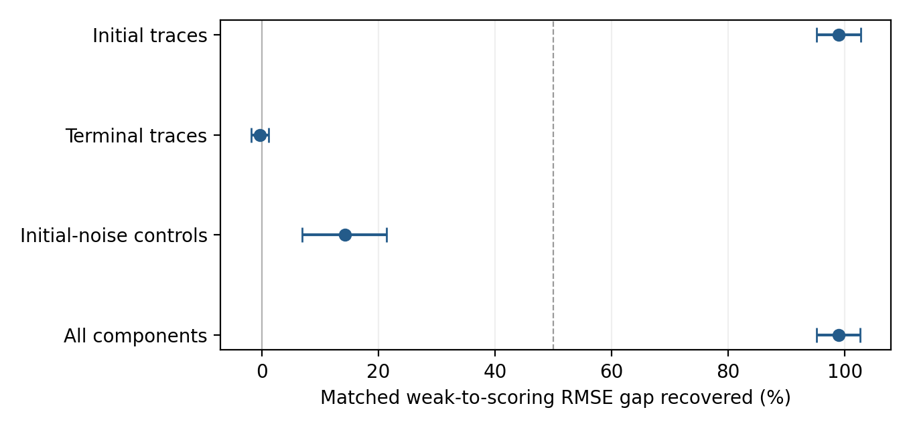

Independent researcher, Almaty, Kazakhstan

Corresponding author: malyshevdanil04@gmail.com

ORCID: https://orcid.org/0009-0007-0947-3866

**MSC 2020:** Primary 62F12; secondary 62M10, 34A55.

## Abstract

Weak-form estimating equations built from test functions that vanish at the boundary discard information about a known initial state when measurement errors are temporally correlated. For deterministic polynomial ODEs observed with stationary Ornstein–Uhlenbeck noise, we characterize the closed class of boundary-free weak influences exactly: it is the annihilator of the initial-state sensitivities, so its sharp information is the initial-state-adjusted Schur complement of the path Fisher information. When the initial state is known, the restriction raises the local RMSE reference by 29% for Van der Pol and almost doubles it for Lorenz; nonzero initial test traces, as proposed by Brunel and coauthors, restore the full class. Our main constructive result is a feasible estimator of every coefficient of a polynomial library, based on smoothed-data instruments, exact Hermite residual covariance and vanishing regularization. Under a checkable trajectory-jet condition it attains the boundary-free bound in sequential small-noise and dense-span limits; rank, weight consistency and moment control are proved rather than assumed. The condition is verified by exact symbolic calculation for the eighteen-coefficient cubic Van der Pol library. Paired simulations show that initial traces recover 95–97% of the known-initial gap at small noise, that the constructive estimator matches its finite-span covariance at small noise, and that substantial excess risk remains at 5% noise.

**Keywords:** weak estimating equations; correlated measurement error; nuisance initial states; Fisher information; polynomial covariance; errors in variables.

## 1. Introduction

Weak formulations of ODE estimation multiply the equations by test functions and integrate by parts, moving derivatives from noisy data onto known functions [@schaeffer2017; @messenger2021; @reinbold2020; @bortz2023]. The test functions are usually required to vanish at both ends of the observation interval, so that no boundary terms appear. That this discards information about a known initial state has been recognized in orthogonality-condition estimation [@brunel2014] and in recent weak identifiability work [@heitzman2026]. This paper determines exactly how much information is lost, when the loss matters, and whether the remaining bound can be attained by a feasible weak estimator.

We work with fully observed deterministic polynomial ODEs on a fixed horizon $[0,T]$, observed with stationary Ornstein–Uhlenbeck (OU) measurement error of fixed physical correlation time. In this experiment dense sampling does not produce consistency: the path laws for different parameters are mutually absolutely continuous, as in fixed-domain Gaussian process inference [@stein1999; @ying1991; @zhang2004], so the continuous record carries finite Fisher information (Lemma 1, Proposition 1). The natural reference is therefore local information and the natural asymptotic regime is small noise, not an increasing number of observations.

The paper has three contributions.

1. **Exact influence classes (Proposition 2, Theorems 1–2).** The closure of boundary-free weak influences is exactly the annihilator of the initial-state sensitivities. Its sharp information equals the Schur complement obtained when the initial state is a nuisance parameter. Hence boundary-free equations lose nothing to first order when the initial state is unknown, and lose exactly the initial-sensitivity projection when it is known. Allowing nonzero initial test traces restores the full class. The projection formula itself is classical [@bickel1993; @vandervaart1998, Chapter 25] and the trace remedy is due to Brunel et al. [@brunel2014, Section 2.3]; what is new is the exact adjoint-range identification of the weak classes and the explicit OU optimal test.
2. **Constructive attainability (Theorem 3).** A feasible estimator of every coefficient of a polynomial library, which integrates no ODE and receives no information about the true support, attains the boundary-free bound in sequential small-noise and dense-span limits. Identifiability of its weak equations reduces to a single trajectory-jet determinant, verified exactly for the cubic Van der Pol library.
3. **Quantitative benchmarks (Section 7).** Paired simulations measure the information cost (29% for Van der Pol, almost a factor two for Lorenz), the recovery achieved by initial traces, and the agreement of the constructive estimator with its own finite-span covariance.

Section 2 reviews related estimators. Section 3 fixes the model and notation, Section 4 the information limits, Section 5 the weak classes and the constructive estimator, and Section 6 the exact polynomial residual covariance used for weighting. Section 7 reports the benchmarks and Section 8 discusses limitations. Proofs not given in the text, protocols and additional checks are in the supplement (S1–S9).

## 2. Related estimation methods

ODE estimation has long used trajectory smoothing and integral matching: spline least squares [@varah1982], nonparametric gradient matching [@brunel2008], measurement-error regression [@liang2008], smooth-and-match estimation [@gugushvili2012] and direct integral estimation [@dattner2015]. Generalized profiling is asymptotically efficient under its approximation and independent-sampling assumptions [@ramsay2007; @qi2010], and one-step likelihood refinement of an ODE pilot is also established [@dattner2018]. Optimal estimating equations and their sandwich information are classical [@godambe1960], as are continuous-time BLUE and endpoint-weighted designs under correlated errors [@dette2016; @dette2017].

Sparse identification of nonlinear dynamics represents a vector field through a library and selects active coefficients [@brunton2016]. Weak formulations reduce sensitivity to numerical differentiation [@schaeffer2017; @messenger2021; @reinbold2020], and their continuum-data theory treats uncorrelated measurement errors [@messenger2025]. A fixed physical correlation time defines a different experiment: adjacent correlations approach one as the mesh is refined. This differs from correlation induced by filtering independently sampled errors over a fixed number of sample indices.

WENDy treats weak estimation as an errors-in-variables problem with coupled feature and response perturbations and an iteratively updated linearized covariance [@bortz2023]. WENDy-MLE uses an approximate Gaussian weak-residual likelihood with parameter-dependent covariance [@rummel2025]; its log-determinant and covariance-derivative terms distinguish it from fixed-weight GLS. Our Hermite covariance extends the coupled calculation to all Gaussian orders for supplied OU noise. Gaussian correction of noisy polynomial features has classical precedents [@fuller1987; @stefanski1989], and finite-noise bias in WENDy remains an active topic [@chawla2026]. Test functions have been chosen by quadrature-error estimates [@tran2026] and spectrally [@chen2026]; WmSINDy combines weak regression with dynamics and noise reconstruction [@lopez2026], and ensemble SINDy quantifies term inclusion by bootstrap aggregation [@fasel2022]. Comparisons with these methods are documented in the research archive; we claim no general superiority for structure selection.

### 2.1. Relation to orthogonality-condition estimation

Brunel et al. [@brunel2014] combine a nonparametric proxy, orthogonality conditions and GMM for independent observations at an increasing number of points, including delay equations. They recognize boundary-information loss and adapt the moments to known boundary values. Our polynomial setting is narrower. It treats fixed-horizon OU error, identifies the complete adjoint influence classes and their Schur-complement relation, gives the explicit OU optimal test, and constructs an attainable full-library estimator. The small-noise and dense-span limits used here differ from their increasing-point asymptotics; the two analyses are complementary.

## 3. Observation model, weak equations and notation

Let $x:[0,T]\to\mathbb R^d$ solve the polynomial ODE

$$
x'_i=f_i(x)=\sum_{j=1}^{p}\xi^*_{ji}\vartheta_j(x),\qquad i=1,\ldots,d,
$$

whose library $\vartheta_1,\ldots,\vartheta_p$ contains all true terms. Observations are $Y(t)=x(t)+\eta_C(t)$, where the coordinates of $\eta_C$ are independent stationary OU processes [@uhlenbeck1930] with covariance

$$
C_j(s,t)=\sigma_j^2\exp(-|s-t|/\tau_j),\qquad \sigma_j>0,\quad\tau_j>0,
$$

common to all parameter values. Actual data are evaluations $y_n=Y(t_n)$ on a grid of mesh $h$; the continuous record is a reference experiment.

**Notation.** The parameter $\theta\in\mathbb R^p$ collects the free entries of $\xi^*$: all library coefficients in Theorem 3, a supplied structure in Section 7. The initial state is $u=x(0)$, and we write $x_\theta=x_{\theta,u}$ when $u$ is fixed. $S=\partial_\theta x_\theta$ and $Z=\partial_u x_{\theta,u}$ are the parameter and initial-state sensitivities. $C$ denotes the noise covariance operator. In the small-noise statements (Proposition 3, Theorem 3) the noise is written $\epsilon\eta$ with scalar amplitude $\epsilon$, and $C$ is the covariance of $\eta$, so that the physical covariance is $\epsilon^2C$ and information scales as $\epsilon^{-2}$. Finite covariance matrices of weak residuals are denoted by $\Sigma$, the Dirac measure at $t$ by $\delta_t$, and a compact coefficient box by $\mathcal B$. For a polynomial vector field, $f_\theta^H$ replaces every monomial by its Hermite-corrected version (Section 6.1), so that $E f_\theta^H(x+\eta_C)=f_\theta(x)$ pointwise.

Fix $K$ test functions $\phi_k\in C_c^2(0,T)$ whose positions and support widths remain fixed as $h$ decreases. Clean weak quantities are

$$
G^0_{kj}=\int_0^T\phi_k\vartheta_j(x)\,dt,\qquad
b^0_{ki}=-\int_0^T\phi'_kx_i\,dt,\qquad b^0=G^0\xi^*.
$$

With corrected features $\widetilde\vartheta_j$ (Section 6.1) and quadrature $\mathcal Q_h$ with weights $w_n$ (composite trapezoidal unless stated otherwise; the endpoint comparisons use composite Simpson),

$$
(G_h)_{kj}=\mathcal Q_h(\phi_k\widetilde\vartheta_j(y)),\qquad
(b_h)_{ki}=-\mathcal Q_h(\phi'_ky_i).
$$

Physical OU infill sets the adjacent correlation to $\exp(-h/\tau)$ with fixed $T,\tau$. An iid control instead has independent errors of fixed per-sample variance, and fixed-index AR(1) keeps the adjacent correlation fixed, so that its physical correlation time vanishes. The three models have different continuum limits.

## 4. Fixed-horizon information limits

### 4.1. OU translation geometry

The stationary OU process satisfies $d\eta_{C,j}=-\eta_{C,j}dt/\tau_j+\sqrt{2\sigma_j^2/\tau_j}\,dW_j$, with an independent initial value $\eta_{C,j}(0)\sim N(0,\sigma_j^2)$. Its Cameron–Martin space $\mathcal H$ is $H^1([0,T];\mathbb R^d)$ as a set, with norm

$$
\|g\|_{\mathcal H}^2=\sum_j\left\{\frac{g_j(0)^2}{\sigma_j^2}+
\frac{\tau_j}{2\sigma_j^2}\int_0^T(g'_j+g_j/\tau_j)^2\,dt\right\}.
$$

Mapping a path to its initial value and innovation path $z(t)-z(0)+\tau_j^{-1}\int_0^tz(s)ds$ separates a normal initial observation from scaled Brownian motion; translation by $g$ gives an initial shift and Brownian drift $g'+g/\tau_j$, and the translation theorem [@cameron1944] gives the norm. Equivalently,

$$
\|g\|_{\mathcal H}^2=\sum_j\left\{\frac{\tau_j}{2\sigma_j^2}\int_0^T(g'_j)^2dt+
\frac1{2\sigma_j^2\tau_j}\int_0^Tg_j^2dt+
\frac{g_j(0)^2+g_j(T)^2}{2\sigma_j^2}\right\}.
$$

The endpoint terms encode the stationary initial noise.

**Lemma 1 (fixed-horizon two-point bound; proof in S1.1).** Let $\theta\ne\theta'$ have mean trajectories in $\mathcal H$ and share the stated OU covariance. Put $\kappa=\|\theta-\theta'\|$ and $d_{\theta\theta'}=\|x_\theta-x_{\theta'}\|_{\mathcal H}$. Every estimator based on any finite grid satisfies

$$
\max_{v\in\{\theta,\theta'\}}P_v\{\|\widehat\theta_h-v\|\geq\kappa/2\}
\geq\Phi(-d_{\theta\theta'}/2)>0,
$$

so its maximal two-point squared risk is at least $(\kappa^2/4)\Phi(-d_{\theta\theta'}/2)$. Dense-grid consistency on a nontrivial fixed-horizon family is therefore impossible [@feldman1958; @zhang2004].

### 4.2. Continuous-record information

**Proposition 1 (continuous-record information).** If $\theta\mapsto x_\theta$ is differentiable in $\mathcal H$ with $s_r=\partial_{\theta_r}x_\theta$, the continuous-record Fisher information is

$$
\mathcal I_{rs}(\theta)=\langle s_r,s_s\rangle_{\mathcal H}.
$$

This is the Gaussian mean-score identity: the directional score has variance equal to the squared Cameron–Martin norm of its sensitivity. When nonsingular, its inverse is the Cramér–Rao bound for regular unbiased estimators. Exact discrete OU innovations converge to this information under grid refinement; S6.1 gives the scalar calculation and shows why unguarded weak ratio estimators can have infinite error moments despite a finite Gaussian influence variance. Information bounds concern local regular influences; finite-noise risk requires separate control, which Proposition 3 and Theorem 3 provide.

## 5. Weak influence classes and efficiency

### 5.1. Exact boundary-free influence class

Along $x_{\theta,u}$ put $J(t)=D_xf(x_{\theta,u}(t),\theta)$, assumed in $C^1([0,T];\mathbb R^{d\times d})$ throughout Section 5, and let the fundamental matrix satisfy $Z'=JZ$, $Z(0)=I_d$. Put $\mathcal D v=v'-Jv$ and $\mathcal D^*\phi=-\phi'-J^T\phi$. Write $\mathcal E=\mathcal H'$ for the continuous dual of the OU Cameron–Martin space, with covariance norm

$$
\|\lambda\|_C^2=\langle\lambda,C\lambda\rangle,
\qquad
\langle C^{-1}g,v\rangle=\langle g,v\rangle_{\mathcal H}.
$$

$\mathcal E$ contains ordinary integrated influences and endpoint evaluation measures; a general element acts on the noise as an $L^2(P)$ limit of integrated Gaussian observations, with variance $\|\lambda\|_C^2$.

**Proposition 2 (exact range and closure).** In $L^2$,

$$
\mathcal D^*H_0^1
=\left\{\ell\in L^2:\int_0^T Z(t)^T\ell(t)dt=0\right\},
$$

and the range of compactly supported smooth tests is dense in this space. Its closure in $\mathcal E$ is

$$
\mathcal M=\overline{\mathcal D^*C_c^\infty}^{\|\cdot\|_C}
=\{\lambda\in\mathcal E:\langle\lambda,Z_j\rangle=0, j=1,\ldots,d\},
$$

which has codimension $d$.

**Proof.** Since $Z^T\mathcal D^*\phi=-(Z^T\phi)'$, zero endpoint values imply the moment constraint. Conversely, for $\ell\in L^2$ with zero moment,

$$
\phi(t)=-Z(t)^{-T}\int_0^t Z(s)^T\ell(s)ds
$$

belongs to $H_0^1$ and satisfies $\mathcal D^*\phi=\ell$. Density of $C_c^\infty$ in $H_0^1$ and continuity of $\mathcal D^*:H_0^1\to L^2$ give $L^2$ density. For the closure in $\mathcal E$, an element $v\in\mathcal H$ annihilates every $\mathcal D^*\phi$ if and only if $\mathcal D v=0$ distributionally, that is $v=Zc$; the Hahn–Banach annihilator characterization of closed subspaces gives the stated closure. The columns of $Z$ are linearly independent in $\mathcal H$, so the constraints have rank $d$. $\square$

The covariance norm is equivalent to the dual Sobolev norm for this OU model.

**Lemma 2 (a concrete dense test family).** Let $V_m$ be vector-valued continuous piecewise-linear splines on nested uniform dyadic partitions of $[0,T]$, vanishing at both endpoints. Then

$$
\overline{\bigcup_m\mathcal D^*V_m}^{\|\cdot\|_C}=\mathcal M.
$$

**Proof.** For $v\in H_0^1$ choose $\psi\in C_c^\infty$ close to $v$ in $H^1$. Its nodal interpolant satisfies $\|I_m\psi-\psi\|_{H^1}\leq c\Delta_m\|\psi''\|_{L^2}$, where $\Delta_m$ is the mesh width, so $\bigcup_mV_m$ is dense in $H_0^1$. Continuity of $\mathcal D^*:H_0^1\to L^2$ and of the embedding $L^2\hookrightarrow\mathcal E$, together with Proposition 2, complete the proof. $\square$

### 5.2. Sharp information and optimal influence

Let $S=[S_1,\ldots,S_p]\in\mathcal H^p$ and form the joint information blocks for $(S,Z)$. Assume $\mathcal I_{uu}$ and the Schur complement below are positive definite, and set

$$
R=S-Z\mathcal I_{uu}^{-1}\mathcal I_{u\theta},
\qquad
\mathcal I_e=\mathcal I_{\theta\theta}
-\mathcal I_{\theta u}\mathcal I_{uu}^{-1}\mathcal I_{u\theta}.
$$

**Theorem 1 (sharp boundary-free influence covariance).** Let $\Lambda=[\lambda_1,\ldots,\lambda_p]\in\mathcal M^p$ satisfy $\langle\lambda_r,S_s\rangle=\delta_{rs}$. Its Gaussian influence covariance obeys

$$
V(\Lambda)\succeq\mathcal I_e^{-1},
$$

with equality for the matrix-valued dual influence

$$
\Lambda_*=C^{-1}R\,\mathcal I_e^{-1}\in\mathcal M^p.
$$

Over normalized compact-test influences the bound is an infimum; it is a minimum only if $\Lambda_*$ belongs to their adjoint range.

**Proof.** The $\mathcal H$-projection gives $\langle C^{-1}R,Z\rangle=0$ and $\langle C^{-1}R,S\rangle=\mathcal I_e$, so $\Lambda_*$ is admissible with covariance $\mathcal I_e^{-1}$. The difference $\Delta=\Lambda-\Lambda_*$ pairs to zero with $S$ and $Z$, hence with $R$; the cross terms vanish and

$$
V(\Lambda)=\mathcal I_e^{-1}+V(\Delta).
$$

For the infimum, approximate each column of $\Lambda_*$ by compact-test influences in covariance norm. Their normalization matrices converge to $I_p$ by continuity of the pairing with $S$, and right-multiplication by their inverses restores exact normalization while preserving covariance convergence. $\square$

For an unknown initial state, $\mathcal I_e$ is the nuisance-adjusted path information, so the weak restriction costs nothing further to first order. For a known initial state, the information lost is exactly $\mathcal I_{\theta u}\mathcal I_{uu}^{-1}\mathcal I_{u\theta}$ and the covariance inflation is $\mathcal I_e^{-1}-\mathcal I_{\theta\theta}^{-1}$; there is no direction-independent percentage loss in general. The mechanism is that $Y(0)-u$ then reveals the initial measurement error, which remains correlated with later observations; the unrestricted score uses it, while boundary-free influences must annihilate the initial sensitivity.

### 5.3. Explicit optimal OU test

For a scalar coordinate and $g\in H^2$, integration by parts in the OU norm gives the dual measure

$$
C^{-1}g=
\frac{g-\tau^2g''}{2\sigma^2\tau}\,dt
+\frac{g(0)-\tau g'(0)}{2\sigma^2}\delta_0
+\frac{g(T)+\tau g'(T)}{2\sigma^2}\delta_T,
$$

applied coordinatewise for independent coordinates. For $g\in H^1$ only, the Riesz representative exists in $\mathcal E$ but need not have this form.

Write a smooth optimal representative as $\Lambda_*=m(t)dt+m_0\delta_0+m_T\delta_T$. On the open interval an adjoint test matrix is

$$
\Phi_*(t)=-Z(t)^{-T}
\left[Z(0)^Tm_0+\int_0^t Z(s)^Tm(s)ds\right],
$$

extended by zero outside $[0,T]$. Its endpoint jumps supply $m_0=-\Phi_*(0+)$ and $m_T=\Phi_*(T-)$, and $\mathcal D^*\Phi_*=\Lambda_*$ distributionally; the initial atom must be included in the cumulative integral, and the annihilation condition supplies the terminal jump. Compact cutoffs approximate this generalized test in covariance norm. Figure 1 shows the scalar case; S6.5 gives the explicit formula.

### 5.4. Covariance-weighted weak regression

For tests $\phi_k$ put $\lambda_k=\mathcal D^*\phi_k$, $D_{kr}=\langle\lambda_k,S_r\rangle$ and $\Sigma_{k\ell}=\langle\lambda_k,C\lambda_\ell\rangle$, after removing exact linear dependencies. If $D$ has full column rank, covariance-weighted weak regression has local influence map and covariance

$$
P=(D^T\Sigma^{-1}D)^{-1}D^T\Sigma^{-1},\qquad
V_K=(D^T\Sigma^{-1}D)^{-1}.
$$

This is the Godambe construction of optimally weighted estimating equations [@godambe1960], with local information $D^\top\Sigma^{-1}D$; WENDy's covariance iteration motivates it [@bortz2023], and WENDy-MLE has the same leading small-noise map under correctly specified covariance (S6.3). The first Hermite order of Proposition 4 supplies the weights; higher orders refine residual covariance at finite amplitude but do not by themselves remove coefficient bias.

**Proposition 3 (guarded fixed-family weak GLS).** Fix a finite deterministic boundary-free test family, a correctly specified polynomial vector field linear in its coefficients, a known initial state and a supplied independent-coordinate OU covariance with a known common correlation time. Suppose that the true coefficient is interior to a compact box $\mathcal B$; that clean and nearby pilot trajectories lie in a common bounded region; that the clean pilot and final designs have full column rank; that the first-order residual covariance $\Sigma_1$ is positive definite; and that the quadrature weights have bounded total mass, converge to their integrals, and leave clean and pilot-model numerical defects of order $o(\epsilon)$ with the derivative control (G4) of S7.2.

Use a declared pilot family containing the true vector field. Apply corrected least squares, clip the pilot to its box, evaluate the full Hermite covariance on its integrated trajectory, and apply the vanishing-ridge, guarded, box-projected GLS routine of S7.2. Then $\widetilde\theta-\theta=O_P(\epsilon)$, the normalized weights converge, and

$$
\epsilon^{-1}(\widehat\theta_{K,\epsilon}-\theta)\Rightarrow N(0,V_K),\qquad
\epsilon^{-2}\operatorname{Cov}(\widehat\theta_{K,\epsilon})\to V_K,
$$

with uniformly integrable squared scaled errors. The expansion, weight consistency and integrability are derived, not assumed (proof in S7.2). For nested dense families satisfying these conditions, the subsequent family limit attains the bound of Theorem 1.

The archived solvers used for Tables 1–6 differ from this routine: they use a fixed relative ridge $\varrho$ and an unbounded final estimate. For fixed design $D$, residual shape $\Sigma_1$ and $q$ stacked moments, their regularized linear map is

$$
W_\varrho=[\Sigma_1+\varrho\operatorname{tr}(\Sigma_1)I/q]^{-1},\quad
P_\varrho=(D^\top W_\varrho D)^{-1}D^\top W_\varrho,\quad
V_\varrho=P_\varrho\Sigma_1P_\varrho^\top,
$$

and the exact identity

$$
V_\varrho-V_0=(P_\varrho-P_0)\Sigma_1(P_\varrho-P_0)^\top\succeq0
$$

quantifies the cost of the ridge. On the eight archived 480-window spans and their endpoint extensions, including Lorenz, the largest relative RMSE increment is $6.7\times10^{-15}$ (S7.3), so the ridge has negligible local cost there. This does not control moments of the unbounded nonlinear final estimate; Table S8 separates the archived benchmarks, the constructive estimator and supplied-candidate testing.

### 5.5. Extended class with a known initial state

In this subsection $u$ is known exactly, $\mathcal I_{\theta\theta}$ is positive definite, and $Z(0)=I_d$, $S(0)=0$. For $\phi\in H^1([0,T];\mathbb R^d)$ use the known-initial residual

$$
m_\phi(\theta)=-\int_0^T[\phi'^TY+\phi^Tf_\theta^H(Y)]dt
+\phi(T)^TY(T)-\phi(0)^Tu,
$$

whose first-order influence is $L\phi=(-\phi'-J^T\phi)dt+\phi(T)\delta_T$. The initial boundary term contains the exact state rather than its noisy observation. This adaptation is due to Brunel et al. [@brunel2014, Section 2.3]; the result below identifies its covariance-dual geometry and its relation to an initial-noise control.

**Theorem 2 (known-initial extended influence class).** Under these assumptions,

$$
\overline{L(H^1)}^{\mathcal E}
=\overline{L\{\phi\in H^1:\phi(T)=0\}}^{\mathcal E}
=\mathcal E,
$$

whereas a terminal trace alone preserves the original class:

$$
\overline{L\{\phi\in H^1:\phi(0)=0\}}^{\mathcal E}=\mathcal M.
$$

Adding initial noise controls to the boundary-free class gives the exact equality

$$
\mathcal M+\{a\delta_0:a\in\mathbb R^d\}=\mathcal E.
$$

In either full closure the sharp normalized influence covariance is $\mathcal I_{\theta\theta}^{-1}$, with representative $\Lambda_{\mathrm{full}}=C^{-1}S\mathcal I_{\theta\theta}^{-1}$; over ordinary tests it is an infimum.

*Proof.* For $g\in\mathcal H$,

$$
\langle g,L\phi\rangle
=\int_0^T\phi^T(g'-Jg)dt+\phi(0)^Tg(0).
$$

If this vanishes for all permitted tests, compact interior tests give $g'=Jg$ weakly, so $g=Zc$. For all $H^1$ tests, or those with $\phi(T)=0$, the initial trace is arbitrary, so $g(0)=c=0$; the annihilator is trivial and the closure is $\mathcal E$. For $\phi(0)=0$ every $Zc$ annihilates the range and there are no other annihilators, so the closure is $\mathcal M$ by Proposition 2. For $\lambda\in\mathcal E$ define $a_j=\langle Z_{\cdot j},\lambda\rangle$, continuous because $Z\in\mathcal H$. Since $Z(0)=I_d$, $\lambda-a\delta_0$ annihilates every column of $Z$ and lies in $\mathcal M$, proving the sum identity. Finally $\langle\Lambda_{\mathrm{full}},S\rangle=I_p$ and $\operatorname{Cov}(\Lambda_{\mathrm{full}})=\mathcal I_{\theta\theta}^{-1}$; any other normalized influence adds a covariance-orthogonal remainder, and attainability as an infimum follows as in Theorem 1. $\square$

Under the conditions of Proposition 3, correct-covariance GLS on dense extended spans therefore approaches the full information $\mathcal I_{\theta\theta}$. Gains of different endpoint additions can overlap in finite families. For compact tests with exact Hermite residual covariance $\Omega$, $\Sigma_0=\operatorname{diag}(\sigma_j^2)$ and $\Gamma=\operatorname{Cov}(m_\phi,Y(0)-u)$, the optimal linear control replaces the residual covariance by

$$
\Omega-\Gamma\Sigma_0^{-1}\Gamma^T.
$$

Only the first Hermite order contributes to $\Gamma$; in coordinate $j$ it is the integral of the linear residual weight against $\sigma_j^2e^{-t/\tau_j}$. Under iid sampled noise, compact-test weights vanish at the initial node and $\Gamma=0$, so the control is a genuinely correlated-noise mechanism.

### 5.6. Constructive full-library attainability

The following procedure estimates every library coefficient; it uses neither the true support nor any ODE solution. Let $\mathcal B$ be the compact coefficient box and use uniform grids with an even number of intervals. Reflect the linear interpolant of $Y$ at the endpoints and smooth it with

$$
\begin{aligned}
K_b(t)&=b^{-1}(315/256)[1-(t/b)^2]_+^4,\quad b=\epsilon^{1/10}/4,\\
w(t)&=[1-((t-T/2)/(T/2-1/2))^2]_+^4.
\end{aligned}
$$

The smoothed proxy $z$ supplies $m$ feature tests $w g_j(z)$ with analytic derivatives. Their Hermite-corrected weak equations give a full-library least-squares pilot, clipped to $\mathcal B$. Append the cubic splines $B_3(t/a-j)$, $a=T/2^k$, $j=2,\ldots,2^k-2$, where $B_3$ is the normalized cardinal cubic spline on $[-2,2]$. Whiten the combined $H^1$ Gram matrix, retaining eigenvalues above $10^{-10}\epsilon^{1/10}$ times the largest. The exact Hermite covariance (Proposition 4), evaluated at the proxy and pilot, gives $\widehat\Sigma_1=\widehat\Omega/\epsilon^2$. With $r_k$ retained scalar tests and $q_k=d r_k=\dim(\widehat\Sigma_1)$ stacked moments, add ridge $\epsilon^2\operatorname{tr}(\widehat\Sigma_1)I_{q_k}/q_k$, solve corrected GLS and project onto $\mathcal B$. Relative minimum-eigenvalue guards use $10^{-8}\epsilon^2$; singular, nonfinite or failed calculations return the box midpoint. S8 specifies column scaling and the covariance guard.

The restriction $T>1$ only makes the half-unit margins of $w$ nonempty; proportional margins and a rescaled kernel work on any horizon. Write $\mathcal I_{e,C}$ for the initial-state-adjusted information of Theorem 1 computed with the covariance $C$ of $\eta$.

**Theorem 3 (constructive attainability under a jet condition).** Consider an analytic trajectory $x_0$ of a polynomial ODE on $[0,T]$, $T>1$, whose vector field is linear in a polynomial library $g_1,\ldots,g_m$ in each of $d$ equations, with all $dm$ true coefficients strictly inside $\mathcal B$. Observe $Y=x_0+\epsilon\eta$ with known independent-coordinate stationary OU covariance and common correlation time $\tau>0$. Assume that at some $t_*\in[0,T]$

$$
\det[\partial_t^r g_j(x_0(t_*))]_{r=0,\ldots,m-1;\ j=1,\ldots,m}\ne0.
$$

Let $h^2=o(\epsilon)$. For each fixed spline level $k$ the pilot satisfies $\widetilde\theta-\theta_0=O_P(\epsilon)$, the normalized covariance weights are consistent, and

$$
\epsilon^{-1}(\widehat\theta_{k,\epsilon}-\theta_0)\Rightarrow N(0,V_k),\qquad
\epsilon^{-2}E[(\widehat\theta_{k,\epsilon}-\theta_0)(\widehat\theta_{k,\epsilon}-\theta_0)^\top]\to V_k,
$$

with uniformly integrable squared scaled errors. Moreover $V_k\to\mathcal I_{e,C}^{-1}$ as $k\to\infty$ after the fixed-level small-noise limit.

The jet determinant is the Wronskian of the library functions along the trajectory. Since $t\mapsto g_j(x_0(t))$ are analytic, it is nonzero at some $t_*$ if and only if these functions are linearly independent on $[0,T]$; the condition is therefore identifiability of the library along the observed trajectory rather than an additional restriction. The procedure does not use the initial state, so it targets the boundary-free bound $\mathcal I_{e,C}^{-1}$ even when $u$ is known. Theorem 2 shows that adding initial-trace tests then enlarges the class to full information; extending the constructive proof to such tests is left open.

S8.1 proves the theorem, including rank, weight consistency and moment control. S8.2 verifies the jet condition for Van der Pol with the full eighteen-coefficient cubic library and $u=(2,0)$: the determinant equals $-65265167726360395776$.

**Relation to existing efficiency results.** Generalized profiling is asymptotically efficient for independent errors observed at an increasing number of points [@qi2010]; direct integral estimators attain the root-$n$ rate in that experiment [@gugushvili2012; @dattner2015], and one-step likelihood refinement of such a pilot reaches efficiency [@dattner2018]. Theorem 3 differs in three respects. First, the experiment has a fixed horizon and physical OU error, so information does not grow with the number of samples (Lemma 1) and the relevant limit is small noise. Second, the bound is attained by estimating equations alone, without integrating the ODE as likelihood refinement does. Third, every library coefficient is estimated without a supplied support, and identifiability of the weak equations reduces to one jet determinant that can be checked by exact symbolic computation. The price is the absence of rates: the theorem holds at each fixed spline level and then in the dense-span limit, and it does not concern finite-noise Wald calibration.

## 6. Exact polynomial weak-residual covariance

### 6.1. Finite Hermite expansion

Assume a common $\tau$ for independent coordinates and set $v_j=\sigma_j^2$. Define $H_0(z;v)=1$, $H_1(z;v)=z$, $H_{q+1}(z;v)=zH_q(z;v)-qvH_{q-1}(z;v)$ and corrected monomials $\widetilde\vartheta_\beta(y)=\prod_jH_{\beta_j}(y_j;v_j)$, whose expectation given $x$ is $x^\beta$ [@stefanski1989]. The continuum residual $r_{ki}=b_{ki}-(G\xi^*)_{ki}$ then expands as

$$
r_{ki}=\sum_{1\leq|\alpha|\leq p_*}\int_0^Tc_{ki,\alpha}(t)H_\alpha(\eta_C(t);v)dt,
\qquad
c_{ki,\alpha}=-\mathbf1_{\{\alpha=e_i\}}\phi'_k
-\phi_k\frac{\partial^\alpha f_i(x)}{\alpha!},
$$

where $p_*\geq1$ is the maximum degree and $H_\alpha=\prod_jH_{\alpha_j}$. Response and feature perturbations share these coefficients and keep their cross-covariance.

**Proposition 4 (exact covariance).** Under these assumptions,

$$
\operatorname{Cov}(r_{ki},r_{\ell m})=
\sum_{1\leq|\alpha|\leq p_*}\alpha!\prod_jv_j^{\alpha_j}
\int_0^T\int_0^Tc_{ki,\alpha}(s)c_{\ell m,\alpha}(t)
e^{-|\alpha||s-t|/\tau}\,ds\,dt.
$$

**Proof.** The generating function $\exp(az-va^2/2)$ gives $E[H_q(U;v)H_r(V;v)]=\mathbf1_{q=r}q!v^q\rho^q$ for jointly Gaussian variables of variance $v$ and correlation $\rho$, the Hermite form of classical Gaussian moment identities [@isserlis1918]. Coordinate independence gives orthogonality between multi-indices and the factor $\alpha!\prod_jv_j^{\alpha_j}$. Substitute $\rho=e^{-|s-t|/\tau}$ and integrate. $\square$

Order $q$ has correlation time $\tau/q$ and need not be negligible at moderate amplitude. Different windows and equations remain correlated despite independent sensor coordinates. The covariance is exact at the clean trajectory and true coefficients; plug-in estimates add an approximation.

### 6.2. Implementation and covariance misspecification

The Hermite sum is evaluated on the grid in linear time without a dense temporal matrix (S6.4, which also treats incorrectly corrected raw features). Under misspecified temporal weights $W$ the leading covariance is $P_W\Sigma_{\mathrm{true},1}P_W^\top$, and wrong correction variances can also shift the moment mean. Sensitivity to supplied and fitted correlation times is reported in S5.4.

## 7. Numerical benchmarks

All benchmarks use fully observed polynomial systems, supplied structure and sensor covariance, and archived paired observations; covariance pilots never receive the generating coefficients. Relative errors divide the coefficient error norm by the norm of the true coefficient vector. Protocols, seed ranges and fingerprints are in S2–S5.

Three test families are compared. *Interior windows* are compactly supported smooth bumps at prescribed multiscale positions and widths; they span boundary-free influences. *Universal endpoint tests* add, without using the ODE, twelve endpoint half-bumps (bumps centred at $0$ or $T$ and truncated there, with full widths $3,1.5,\ldots,0.09375$), which have nonzero traces, together with the $d$ initial controls $Y(0)-u$. *Model-adjoint tests* are obtained by integrating the adjoint equation at the pilot so that their influences contain the efficient score directions of Theorem 2; they serve as an implementation check. In Sections 7.1–7.4, covariance weights come from a bounded 30-window pilot fit integrated from the known initial state; the constructive estimator of Section 7.6 integrates no ODE.

### 7.1. Information cost and finite-span efficiency

For Van der Pol we fit four coefficients in $x'=a v$, $v'=b x+c v+d_3x^2v$, with truth $(1,-1,1,-1)$, $u=(2,0)$, $T=20$, $h=0.005$ and OU correlation time 0.3. At 5% noise the known-initial local RMSE reference is 0.013093 and the boundary-free reference is 0.016904, a 29% cost. Both scale linearly with noise amplitude.

Table 1. Oracle Gaussian influence RMSE under OU noise at 5%. Both columns use the same test span and clean design and differ only in the covariance used for GLS weights.

| Prescribed windows | Retained tests | OU-weight RMSE | iid-weight RMSE | OU RMSE / class reference |
|---:|---:|---:|---:|---:|
| 30 | 30 | 0.019605 | 0.020296 | 1.1597 |
| 120 | 120 | 0.017043 | 0.017839 | 1.0082 |
| 480 | 479 | 0.016938 | 0.017734 | 1.0020 |

Rich spans produce most of the improvement: 480-window OU GLS is within 0.2% of the boundary-free reference, whereas iid weights keep a gap of about 5%.

Table 2. Van der Pol on 2000 paths at 0.5% noise. The local reference is the leading Gaussian influence RMSE; all paths are retained.

| Estimator | RMSE (95% interval) | Bias | Dispersion | Local reference |
|---|---:|---:|---:|---:|
| One step, known initial | 0.001301 [0.001269, 0.001332] | 0.000085 | 0.001298 | 0.001309 |
| One step, unknown initial | 0.001838 [0.001790, 0.001887] | 0.000469 | 0.001777 | 0.001690 |
| Three steps, unknown initial | 0.001669 [0.001630, 0.001708] | 0.000068 | 0.001668 | 0.001690 |
| Weak GLS, OU | 0.001685 [0.001645, 0.001723] | 0.000083 | 0.001683 | 0.001690 |
| Weak GLS, iid | 0.001759 [0.001718, 0.001801] | 0.000103 | 0.001756 | 0.001690 |

Weak GLS uses 480 prescribed windows; likelihood refinements use exact OU innovations and analytic sensitivities. The paired iid-minus-OU RMSE difference is 0.00007426 (95% bootstrap interval [0.00005576, 0.00009327]), a 4.22% benefit of temporal weighting. One unknown-initial scoring step retains nonlinear initialization bias; three steps reach the nuisance-adjusted reference. The known-initial estimate is more accurate because it uses the information that compact tests discard.

### 7.2. Recovery with universal endpoint tests

With known $u$, the universal family uses the residual $m_\phi$ of Section 5.5 with 480 interior windows, twelve endpoint half-bumps and the initial controls. The relative success criteria (at least 50% recovery of the weak-to-scoring gap; model-adjoint RMSE within 5% of scoring) replaced an unsuitable absolute screen threshold before any new endpoint outcomes were inspected; S5.5 records the amendment and the quadrature checks.

Table 3. Known-initial endpoint confirmation on 1968 paired Van der Pol paths at 0.5% noise. The likelihood reference is one known-initial Fisher-scoring step.

| Method | RMSE | Bias norm | Dispersion |
|---|---:|---:|---:|
| Boundary-free, 480 | 0.00168754 | 0.00008679 | 0.00168531 |
| Universal endpoints | 0.00130936 | 0.00007049 | 0.00130746 |
| Model-adjoint endpoints | 0.00129741 | 0.00006771 | 0.00129564 |
| Known-initial scoring | 0.00129800 | 0.00008753 | 0.00129505 |

Universal endpoints recover 97.1% of the gap (paired interval 95.5–98.6%) and lie 0.88% above scoring; model-adjoint tests match scoring, confirming the implementation.

### 7.3. Attribution to initial traces

The 500-path ablation holds Simpson quadrature and the covariance pilot fixed and adds one endpoint component at a time to a matched boundary-free branch.

Table 4. Endpoint-component ablation on 500 paired paths at 0.5% noise. Gap closure is measured between the matched boundary-free branch and known-initial scoring; intervals resample common record indices.

| Added component | RMSE | Gap closed | Paired 95% interval |
|---|---:|---:|---:|
| Initial half-windows | 0.00132445 | 98.9% | [95.1%; 102.7%] |
| Terminal half-windows | 0.00164493 | -0.3% | [-1.8%; 1.2%] |
| Initial controls only | 0.00159795 | 14.3% | [7.0%; 21.4%] |
| All components | 0.00132453 | 98.9% | [95.1%; 102.6%] |
| Matched boundary-free | 0.00164395 | 0% | — |
| Known-initial scoring | 0.00132100 | 100% | — |

Initial traces alone recover essentially the entire gap, as Theorem 2 predicts and as in the Brunel adaptation; terminal traces recover nothing, consistent with the unchanged class. Initial controls alone recover 14.3%, but add no resolved gain to initial traces: the all-minus-initial RMSE difference is $7.46\times10^{-8}$ with paired interval $[-7.18\times10^{-7},8.55\times10^{-7}]$. Component contributions overlap and are not additive.

### 7.4. Moderate noise and Lorenz

At 5% noise the Van der Pol comparison uses all 128 matched paths, the same feasible pilot and full nonlinear likelihood fits with exact OU innovations.

Table 5. Moderate-noise endpoint comparison on 128 paired Van der Pol paths at 5% noise.

| Method | RMSE | Bias norm | Dispersion |
|---|---:|---:|---:|
| Matched boundary-free | 0.0255965 | 0.0081646 | 0.0242594 |
| Universal endpoints | 0.0218790 | 0.0056954 | 0.0211247 |
| Known-initial MLE | 0.0142088 | 0.0007255 | 0.0141902 |
| Unknown-initial MLE | 0.0171952 | 0.0006504 | 0.0171829 |

Universal endpoints recover only 32.6% of the gap (18.3–45.8%), failing the 50% criterion. Their dispersion 0.021125 exceeds the clean-design first-order and full-Hermite references 0.013094 and 0.013636, so at this amplitude finite-noise design, pilot and fitting effects dominate the restored local geometry. A matched comparison with the authors' WENDy implementation is in S5.3.

For Lorenz we fit $(s,r,b)=(10,28,8/3)$ in the supplied physical structure, with $u=(1,1,1)$, $T=4$, $h=0.001$, OU correlation time 0.1 and 0.5% coordinate noise. The local relative RMSE reference is 0.000411 with unknown and 0.000209 with known initial state, almost a factor two.

Table 6. Lorenz endpoint confirmation on 256 paired paths at 0.5% noise.

| Method | RMSE | Bias norm | Dispersion |
|---|---:|---:|---:|
| Matched boundary-free | 0.00040994 | 0.00002170 | 0.00040936 |
| Universal endpoints | 0.00021686 | 0.00002153 | 0.00021579 |
| Known-initial MLE | 0.00020784 | 0.00002355 | 0.00020650 |

All 256 paths are retained. Universal endpoints recover 95.5% of the gap (92.8–98.0%); their dispersion is close to the full-Hermite reference 0.00020926.

### 7.5. Direction-specific information cost

For the negative cubic perturbation $\delta x^3$ in the second Van der Pol equation, profiling the seventeen other library coefficients gives full-information and boundary-free two-point reference magnitudes 0.01928 and 0.01941 at 0.5% noise. The initial-state cost in this direction is only 0.68%, far below the aggregate coefficient cost. Supplied-candidate Wald testing and sparse selection are compared in S3, S4 and S9.

### 7.6. The constructive estimator against its finite-span reference

The interior proxy smoothing bias is $O(b^2)=O(\epsilon^{1/5})$ (Lemma S8.A), so the instruments converge slowly, although the clean weak identity still gives $\widetilde\theta-\theta_0=O_P(\epsilon)$. The problem is ill-conditioned: the clean raw Gram matrix has minimum eigenvalue $6.07\times10^{-10}$ and condition number at least $7.1\times10^9$, and the column-scaled GLS normal matrix has condition number $1.40\times10^6$. Positivity at a fixed level suffices for Theorem 3, but its constants depend on these gaps.

The estimator uses nine smoothed-data feature instruments and 125 cubic splines. The deterministic limiting covariance for this 134-test span has $\sqrt{\operatorname{tr}V_k}=9.8144$, computed without ridge or truncation; halving the finest grid changes it by $4.7\times10^{-8}$ relatively. It concerns all eighteen coefficients, unlike the four-coefficient benchmarks above.

Table 7. Constructive full-library estimator on 100 independent paths per amplitude. Intervals are pointwise and resample archived coefficient errors 10,000 times.

| Noise | RMSE/$\epsilon$ | RMSE/$(\epsilon\sqrt{\operatorname{tr}V_k})$ | 95% interval for ratio |
|---:|---:|---:|---:|
| 5% | 11.6265 | 1.1846 | 1.1140–1.2563 |
| 0.5% | 10.3505 | 1.0546 | 0.9883–1.1202 |
| 0.1% | 9.9850 | 1.0174 | 0.9452–1.0885 |
| 0.05% | 9.5899 | 0.9771 | 0.8994–1.0528 |
| 0.01% | 9.3516 | 0.9528 | 0.8891–1.0147 |

The four lower-noise intervals include one; the 5% interval lies above it. No guard fallback or final clipping occurred on the 500 paths. At 0.01% noise the spectral cutoff retained 133 tests in 65 fits and 132 in 35, so the finite-amplitude estimator does not use exactly the 134-test reference span, and a ratio slightly below one is not excluded. With 100 paths per level, the apparent downward trend is not resolved; the ratios show compatibility with the limiting reference rather than numerical proof of attainment. At 5% noise the eighteen-coefficient RMSE is 0.5813 (root-mean-square coordinate error 0.1370): the construction is an asymptotic witness, not a recommended moderate-noise method. S9.2 records matrix checks and covariance diagnostics.

## 8. Discussion and limitations

Boundary-free weak equations retain exactly the local information available when the initial state is a nuisance parameter. When the state is known, the cost is 29% of the aggregate RMSE reference for Van der Pol and almost a factor two for Lorenz, but it is direction specific: only 0.68% for a cubic-term perturbation. The theoretical contributions are the exact adjoint-range identities and the constructive attainability result; the projection formulas are classical and the trace remedy is Brunel's.

In practice, when the initial state is known and errors are temporally correlated, test functions with a nonzero initial trace should be used. Time-only endpoint half-bumps recover 97.1% of the gap for Van der Pol and 95.5% for Lorenz at small noise, and the ablation attributes essentially all of this to initial traces. The correlated-noise initial control helps on its own (14.3%) but not in addition to traces. Correct OU weighting adds a smaller gain of about 4%.

The limitations are substantial. At 5% Van der Pol noise only 32.6% of the likelihood gap is recovered, likelihood remains more accurate than the weak estimators, and the constructive full-library estimator is imprecise. The covariance weights of the endpoint benchmark estimators in Section 7 still require an integrated pilot model, and no computational advantage has been demonstrated. Theorem 3 gives sequential limits without joint span–noise rates, and exact residual covariance does not yield exact finite-noise estimator variance when weights and designs depend on the record. The numerical evidence covers two synthetic systems with supplied covariance and full observation; unknown covariance, heterogeneous states, partial observation, process noise and real data require further work. Independent-record GMM, fission and cross-fitting are preserved in a separate research archive and lie outside the main claims.

## Data availability

The current code and synthetic-data archive, v1.3.2, is publicly available in the [versioned reproducibility repository](https://github.com/malyshevdanil/wsindy-information-limits/tree/v1.3.2). Configurations, seed ranges, source fingerprints, coefficient estimates, covariance summaries and SHA256 manifests permit exact input reconstruction and paired audit. Full synthetic time series are regenerated from the prespecified seed protocol. Pinned download specifications retrieve original author sources. The separate research archive preserves earlier extensions. The [preceding v1.2.0 snapshot](https://doi.org/10.5281/zenodo.23313935) remains unchanged. No external experimental dataset is used.

## Declaration of generative AI and AI-assisted technologies

Codex assisted with research code, literature searches, Russian-to-English translation, and mathematical derivations and proof development. The author verified the results and takes full responsibility for the manuscript.

## References
