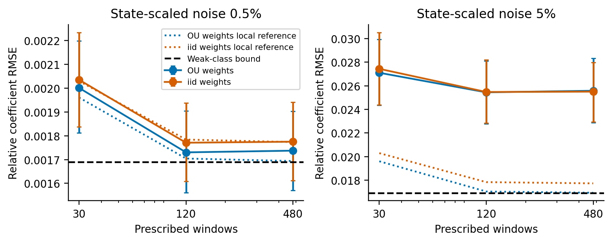

## Abstract

Weak-form dynamical identification avoids differentiating noisy measurements, but removing boundary terms also discards information. For deterministic ODEs observed in stationary Ornstein-Uhlenbeck measurement error, we characterize the closure of boundary-free adjoint influences: it is exactly the covariance-dual subspace orthogonal to initial-state sensitivities. This gives a sharp local covariance bound equal to the inverse initial-state Schur complement, even when the initial state is known. We construct its optimal influence and an explicit generalized test function with endpoint jumps. Compact tests attain the bound as an infimum. Correct-covariance weak generalized least squares approaches this bound for dense test spans, in a sequential small-noise limit with controlled quadrature and regular pilots. A finite Hermite expansion supplies exact coupled polynomial residual weights. A fixed-horizon two-point bound separates this efficiency question from consistency under denser sampling. Experiments test a smoothed scalar optimal function with a fitted pilot and nested 30-, 120- and 480-window Van der Pol families, comparing physical OU and iid weights. The scalar fitted-pilot median error decreases from 0.224 to 0.060. Van der Pol empirical RMSE at 0.5% noise is 0.00174, versus the weak reference 0.00169; the 5% experiment retains excess error. Bias and dispersion are reported separately. The contribution identifies which information weak equations can retain and how covariance weighting and test-space approximation govern its recovery.

**Keywords:** weak-form identification; correlated measurement error; fixed-domain asymptotics; Fisher information; polynomial covariance; errors in variables.

## 1. Introduction

Data acquisition for dynamical identification involves three choices: how often to sample, how long to observe, and how many independent recordings to acquire. These choices have different statistical effects. Sampling more frequently improves numerical integration while repeatedly observing the same correlated error path. A longer recording may encounter new noise but little additional parameter sensitivity. Independent recordings can add information even when each individual trajectory remains statistically unresolved.

Sparse identification of nonlinear dynamics represents a vector field through a library and selects active coefficients [@brunton2016]. Integral formulations reduce sensitivity to numerical differentiation [@schaeffer2017], and weak formulations transfer differentiation to test functions [@messenger2021; @reinbold2020]. Their regression matrices still contain noisy states. Numerical resolution, feature bias, residual covariance and model selection interact, so reducing quadrature error does not by itself establish statistical consistency.

The distinction between fixed-domain and increasing-domain observations is classical in Gaussian process inference [@stein1999]. Ying established fixed-domain results for exponential covariance parameters [@ying1991], and Zhang used equivalence of Gaussian measures to explain inconsistent covariance estimation in the Matérn family [@zhang2004]. Those results concern covariance parameters. Here the covariance is common across parameters, and the parameter enters the deterministic mean through an ODE. The same measure-equivalence mechanism supplies an estimator-independent limit, with an explicit norm determined by dynamical sensitivities.

Continuous-time regression with correlated errors has an established optimal-design theory, including optimal signed measures with endpoint masses. Dette, Pepelyshev and Zhigljavsky derive continuous-record best linear unbiased estimators and efficient discrete designs for triangular covariance kernels [@dette2016]. Dynamical sensitivities define a local regression in this framework. Finite limiting precision and endpoint information are therefore precedents for our weak-estimation analysis.

The continuum-data theory of WSINDy studies uncorrelated measurement errors and library-dependent consistency [@messenger2025]. Fixed physical correlation time defines a different experiment: adjacent correlations approach one as the mesh is refined. Correlation induced by filtering independently sampled errors also requires distinguishing a physical filter scale from a fixed number of sample indices. Our analysis concerns a fixed covariance process observed at increasingly dense times.

Our main result identifies the complete boundary-free adjoint influence class and constructs the influence attaining its sharp information reference in covariance-norm closure. Correct temporal covariance and dense test spans then yield a conditional, sequential small-noise efficiency result for WENDy-like estimation. An explicit OU adjoint construction and exact polynomial residual weights make the reference computable. Continuous-regression BLUE, Gaussian projection and Hermite identities are established results [@dette2016; @isserlis1918]; the contribution is their precise connection through the ODE adjoint range, including the boundary restriction and the order of limits. Two experiments test the resulting predictions.

## 2. Related estimation methods

WENDy treats weak parameter estimation as an errors-in-variables problem and iteratively updates a linearized residual covariance [@bortz2023]. It retains perturbations of both the feature matrix and the response. We use the same coupled residual and compute every Gaussian order for polynomial features under the specified OU model. First-order truncation recovers the structure motivating weak reweighting, with temporal covariance inserted explicitly. Residual covariance is distinct from the covariance of the nonlinear coefficient estimator.

Errors-in-variables effects have a substantial statistical literature [@fuller1987]. Gaussian correction of nonlinear functions of a noisy mean also precedes weak identification [@stefanski1989]. Hermite correction removes pointwise polynomial bias when marginal noise variance is known; it does not remove random design–response coupling. Generalized smoothing and profiling estimate ODE parameters through a different compromise between model fidelity and observation error [@ramsay2007]. The information bound applies to these alternatives when they observe the same path experiment.

WmSINDy combines weak regression with simultaneous dynamics and noise reconstruction [@lopez2026]. We distinguish the large fixed-window regression-component study from a separate paired execution of the complete adaptive author WSINDy, WENDy and WmSINDy pipelines. The latter retains noise estimation or reconstruction and adaptive test-function selection; WENDy supplies structure for parameter estimation. Ensemble-SINDy uses bootstrap aggregation to quantify feature inclusion [@fasel2022]. Resampling one recorded path and acquiring independent physical recordings are different operations: the latter changes the number of independent path experiments in the information calculation.

## 3. Observation model and weak equations

Let $x_\theta:[0,T]\to\mathbb R^d$ be a deterministic ODE trajectory. In the polynomial setting,

$$
x'_i=f_i(x)=\sum_{j=1}^{p}\xi^*_{ji}\vartheta_j(x),\qquad i=1,\ldots,d.
$$

The library contains all true terms. Observations are $Y(t)=x_\theta(t)+\varepsilon(t)$, with independent stationary OU coordinates [@uhlenbeck1930] and common-across-parameter covariance

$$
C_j(s,t)=\sigma_j^2\exp(-|s-t|/\tau_j),\qquad \sigma_j>0,\quad\tau_j>0.
$$

The continuous record is a statistical reference experiment; actual data are evaluations $y_n=Y(t_n)$ at mesh $h$. Initial conditions are known unless stated otherwise; unknown initial conditions would introduce nuisance sensitivities.

Fix $K$ test functions $\phi_k\in C_c^2(0,T)$. Their positions and full support widths $L$ remain fixed as $h$ decreases. Let $\mathcal Q_h$ be composite trapezoidal quadrature with weights $w_n$. Clean weak quantities are

$$
G^0_{kj}=\int_0^T\phi_k\vartheta_j(x)\,dt,\qquad
b^0_{ki}=-\int_0^T\phi'_kx_i\,dt,\qquad b^0=G^0\xi^*.
$$

Noisy matrices use corrected polynomial features $\widetilde\vartheta_j$, defined in Section 5:

$$
(G_h)_{kj}=\mathcal Q_h(\phi_k\widetilde\vartheta_j(y)),\qquad
(b_h)_{ki}=-\mathcal Q_h(\phi'_ky_i).
$$

Physical OU infill sets $\rho(h)=\exp(-h/\tau)$ with fixed $T,\tau$. An iid discrete control has independent error of fixed per-sample variance. Fixed-index AR(1) instead keeps $\rho<1$ constant, making the physical correlation time $-h/\log\rho\to0$. These models have different continuum limits.

## 4. An estimator-independent fixed-horizon limit

### 4.1. OU translation geometry

The stationary OU process satisfies $d\varepsilon_j=-\varepsilon_jdt/\tau_j+\sqrt{2\sigma_j^2/\tau_j}\,dW_j$, with an independent initial value $\varepsilon_j(0)\sim N(0,\sigma_j^2)$. Its Cameron–Martin space is $H^1([0,T];\mathbb R^d)$ as a set, with norm

$$
\|g\|_{\mathcal H}^2=\sum_j\left\{\frac{g_j(0)^2}{\sigma_j^2}+
\frac{\tau_j}{2\sigma_j^2}\int_0^T(g'_j+g_j/\tau_j)^2\,dt\right\}.
$$

Transforming a path into its initial value and innovation path $z(t)-z(0)+\tau_j^{-1}\int_0^tz(s)ds$ separates the normal initial observation from scaled Brownian motion. Translation by $g$ gives an initial shift and Brownian drift $g'+g/\tau_j$. The classical translation theorem [@cameron1944] gives the norm. Equivalently,

$$
\|g\|_{\mathcal H}^2=\sum_j\left\{\frac{\tau_j}{2\sigma_j^2}\int_0^T(g'_j)^2dt+
\frac1{2\sigma_j^2\tau_j}\int_0^Tg_j^2dt+
\frac{g_j(0)^2+g_j(T)^2}{2\sigma_j^2}\right\}.
$$

The endpoint terms encode stationary initial noise. Zero initial error would define a different experiment.

**Theorem 1 (fixed-horizon two-point bound).** Suppose $x_\theta\in H^1$ and all parameters share the stated positive OU covariance. For distinct $\theta,\eta$, put $\delta=\|\theta-\eta\|$ and $d_{\theta\eta}=\|x_\theta-x_\eta\|_{\mathcal H}$. Every estimator from any finite grid satisfies

$$
\max_{v\in\{\theta,\eta\}}P_v\{\|\widehat\theta_h-v\|\geq\delta/2\}
\geq\Phi(-d_{\theta\eta}/2)>0.
$$

No denser-grid estimator sequence is consistent in probability at every parameter of a nontrivial family. Moreover,

$$
\max_{v\in\{\theta,\eta\}}E_v\|\widehat\theta_h-v\|^2
\geq\frac{\delta^2}{4}\Phi(-d_{\theta\eta}/2).
$$

**Proof.** The mean difference belongs to the common Cameron–Martin space, making the path laws equivalent; this is the common-covariance case of Gaussian measure equivalence [@feldman1958]. Under the first law the log likelihood ratio of the second is normal with mean $-d_{\theta\eta}^2/2$ and variance $d_{\theta\eta}^2$. Their total variation is $2\Phi(d_{\theta\eta}/2)-1$. Sampling cannot increase total variation. A nearest-parameter test derived from an estimator can err only if that estimator is at least $\delta/2$ from the generating parameter. The sum of testing errors is at least one minus total variation, giving the probability bound. Multiplying the estimation probability by $\delta^2/4$ gives the risk bound. Both bounds hold at every mesh. $\square$

A constant estimator can be consistent at one parameter. The theorem excludes consistency throughout the family. The equivalence-based obstruction is established fixed-domain theory [@zhang2004]; its norm and quantitative specialization here concern ODE mean trajectories. The bound includes adaptive weak functions and full-path inference.

### 4.2. Continuous-record information and scalar weak ratios

**Proposition 1 (continuous-record information).** If $\theta\mapsto x_\theta$ is differentiable in $\mathcal H$ and $s_r=\partial_{\theta_r}x_\theta$, continuous-record Fisher information is

$$
\mathcal I_{rs}(\theta)=\langle s_r,s_s\rangle_{\mathcal H}.
$$

The Gaussian mean-score identity proves the assertion: the directional score has variance equal to the squared Cameron-Martin norm of its sensitivity. Its inverse is the Cramér–Rao covariance bound for regular unbiased estimators, when nonsingular. Biased estimators require the corresponding bias derivative; finite-horizon maximum likelihood need not attain the unbiased bound.

For $x_a(t)=x_0e^{at}$ with known $x_0$, $s(t)=x_0te^{at}$ and

$$
\mathcal I_T(a)=\frac{\tau x_0^2}{2\sigma^2}
\int_0^Te^{2at}[1+(a+\tau^{-1})t]^2\,dt.
$$

On a uniform grid, exact innovations give

$$
\mathcal I_h(a)=\frac{s(0)^2}{\sigma^2}+
\frac{\sum_{n=1}^N[s(t_n)-\rho s(t_{n-1})]^2}{\sigma^2(1-\rho^2)}
\longrightarrow\mathcal I_T(a),\qquad\rho=e^{-h/\tau}.
$$

Nested grids give increasing information bounded by $\mathcal I_T$. The limit follows from a Riemann sum of squared sensitivity innovations. Statistical saturation therefore concerns the full experiment.

For $D_\phi=\int\phi x_a\ne0$, a scalar weak ratio has limit

$$
\widehat a_h=\frac{-\mathcal Q_h(\phi'Y)}{\mathcal Q_h(\phi Y)}
\longrightarrow a+\frac{A}{D_\phi+B},\qquad
A=\int(-\phi'-a\phi)\varepsilon,\quad B=\int\phi\varepsilon.
$$

OU path continuity gives almost sure convergence of the quadratures. The weights $\phi$ and $-\phi'-a\phi$ are independent: dependence would make a nonzero compactly supported function solve a homogeneous first-order equation. The OU kernel is strictly positive on nonzero weights, so $(A,B)$ is nondegenerate Gaussian. Positive conditional variance of $A$ given $B$ and positive denominator density at zero imply infinite absolute and squared error moments of the unguarded ratio. Its empirical summaries should use quantiles or explicit guards.

The influence $\ell=(-\phi'-a\phi)/D_\phi$ has Gaussian variance $V_\phi=\iint\ell(u)C(u,v)\ell(v)dudv$. Differentiating the weak identity gives $\int\ell s=1$. Cauchy–Schwarz in the covariance RKHS gives

$$
1\leq V_\phi\mathcal I_T(a),\qquad
\operatorname{Eff}_\phi=[\mathcal I_T(a)V_\phi]^{-1}\leq1.
$$

This efficiency concerns the Gaussian linearization; it is not the unguarded ratio's variance.

### 4.3. Exact boundary-free influence class

Let $J\in C^1([0,T];\mathbb R^{d\times d})$, and let the invertible fundamental matrix satisfy $Z'=JZ$, $Z(0)=I_d$. Put $A h=h'-Jh$ and $A^*\phi=-\phi'-J^T\phi$. Sensor coordinates have independent stationary OU covariance with fixed positive scales. Its Cameron–Martin space $\mathcal H$ is $H^1$ with the OU inner product. Write $\mathcal E=\mathcal H'$ for its continuous dual, equipped with the covariance norm

$$
\|\lambda\|_C^2=\langle\lambda,C\lambda\rangle,
\qquad
\langle C^{-1}g,h\rangle=\langle g,h\rangle_{\mathcal H}.
$$

This definition includes ordinary integrated influences and endpoint evaluation measures. It is the variance norm of the associated Gaussian linear observation; the noise path itself need not belong to $\mathcal H$.

**Proposition 2 (exact range and closure).** In $L^2$,

$$
A^*H_0^1
=\left\{\ell\in L^2:\int_0^T Z(t)^T\ell(t)dt=0\right\}.
$$

The range of compactly supported smooth tests is dense in this space in $L^2$. Its closure in $\mathcal E$ is exactly

$$
\mathcal M=\overline{A^*C_c^\infty}^{\|\cdot\|_C}
=\{\lambda\in\mathcal E:\langle\lambda,Z_j\rangle=0, j=1,\ldots,d\}.
$$

Consequently $\mathcal M$ has codimension $d$.

**Proof.** Since $Z^TA^*\phi=-(Z^T\phi)'$, zero endpoint values imply the moment constraint. Conversely, for an $L^2$ influence with zero moment,

$$
\phi(t)=-Z(t)^{-T}\int_0^t Z(s)^T\ell(s)ds
$$

belongs to $H_0^1$ and satisfies $A^*\phi=\ell$. Approximation in $H_0^1$ by $C_c^\infty$ and continuity of $A^*:H_0^1\to L^2$ give $L^2$ density. For the stronger closure statement, a function $h\in\mathcal H$ annihilates every $A^*\phi$ if and only if $Ah=0$ distributionally, hence $h=Zc$. The Hahn–Banach annihilator characterization of a closed subspace then gives the stated closure in $\mathcal H'$. The columns of $Z$ are linearly independent elements of $\mathcal H$, so their dual constraints have rank $d$. $\square$

Zero values at the endpoints do not imply compact support. Equality for literal compact tests, without a closure or an $H_0^1$ qualification, would be false. The relevant closure uses the covariance norm, which is equivalent to the dual Sobolev norm for this positive OU model.

### 4.4. Sharp information and optimal influence

Let $S=[S_1,\ldots,S_p]\in\mathcal H^p$ be coefficient sensitivities, and form the joint information blocks for $S$ and $Z$. Assume $\mathcal I_{uu}$ and the Schur complement are positive definite. Set

$$
R=S-Z\mathcal I_{uu}^{-1}\mathcal I_{u\theta},
\qquad
\mathcal I_e=\mathcal I_{\theta\theta}
-\mathcal I_{\theta u}\mathcal I_{uu}^{-1}\mathcal I_{u\theta}.
$$

Projection and best linear unbiased estimation in correlated continuous regression are classical [@dette2016]. Here the adjoint-range characterization identifies exactly which dynamical weak influences obey that projection.

**Theorem 2 (sharp boundary-free influence covariance).** Let $\Lambda=[\lambda_1,\ldots,\lambda_p]\in\mathcal M^p$ satisfy $\langle\lambda_r,S_s\rangle=\delta_{rs}$. Its Gaussian influence covariance obeys

$$
V(\Lambda)\succeq\mathcal I_e^{-1}.
$$

The bound is attained in $\mathcal M$ by the matrix-valued dual influence

$$
\Lambda_*=C^{-1}R\,\mathcal I_e^{-1}.
$$

It is the infimum for normalized compact-test influences. It is a minimum among literal compact tests only when $\Lambda_*$ belongs to their adjoint range.

**Proof.** The $\mathcal H$ projection makes $\langle C^{-1}R,Z\rangle=0$ and $\langle C^{-1}R,S\rangle=\mathcal I_e$. Thus $\Lambda_*$ meets both constraints and has covariance $\mathcal I_e^{-1}$. The difference $\Delta=\Lambda-\Lambda_*$ pairs to zero with both $S$ and $Z$, hence with $R$. Covariance cross terms vanish and

$$
V(\Lambda)=\mathcal I_e^{-1}+V(\Delta).
$$

For attainability as an infimum, approximate each column of $\Lambda_*$ by compact-test influences in covariance norm. Their normalization matrices converge to $I_p$ by continuous pairing with $S$; right-multiplication by their inverse transpose enforces exact normalization while preserving the range and covariance convergence. $\square$

This is a matrix statement. Dividing a vector influence by a scalar information is valid only when $p=1$. The information loss is exactly $\mathcal I_{\theta u}\mathcal I_{uu}^{-1}\mathcal I_{u\theta}$; covariance inflation is $\mathcal I_e^{-1}-\mathcal I_{\theta\theta}^{-1}$. There is no direction-independent scalar loss percentage in general.

### 4.5. Explicit optimal OU test

For a scalar coordinate with $g\in H^2$, integration by parts in the stationary OU norm gives the dual measure

$$
C^{-1}g=
\frac{g-\tau^2g''}{2\sigma^2\tau}\,dt
+\frac{g(0)-\tau g'(0)}{2\sigma^2}\delta_0
+\frac{g(T)+\tau g'(T)}{2\sigma^2}\delta_T.
$$

For independent coordinates the formula applies coordinatewise, using their respective scales. If only $g\in H^1$, the Riesz representative remains well-defined in $\mathcal H'$ but need not be a density plus finite endpoint measures.

For a smooth optimal representative write $\Lambda_*=m(t)dt+m_0\delta_0+m_T\delta_T$. On the open interval an adjoint test matrix is

$$
\Phi_*(t)=-Z(t)^{-T}
\left[Z(0)^Tm_0+\int_0^t Z(s)^Tm(s)ds\right].
$$

Extend it by zero outside the observation interval. Its endpoint jumps supply $m_0=-\Phi_*(0+)$ and $m_T=\Phi_*(T-)$, and distributionally $A^*\Phi_*=\Lambda_*$. These formulas include the initial atom; omitting it in the cumulative integral is incorrect. The annihilation condition supplies the terminal jump. Cutoff and smoothing approximate this generalized test in covariance norm. These measures describe a statistical reference; the implemented estimators keep compact tests and add no explicit boundary observation terms.

For scalar exponential dynamics, $z=e^{at}$, $s=x_0te^{at}$, $k=\mathcal I_{au}/\mathcal I_{uu}$ and $g=e^{at}(x_0t-k)$. Define

$$
A_0=\frac{(1-\tau^2a^2)x_0}{2\sigma^2\tau},\qquad
B_0=\frac{-(1-\tau^2a^2)k-2\tau^2ax_0}{2\sigma^2\tau},
$$

$$
q_0=\frac{-k-\tau(x_0-ak)}{2\sigma^2},\qquad
F_j(t)=\int_0^t s^je^{2as}ds.
$$

Then

$$
\phi_*(t)=-\frac{e^{-at}}{\mathcal I_e}
[q_0+A_0F_1(t)+B_0F_0(t)].
$$

For $a\ne0$, $F_0=\operatorname{expm1}(2at)/(2a)$ and $F_1=[e^{2at}(2at-1)+1]/(4a^2)$; their continuous limits at $a=0$ are $t$ and $t^2/2$. A pilot coefficient substitutes into this expression before a compact cutoff is applied. The explicit multivariate fundamental-matrix expression is an analytical identity, not a guarantee of stable numerical inversion of $Z(t)$; strongly contracting dynamics can make that inversion ill-conditioned.

### 4.6. Correct-covariance GLS and dense spans

For tests $\phi_k$, put $\lambda_k=A^*\phi_k$, $D_{kr}=\langle\lambda_k,S_r\rangle$ and $\Sigma_{k\ell}=\langle\lambda_k,C\lambda_\ell\rangle$. Remove exact linear dependencies. If $D$ has full column rank, covariance-weighted weak regression has local influence and covariance

$$
P=(D^T\Sigma^{-1}D)^{-1}D^T\Sigma^{-1},\qquad
V_K=(D^T\Sigma^{-1}D)^{-1}.
$$

WENDy's covariance iteration motivates this construction [@bortz2023], but the released iid covariance is not the correct physical-OU covariance. Under polynomial features Proposition 3 supplies the complete coupled residual weights. Its order-one term determines the small-noise efficient influence; higher orders correct residual uncertainty at finite amplitude without by themselves removing coefficient-estimator bias.

**Corollary 1 (small-noise, dense-span efficiency).** Let the noise be $\epsilon Z_C$ with known covariance shape $C$. Assume a smooth identifiable parameterization, a generating parameter interior to a compact parameter set, consistent pilots, consistent covariance-shape weights and quadrature error $o(\epsilon)$. For each fixed finite test family assume a regular local weak solution with the GLS linearization. For the covariance conclusion additionally assume uniform integrability of $\|\epsilon^{-1}(\widehat\theta_{K,\epsilon}-\theta)\|^2$. A sufficient implementation uses a uniformly stable smooth local solve, Gaussian moment control on the local Taylor remainder, and bounded fallback outside the regular region whose probability is $o(\epsilon^2)$. Then

$$
\epsilon^{-1}(\widehat\theta_{K,\epsilon}-\theta)
\Rightarrow N(0,V_K),\qquad
\epsilon^{-2}\operatorname{Cov}(\widehat\theta_{K,\epsilon})\to V_K.
$$

If nested test-influence spans are dense in $\mathcal M$, then

$$
V_K\longrightarrow\mathcal I_{e,C}^{-1}.
$$

**Proof.** For fixed $K$, a first-order expansion of the weak equations gives $D(\widehat\theta-\theta)=\epsilon r_1+o_p(\epsilon)$ with the GLS map above. Consistent pilots and weights change the leading map by $o_p(1)$; derivatives of pilot-dependent tests multiply the zero clean residual. Gaussianity gives the distributional assertion; the stated risk condition justifies covariance convergence. In the Gaussian dual space, finite-family information is the Gram matrix of the orthogonal projection of $C^{-1}R$ onto its test span. Density gives projection convergence, and nested spans give increasing information; continuity of inversion at positive definite $\mathcal I_e$ gives covariance convergence. $\square$

The conclusion is sequential: first small noise and controlled quadrature for fixed $K$, then dense spans. A diagonal joint limit requires uniform remainder, conditioning and covariance-weight control that are not supplied here. This theorem concerns regular WENDy-like weak estimation with correct covariance and supplied identifiable structure, not all implementations called WENDy, finite-noise sparse selection, or a universal plateau for misspecified iid weighting. A fixed basis cutoff must be compatible with the density assumption; discarding an informative direction permanently can invalidate it.

## 5. Exact polynomial weak-residual covariance

### 5.1. Finite Hermite expansion

Assume a common $\tau$ for independent coordinates, and set $v_j=\sigma_j^2$. Define $H_0=1$, $H_1=u$, $H_{q+1}=uH_q-qvH_{q-1}$ and corrected monomials $\widetilde\vartheta_\beta(y)=\prod_jH_{\beta_j}(y_j;v_j)$. Their expectation given $x$ is $x^\beta$. This Gaussian debiasing construction [@stefanski1989] centers the polynomial residual at the true coefficients.

For continuum residual $r_{ki}=b_{ki}-(G\xi^*)_{ki}$, polynomial expansion gives

$$
r_{ki}=\sum_{1\leq|\alpha|\leq p_*}\int_0^Tc_{ki,\alpha}(t)H_\alpha(\varepsilon(t);v)dt,
$$

where $p_*\geq1$ is the relevant maximum degree, $H_\alpha=\prod_jH_{\alpha_j}$ and

$$
c_{ki,\alpha}=-\mathbf1_{\{\alpha=e_i\}}\phi'_k
-\phi_k\frac{\partial^\alpha f_i(x)}{\alpha!}.
$$

The response and feature perturbations share this coefficient and retain their cross-covariance.

**Proposition 3 (exact covariance).** Under these assumptions,

$$
\operatorname{Cov}(r_{ki},r_{\ell m})=
\sum_{1\leq|\alpha|\leq p_*}\alpha!\prod_jv_j^{\alpha_j}
\int_0^T\int_0^Tc_{ki,\alpha}(s)c_{\ell m,\alpha}(t)
e^{-|\alpha||s-t|/\tau}\,ds\,dt.
$$

**Proof.** The generating function $\exp(zu-vz^2/2)$ yields $E[H_q(U;v)H_r(V;v)]=\mathbf1_{q=r}q!v^q\rho^q$ for jointly Gaussian variables of variance $v$ and correlation $\rho$. This is the Hermite form of classical Gaussian moment identities [@isserlis1918]. Coordinate independence gives orthogonality between different multi-indices and factor $\alpha!\prod_jv_j^{\alpha_j}$. Substitute $\rho=e^{-|s-t|/\tau}$ and integrate the finite expansion. $\square$

The order-one covariance supplies the GLS weights required by Corollary 1. Higher orders refine residual weights at finite amplitude; they do not alone remove coefficient bias. Order $q$ has correlation time $\tau/q$. Higher orders need not be negligible at moderate amplitude. Different windows and equations remain correlated despite independent sensor coordinates. The covariance is exact for a supplied clean trajectory and true polynomial; plugging in estimates introduces another approximation.

### 5.2. Raw features and efficient evaluation

For correction variance $\widehat v$, define

$$
\bar f=\exp\left[\frac12\sum_j(v_j-\widehat v_j)\partial_j^2\right]f.
$$

The exponential terminates for polynomials. Using $\bar f$ in $c$ gives covariance, while mean residual is $\int\phi_k[f_i(x)-\bar f_i(x)]dt$. Raw monomials use $\widehat v=0$. Mean bias and covariance are separate outputs.

On a uniform grid, collect weighted coefficients into an $N\times Kd$ matrix $U_\alpha$. Each term is $\alpha!v^\alpha U_\alpha^TR_{q,h}U_\alpha$, where $(R_{q,h})_{nm}=\rho_q^{|n-m|}$ and $\rho_q=e^{-qh/\tau}$. For vector $u$,

$$
a_n=u_n+\rho_qa_{n-1},\qquad z_n=u_n+\rho_qz_{n+1},\qquad
R_{q,h}u=a+z-u,
$$

with zero exterior initialization. Each multi-index costs $O(N(Kd)^2)$ time and $O(NKd+(Kd)^2)$ memory, avoiding an $N\times N$ temporal matrix. An independent fixed-variance nugget has additional diagonal-in-time covariance; its linear weak contribution is $O(h)$. The exact mixed-noise formula is in the supplement.

### 5.3. Local coefficient uncertainty

Fix a supplied support with full-rank clean design. In a small-noise coupling $\varepsilon=\sigma Z$, polynomial smoothness and pseudoinverse continuity give, for each fixed path near the clean design,

$$
\widehat\xi-\xi^*=\sigma P_0r_1+O_Z(\sigma^2),\qquad
\Sigma_{\mathrm{lin}}=P_0\Sigma_{r,1}P_0^T.
$$

$P_0$ maps the joint residual ordered by window and equation to the supplied coefficient coordinates, retaining cross-equation covariance. $\Sigma_{r,1}$ contains Gaussian order one. Discrete validation subtracts the noise-free discrete fit to isolate quadrature error. This pathwise expansion defines a Gaussian surrogate, rather than an unconditional moment expansion. A singular-value guard specifies the conditional region for actual coefficient-covariance validation.

## 6. Sampling and the scope of efficiency

Theorem 1 applies at fixed physical noise covariance and fixed horizon. Corollary 1 concerns a different limit: decreasing noise for each fixed test family, followed by dense test spans. Increasing the grid density improves the quadrature approximation; it does not replace either limit. Increasing the number of tests improves approximation of an admissible influence but cannot recover the initial-state information excluded by Proposition 2.

Independent records add their sensitivity information. Longer records add useful information only while parameter sensitivities remain appreciable. For scalar decay, information approaches a finite limit as duration increases. These distinctions and numerical acquisition and aggregation checks are detailed in S9. Averaging corrected weak matrices and stacking noisy regressions are different estimating equations; the latter can retain errors-in-variables bias [@fuller1987].

## 7. Two tests of the efficiency prediction

Both experiments use known covariance shape and supplied identifiable structure. They test feasible weak-estimation components, separately from the complete author pipelines archived in S6 and S9.6. No true parameter is supplied to a feasible pilot. Deterministic geometry calculations use true parameters only as local references. All computations execute on Kaggle; protocols, seeds, source fingerprints and output archives are preserved.

### 7.1. Scalar optimal test with a fitted pilot

The scalar model is $x'=ax$, with $a=-1$, $x_0=2$, $T=4$ and OU correlation time 0.4. Noise standard deviations are 0.1, 0.02 and 0.005. For each amplitude, 1000 independent OU paths are shared across tests. A 30-window weak OLS pilot, clipped to $[-2.5,0.5]$, is substituted into the explicit function of Section 4.5. A quintic cutoff is zero within a quarter of the declared width from either endpoint and reaches one at that width. Widths are 0.2, 0.1, 0.05, 0.025 and 0.0125. Simpson quadrature uses $h=1/16384$. The generating-parameter test is an oracle comparison; the fitted-pilot test receives no true coefficient.

Unguarded weak ratios can have infinite population moments (Section 4.2). Reported scalar RMSE therefore uses the prespecified clipping of final estimates to $[-2.5,0.5]$; unbounded medians are also archived. A clean-moment denominator diagnostic does not filter paths and is not used by the estimator. All path counts, clips and diagnostics are listed in S8.

Table 1. Scalar coefficient errors at cutoff width 0.0125, with 1000 paired paths per amplitude. Medians are absolute errors; RMSE uses bounded final estimates. The reference is the standard deviation of the efficient Gaussian influence, not a finite-noise bound on the nonlinear bounded estimator.

| Noise SD | One-window median | Pilot-test median (95% interval) | Pilot-test RMSE | Weak influence SD |
|---|---:|---:|---:|---:|
| 0.1 | 0.22443 | 0.05981 [0.05662, 0.06437] | 0.09035 | 0.09063 |
| 0.02 | 0.04585 | 0.01248 [0.01159, 0.01331] | 0.01818 | 0.01813 |
| 0.005 | 0.01141 | 0.00312 [0.00289, 0.00336] | 0.00455 | 0.00453 |

At noise SD 0.1, the fitted-pilot median is 0.05981, compared with 0.22443 for the fixed window. The Gaussian absolute-error median at the class bound is 0.06113. These are different statistical summaries; agreement of medians alone does not establish covariance efficiency. At the smallest noise the pilot-test bias is 0.000050 and dispersion 0.004551. The oracle local efficiency relative to the weak-class bound at width 0.0125 is 0.9864. Full width and amplitude dependence is retained in S8.

### 7.2. Van der Pol: nested spans and temporal weighting

We estimate four independently free coefficients in $x'=av$, $v'=bx+cv+dx^2v$, with truth $(1,-1,1,-1)$, initial state $(2,0)$, $T=20$, OU correlation time 0.3 and $h=0.005$. Marginal coordinate noise scales are fixed from the same clean $h=0.01$ calibration as S9.6. The relative error denominator is the Euclidean coefficient norm, two. The continuous known-initial-state reference is 0.013093 at 5% noise; the sharp boundary-free relative RMSE reference is 0.016904. At 0.5% noise these scale down by ten. Estimating a single tied oscillator parameter would be a different information experiment (S9.7).

The nested families contain 30 full-width-three bumps; then 30 width-1.5 and 60 width-0.75 bumps; then 120 width-0.375 and 240 width-0.1875 bumps. A fixed $H^1$ Gram transformation preserves their spans while improving representation. Relative cutoff $10^{-10}$ retains 30, 120 and 479 dimensions; the largest family has one linear dependence at this numerical resolution. The smallest retained relative Gram eigenvalue in that family is approximately $2.1\times10^{-5}$. Covariance solves add $10^{-10}$ times the mean diagonal. This finite family is an approximation experiment, not a proof of density for an infinite sequence.

Table 2. Oracle Gaussian influence RMSE under actual OU noise at 5%. Both methods use the same test span and clean design; they differ only in the covariance used for GLS weights. Actual variance uses the OU covariance for both.

| Prescribed windows | Retained tests | OU-weight RMSE | iid-weight RMSE | OU RMSE / class reference |
|---:|---:|---:|---:|---:|
| 30 | 30 | 0.019605 | 0.020296 | 1.1597 |
| 120 | 120 | 0.017043 | 0.017839 | 1.0082 |
| 480 | 479 | 0.016938 | 0.017734 | 1.0020 |

The OU-weighted 480-window local reference is within 0.2% in RMSE of the class optimum; iid weighting retains a roughly 4.9% gap. Optimal weighting in the narrow 30-window span limits how much temporal covariance can help. Expanding the span makes the distinction observable. This is a verified prediction for the specified spans; it does not imply that every iid-weighted dense family must have a positive limiting gap. The independent exact-polynomial covariance fixture agrees with Proposition 3 to relative error below $10^{-14}$.

The largest clean discrete GLS coefficient error is 2.82e-07, below the small-noise error scale. For the feasible test, 128 independent paths at each amplitude are shared by both weights and all three families. Hermite-corrected moments use known marginal variances. A 30-window OLS pilot is clipped to a fixed physical parameter box and integrated from the known initial state. Exact polynomial covariance is evaluated on this fitted model trajectory, and coefficient-dependent weights are updated for at most 100 iterations, with relative tolerance $10^{-7}$. The true trajectory is not supplied to this estimator. This is a known-support WENDy-like component; the complete author WENDy benchmark is documented separately in S6 and S9.6.

Table 3. Feasible Van der Pol empirical relative RMSE and 95% path bootstrap intervals, with 128 paired paths per row. Bias and dispersion refer to the OU-weighted coefficient errors; their squares sum to empirical MSE. Final coefficient estimates are unbounded, so these finite-cohort summaries do not assert finite unconditional moments.

| Noise | Windows | OU RMSE (95% interval) | iid RMSE (95% interval) | OU bias | OU dispersion |
|---|---:|---:|---:|---:|---:|
| 0.5% | 30 | 0.00200 [0.00181, 0.00220] | 0.00203 [0.00184, 0.00223] | 0.00027 | 0.00198 |
| 0.5% | 120 | 0.00173 [0.00156, 0.00190] | 0.00177 [0.00161, 0.00194] | 0.00010 | 0.00173 |
| 0.5% | 480 | 0.00174 [0.00157, 0.00190] | 0.00178 [0.00161, 0.00194] | 0.00011 | 0.00173 |
| 5% | 30 | 0.02711 [0.02437, 0.02993] | 0.02744 [0.02439, 0.03050] | 0.00900 | 0.02557 |
| 5% | 120 | 0.02545 [0.02277, 0.02810] | 0.02548 [0.02286, 0.02819] | 0.00770 | 0.02426 |
| 5% | 480 | 0.02558 [0.02288, 0.02833] | 0.02551 [0.02295, 0.02799] | 0.00814 | 0.02425 |

At 0.5% noise, OU weighting with 480 windows gives empirical RMSE 0.001737, versus the sharp reference 0.001690. At 5% noise it gives 0.025583, versus 0.016904; bias 0.008143 and dispersion 0.024253 identify finite-noise excess error. The stronger finite-noise assertion that more windows alone would reach 0.016904 is therefore not supported by this feasible implementation. The small-noise result and deterministic geometry support the conditional efficiency mechanism, while the moderate-noise result delimits it.

At 0.5% noise, paired iid-minus-OU RMSE for 480 windows is 0.000038, with 95% interval [-0.000038, 0.000116]. At 5% noise, paired iid-minus-OU RMSE for 480 windows is -0.000075, with 95% interval [-0.001295, 0.001045]. Both paired intervals include zero: this 128-path experiment does not resolve a statistical advantage of OU over iid weighting. Intervals are not adjusted for multiple comparisons. All 1536 final fits meet the stopping tolerance within 23 iterations, and no pilot is clipped; the finite-noise gap persists after this convergence control. Stopping counts are retained in S8; no path is excluded.

### 7.3. Supporting validation

The supplement retains fixed-window sparse selection, coefficient linearization checks, independent-record aggregation and 448 complete adaptive author fits. These results provide context without constituting a test of Corollary 1. In the separate 16-path 5% OU comparison, full WmSINDy has empirical RMSE 0.01926 and WENDy 0.02154, compared with the weak reference 0.01690; their medians of approximately 0.015 do not establish efficiency. Full coefficient and support distributions are retained in S9.6–S9.7.

Stacking heterogeneous noisy regressions retains bias: the 16-record empirical error decomposition is bias 0.03738, dispersion 0.00835 and RMSE 0.03830. Approximately 95.3% of empirical MSE is squared bias (S9.9). In the coefficient covariance check all 2000 paths pass the design guard, so it does not filter that finite sample. Its relative RMS linearization discrepancy can exceed one because its denominator is the RMS linear displacement (S3 and S9.3). These observations distinguish covariance calculation, estimator bias and independent acquisition.

## 8. Discussion and limitations

The adjoint-range characterization turns the initial-sensitivity constraint into an exact description of the closed influence class. Its sharp optimum follows from classical Gaussian projection, and the OU inverse covariance makes an optimal generalized test explicit. Endpoint atoms explain why compact tests generally approach the optimum without attaining it. The constructed scalar cutoff uses compact tests throughout; this article does not test an estimator with additional boundary terms.

Correct covariance weighting is optimal within a fixed span. Density in the covariance norm is required to approach the class bound. A well-conditioned representation changes computation, not the underlying span. An explicit fundamental-matrix inverse may itself be ill-conditioned for a contracting dynamical direction. The multiscale calculation therefore uses a fixed, data-independent basis transformation and reports retained dimensions and numerical relaxation.

Corollary 1 requires consistent pilots, correct covariance shape, a regular local estimator, controlled quadrature and risk conditions. Its limits are sequential. It does not prove a joint window-growth/noise-decay limit, global convergence of covariance iterations, efficiency after sparse support selection, or efficiency of the released iid WENDy implementation under OU noise. A finite nested family does not establish density of an infinite family. The iid comparison tests a specified misspecification and does not establish a universal limiting plateau.

Exact residual covariance and marginal Hermite correction address distinct parts of the weak errors-in-variables problem. At finite noise, random design and pilot errors can still produce bias and excess dispersion. The numerical comparison therefore reports RMSE, bias, dispersion, stopping diagnostics and uncertainty, rather than equating a median error with a covariance bound. Supplementary complete-pipeline results use a different 16-path protocol and are not pooled with the new 128-path experiment.

The analysis assumes fully observed deterministic ODEs and additive stationary Gaussian measurement error with known positive covariance common across parameters. Unknown covariance, partial observation and process noise are outside the theorem proved here. The scope is an information reference and its weak approximation, rather than a general ranking of identification algorithms.

## Declaration of generative AI and AI-assisted technologies

OpenAI Codex assisted literature searches, mathematical drafting, source development, experiment orchestration, numerical interpretation and manuscript preparation. Numerical results are derived from archived execution outputs, and figures are produced by plotting code. The tool is not an author. The human authors must review and edit the manuscript and accept responsibility for its content before submission; this statement does not assert that their review has already occurred.

## Data availability

Code, synthetic observations, numerical outputs and frozen execution notebooks are available in the public [reproducibility repository, version v1.1.0](https://github.com/malyshevdanil/wsindy-information-limits/tree/v1.1.0). The repository includes protocol configurations, source fingerprints, pinned author-code download specifications, compatibility adapters, postprocessing scripts and SHA256 manifests. Original author sources are downloaded from their pinned repositories rather than redistributed. No external experimental dataset is used. The tagged snapshot identifies the version supporting this article; a DOI has not been assigned.

## References
