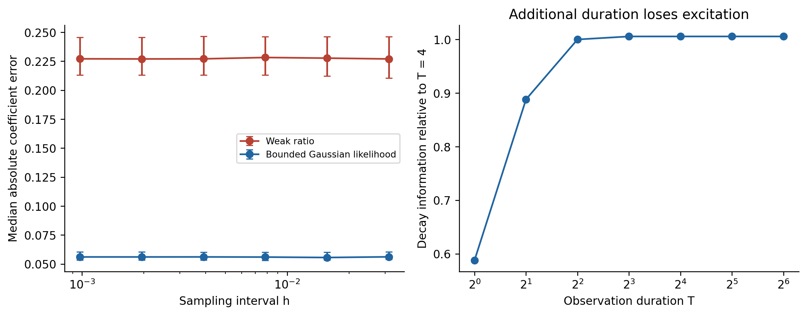
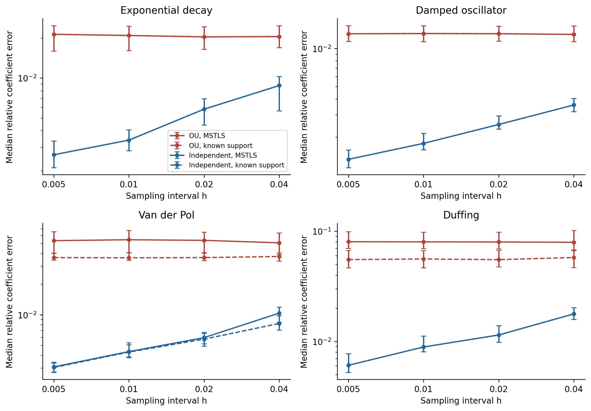
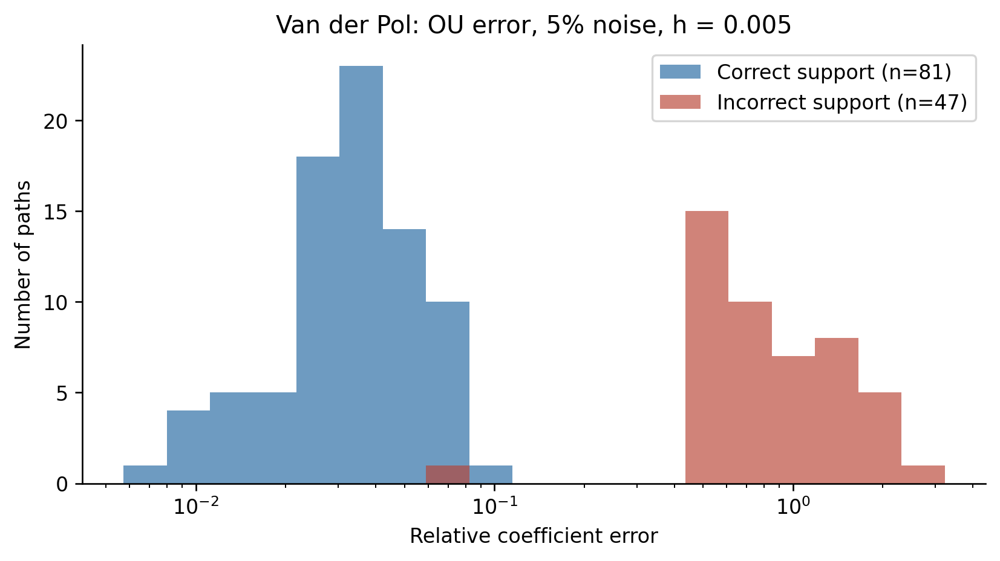
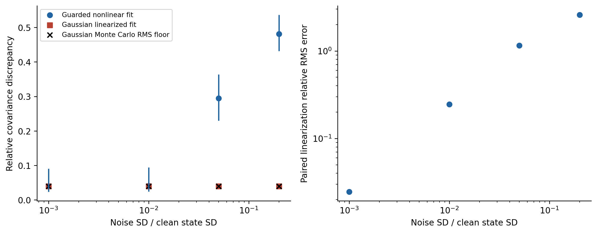
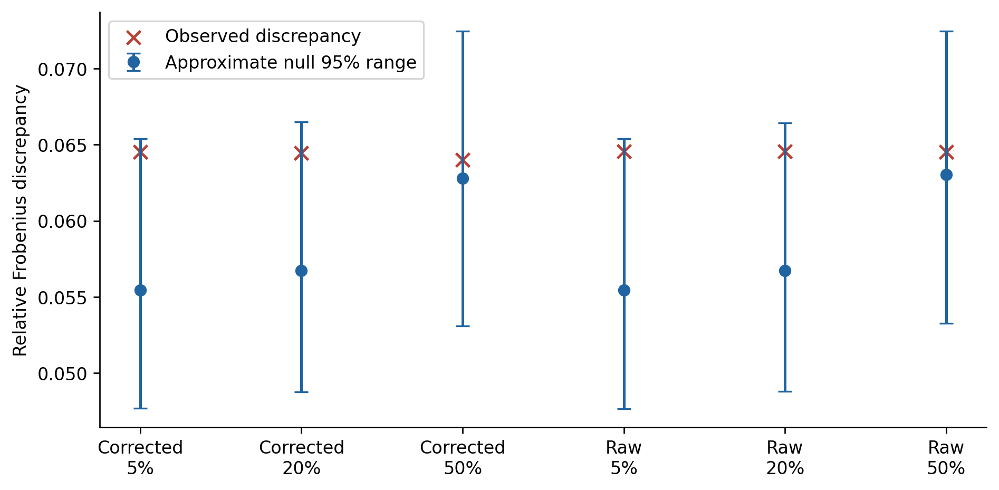
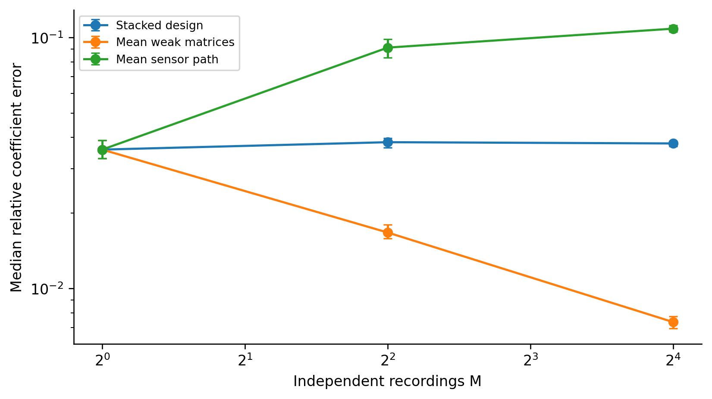
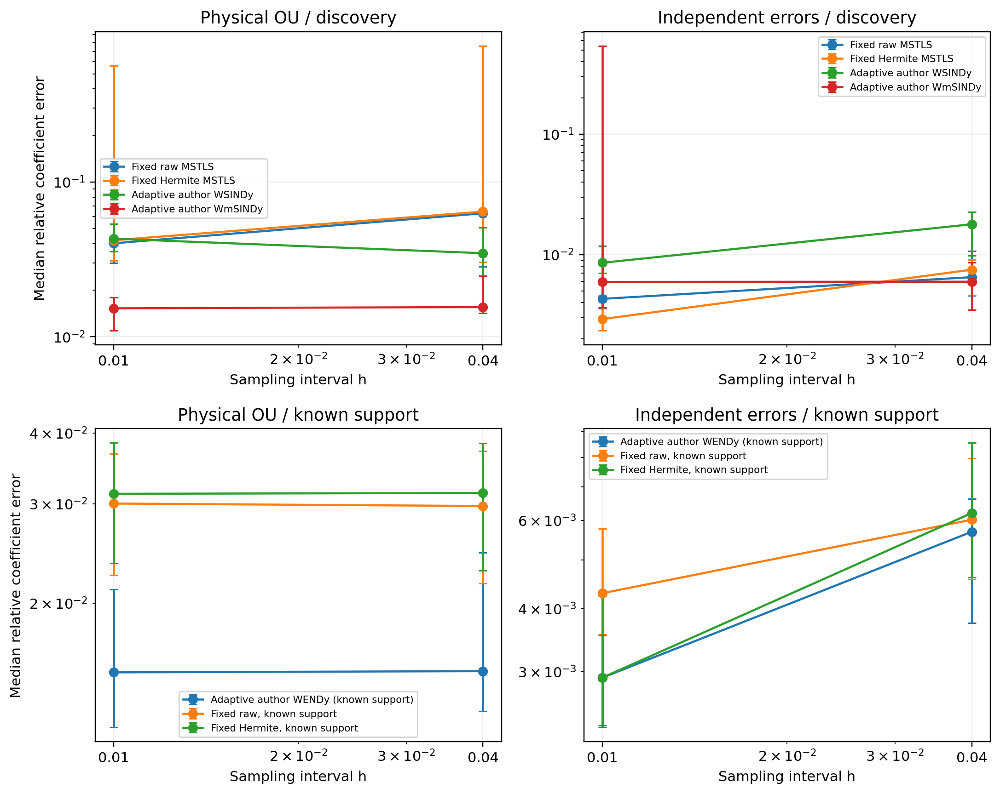
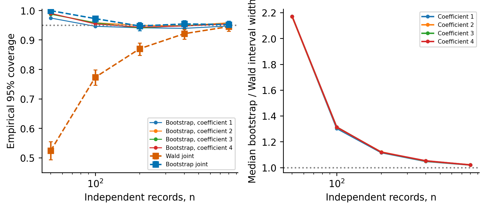

This archive preserves earlier research extensions and supporting benchmarks. Its S-labels retain the original cross-references. These extensions are outside the submitted mathematical claims.

## S2. Mixed-noise covariance

Let each sample error contain OU variance $v_{c,j}$ and independent nugget variance $v_{w,j}$, with total $v_j=v_{c,j}+v_{w,j}$. For assumed correction $\widehat v$, use $\bar f=\exp[\frac12\sum_j(v_j-\widehat v_j)\partial_j^2]f$ in the residual coefficients. The exact discrete covariance is

$$
\Sigma_r=\sum_{\alpha\ne0}\alpha!\left[
v_c^\alpha U_\alpha^TR_{|\alpha|,h}U_\alpha+
(v^\alpha-v_c^\alpha)U_\alpha^TU_\alpha\right].
$$

Distinct times share only OU covariance; equal times contain total marginal variance. The response–library covariance is included in $U_\alpha$. Correctness fixtures compare this expression with Gaussian quadrature, including raw and miscalibrated features.

## S3. Covariance-estimation Monte Carlo error

For independent centered vectors $r_m$ with covariance $\Sigma$, use $S_n=n^{-1}\sum_mr_mr_m^T$ and theoretical centering. Independence gives

$$
E\|S_n-\Sigma\|_F^2=\frac{E\|r\|^4-\|\Sigma\|_F^2}{n}.
$$

For Gaussian vectors $E\|r\|^4=(\operatorname{tr}\Sigma)^2+2\|\Sigma\|_F^2$, making the relative RMS floor

$$
\frac{\sqrt{(\operatorname{tr}\Sigma)^2+\|\Sigma\|_F^2}}{\sqrt n\,\|\Sigma\|_F}.
$$

Polynomial residuals above order one are non-Gaussian. The protocol estimates their fourth moment and labels the Gaussian expression as a reference. An affine-null bootstrap centers archived residuals, whitens empirical covariance, recolors to the analytical target and resamples 250 multinomial count vectors with the original path count. Covariance eigenvalues are floored at $10^{-12}$ of the largest during whitening. This approximate null retains empirical shape; its exceedance fraction is not an exact test p-value.

Coefficient validation uses 2,000 paths at amplitudes $0.001,0.01,0.05,0.2$. Errors subtract the clean discrete fit. The residual surrogate uses the true coefficients; the exact finite-grid derivative about the clean fit would instead use its slightly quadrature-shifted coefficients. This remaining quadrature-scale distinction is retained rather than described as an exact finite-grid coefficient identity. A guard requires every support-restricted design's smallest singular value to exceed half the clean value. Actual covariance is conditional on this event, whereas the linearized Gaussian covariance is unguarded. Counts, bias and paired linearization errors accompany discrepancy values. The protocol does not presume finite unconditional nonlinear estimator moments.

## S4. Protocol, implementation and provenance

`configs/revision.json` was fixed before the corresponding numerical outputs; it is not a public preregistration. Numerical experiments execute in CPU Kaggle notebooks. Batched deterministic Van der Pol integration uses the recorded solver and tolerances; a correctness check compares batched and individual trajectories. Duplicate executions are not counted as independent evidence. Six synthetic residual arrays are used for covariance-error calibration. Notebook source fingerprints identify the executed implementation; local manuscript edits do not regenerate those execution snapshots.

Seed ranges start at 1,000,000 for sparse regression, 1,100,000 for scalar likelihood, 1,200,000 for coefficient validation, 1,300,000 for covariance bootstrap and 1,500,000 for heterogeneous records. Other experiment ranges are disjoint. Seed reuse within a condition pairs grids and methods. Conditions use common random numbers and cannot be pooled as independent experiments.

Four systems, two regimes, two amplitudes, four grids, three methods and 128 paths produce 24,576 fits. Thirty fourth-power bump functions have full support width 1.6 for decay and three for oscillators. All centers remain fixed. The correlation ratio is $\tau/L=0.1$. The independent protocol has no forecasting endpoint. Scalar likelihood has 1,000 paths on six nested grids. Heterogeneous acquisition uses 400 blocks with up to 16 recordings, initial offsets uniform on $[-0.25,0.25]^2$ around $(2,0)$ and fixed sensor noise amplitudes derived from the baseline path.

Relative MSTLS uses zero ridge penalty, unit rescaling, 50 logarithmic thresholds $10^{-4}$ to one and loss weight 0.8. Seven equation fixtures matched the pinned author regression code exactly; the repository commit and SHA-256 are recorded in the parity report. This component does not reproduce adaptive WSINDy or simultaneous noise reconstruction in WmSINDy [@messenger2021; @lopez2026]. Author source is inspected separately and excluded from the distribution package because no redistribution license was found in the inspected tree.

Every output retains source fingerprint, execution environment and completion status. Completed notebooks remain immutable snapshots. Seven correctness tests check exponential covariance application, integration by parts, OU sampling, Hermite correction, exact raw/miscalibrated/mixed covariance, clean recovery and conservative diagnostic refusal. Additional checks verify common-variance scaling of IRLS and batched versus individual ODE integration. Local postprocessing creates tables and figures from downloaded results. Median intervals resample independent paths; support intervals are Wilson intervals. No global multiplicity-adjusted comparison is claimed.

## S5. Aggregation and approximation diagnostics

Coefficient-level aggregation diagnostics use the same 400 blocks, random seeds, initial conditions and sensor errors as Table S5. A separate execution preserves the coefficient matrices without changing the estimators. It replays the existing experiment and is not an additional set of independent records. Error norms are checked against the original output before combining these results.

For coefficient error vectors $e_m$ normalized by $\|\xi^*\|_F$, define $B=\|\bar e\|$, $S^2=n^{-1}\sum_m\|e_m-\bar e\|^2$ and $R^2=n^{-1}\sum_m\|e_m\|^2$. The empirical identity $R^2=B^2+S^2$ separates squared bias of the sample mean from dispersion; finite-sample $B^2$ includes sampling error of that mean. An adjusted estimate subtracts $\operatorname{tr}(\widehat{\operatorname{Cov}}e)/n$ using the unbiased sample covariance. Medians alone do not identify this decomposition.

The relative RMS linearization diagnostic in Table S4 divides the RMS difference between actual and linearized coefficient displacements by the RMS linear displacement. It can exceed one. All 2000 paths pass the singular-value guard at each amplitude, so guarded and complete empirical samples coincide; this is not proof of finite population moments.

## S6. Complete adaptive author-pipeline reproduction

A separate protocol, `configs/full_adaptive.json`, was frozen before comparative outputs. It uses Van der Pol with parameter one, initial state (2,0), duration 20, noise amplitude five percent, OU correlation time 0.3 or independent errors, and meshes 0.04 and 0.01. Seeds 910000--910015 give 16 independent records per cell. All algorithms receive the same fine-grid error realization and its coarse restriction; SHA256 checks verify paired inputs. This seed range is separate from the earlier studies. Discovery libraries have nine nonconstant monomials of total degree one through three, matching the released WmSINDy example. Fixed-window discovery and supplied-support comparators are rerun on that library, rather than reusing ten-feature results.

Pinned author repositories are WSINDy_ODE commit `72d8d6e5be2b`, WENDy commit `65c52a893b1f`, and the WmSINDy Van der Pol example at commit `f1a781009a5c` [@messenger2021; @bortz2023; @lopez2026]. Files or repository ZIPs are fetched from those revisions and verified with the full revision identifiers and SHA256 values in `configs/author_pins.json`. Core author functions are executed without rewriting the statistical algorithms. Author sources are excluded from distributed archives; download instructions and our adapters are provided.

WSINDy uses FFT-corner widths and polynomial degrees, gradient-adapted placement with relax_AG=1, automatic SMAF smoothing initialized as in the released driver, scaling parameter two, 100 thresholds from 1e-4 to one, zero ridge penalty and loss weight 0.8. The adaptive placement is explicitly enabled relative to the released driver's uniform-placement default. GLS remains disabled, as in that driver. Selected widths, degrees, centers, smoothing-filter lengths and losses are saved.

WENDy uses the released set-and-forget settings: estimated noise, the exp(-9/(1-x²)) bump, automatic minimum radius and four dyadic multiples, SVD corner truncation, maximum 100 iterations, relative tolerance 1e-10, diagonal relaxation 1e-10, and normality checks after iteration ten with cutoff 1e-4. Its four-term structure is prespecified. Actual coefficients are withheld: the diagnostic true_vec is replaced by a unit vector and use_true=0. The returned normality value and iterates are archived. These are the released iid-noise equations; under physical OU error they are evaluated as a misspecified observation model, without claiming a full adaptive OU-WENDy extension.

The MATLAB functions execute under GNU Octave 8.4.0 with statistics and signal packages. Separate compatibility functions provide exact analytic polynomial Jacobians in the declared feature order, exact values and first derivatives of the specified bump with author normalization, and the two-input pagemtimes operation used in covariance construction. These replace Symbolic Toolbox and missing host operations. They do not change radius selection, SVD, covariance updates, regression or stopping logic. Bitwise agreement with a proprietary MATLAB runtime is not asserted.

WmSINDy executes the author Python initializer, RK4 predictions, weak-residual loss, gradient updates, adaptive window function, pruning and least-squares refits. Every completed fit performs eight outer cycles of 5000 Adam steps (40,000 total), with threshold 0.15, learning rate 0.001, epsilon 1e-7, q=1 and decay 0.9. Noise is initialized to zero. Legacy Adam is used with TensorFlow 2.20.0 / tf-keras 2.20.1. Slots for new coefficient variables are created outside traced functions, and the author loss functions are retraced after each window update so changed variable-container shapes are actually used. Adam is initialized independently for each recording; noise-variable slots and iteration count continue through its eight cycles. The released all-valid-convolution-row calculation is retained. Loss checkpoints, eight coefficient iterates, window widths, spectral corners, optimizer counts and the reconstructed noise signal are archived.

The compatibility control uses the author's Van der Pol example: parameter 0.5, initial state (-2,1), duration ten, 1000 linspace points, iid Gaussian amplitude 25 percent and seed one. Its nominal WmSINDy prediction step 0.01 is retained although the linspace spacing is 10/999. The benchmark instead uses its exact grid spacing. Clean trajectories are integrated with DOP853 at relative and absolute tolerances 1e-12 for this control. The single control checks execution and recovery and does not reproduce the published 50-run aggregate figure. Reported comparison coefficient errors use the Frobenius norm.

The comparison contains 448 planned fits: four discovery algorithms and three supplied-support parameter estimators, four observation cells and 16 records. Discovery success is exact support equality; supplied-support estimators receive no structure-discovery score. Failure counts remain in success denominators. Error medians and bootstrap intervals condition on completed fits; all failures and their logs are retained. Mesh differences are paired by recording. Wilson limits accompany support counts in `reports/full_adaptive_results.json`. Computational runtimes are execution diagnostics, not cross-language speed claims. With one oscillator and 16 paths per cell, these results do not justify universal rankings or fine precision of support probabilities.

## S7. Information, window optimization and coefficient replay

The configuration `configs/reviewer.json` specifies supplementary calculations for Sections S9.7–S9.9. The Van der Pol calibration uses the identical clean h=0.01 trajectory and coordinate standard deviations as the complete-pipeline comparison. Noise variances are held fixed under every parameter perturbation. Four independently free coefficients are ordered as velocity in equation one, then position, velocity and position-squared times velocity in equation two. The augmented DOP853 system integrates the two states, eight coefficient sensitivities and four initial-state sensitivities, with relative tolerance 1e-11 and absolute tolerance 1e-13. Stationary OU innovations give exact sampled-trajectory information from these numerical sensitivities; trapezoidal integration evaluates the continuous norm on grids from h=0.04 down to 0.00125. Central coefficient perturbations of size 1e-5 check sensitivities at 101 points. The covariance matrices, joint information, sensitivities and their derivatives are archived.

The scalar window optimum uses the complete cross-window residual covariance and the normalization constraint in Section 5.4. Covariance eigenvalues below 1e-10 or 1e-12 times the largest are discarded. The normalization vector is projected onto the retained eigenspace, where the constrained quadratic optimum is computed. The resulting influences are checked for unit coefficient sensitivity and zero initial-state sensitivity. Quadrature uses 4096 and 8192 intervals. The spectral-cutoff dependence of the enriched 120-window family is retained in S9.8 and numerical report; no global shape optimum is claimed. The calculation uses generating parameters and noise covariance, so the numbers concern an oracle local Gaussian reference.

The heterogeneous coefficient replay exactly reproduces all 3600 method/block/record-count errors of the 400-block aggregation experiment. It saves coefficients in addition to norms and does not supply new independent evidence. Bias and dispersion obey the empirical squared-error identity in S5. The bias-fraction adjustment subtracts the estimated sampling variance of the coefficient sample mean; neither adjusted nor unadjusted fractions are claimed as exact population quantities.

For the 16-path adaptive comparison, relative RMSE uses the complete coefficient matrices, including falsely selected terms, and the same Frobenius denominator as the error medians. Its 95% intervals resample independent records 5000 times. Comparing that RMSE with a local unbiased information reference indicates the scale of remaining error; it does not establish unbiasedness, regularity, calibrated uncertainty or attained efficiency.

## S8. Efficiency protocols and complete summaries

Theoretical proofs and their function-space assumptions are stated in Sections 5.1–5.4 and in the standalone proof document. The configuration `configs/efficiency.json` defines the original scalar and Van der Pol experiments; each executed notebook retains its own exact configuration and source fingerprint. Numerical experiments run on private CPU Kaggle notebooks. Synthetic OU paths use seeds 2100000–2100999 for the scalar experiment and 2200000–2200127 for Van der Pol, independent of other studies. Noise amplitudes, methods and window families are paired within seed. Resampling uses 5000 independent-path bootstrap draws with generator seed 2302600; paired comparisons resample one common path-index vector. These are unadjusted exploratory intervals.

The scalar cutoff is the product of two quintic smoothstep ramps. For distance $d$ from an endpoint and width $\delta$, $z=\min(1,\max(0,(d-\delta/4)/(3\delta/4)))$ and $\eta=z^3(10-15z+6z^2)$. Its derivative is included analytically in the weak equation. The functions are compactly supported and $C^2$, which suffices for the implemented weak form; smooth approximation yields the same covariance closure. Scalar experiments use 65536 quadrature intervals. The pilot and every final scalar estimate are clipped to $[-2.5,0.5]$ for the bounded-risk summaries. Unbounded error medians and every estimate are preserved. The ratio denominator diagnostic uses the generating clean moment only after fitting; it neither rejects observations nor changes estimates.

Table S1. Scalar fitted-pilot summaries for every amplitude and cutoff. RMSE, bias and dispersion use bounded final estimates. All 1000 paths enter each row. Clips count altered final estimates; diagnostic pass counts do not select a subset.

| Noise SD | Cutoff | Median | RMSE | Bias | Dispersion | Clips | Diagnostic passes |
|---:|---:|---:|---:|---:|---:|---:|---:|
| 0.1 | 0.2 | 0.067465 | 0.101006 | 0.002470 | 0.100976 | 0 | 1000/1000 |
| 0.1 | 0.1 | 0.064633 | 0.094347 | 0.004031 | 0.094261 | 0 | 1000/1000 |
| 0.1 | 0.05 | 0.061741 | 0.092370 | 0.004332 | 0.092269 | 0 | 1000/1000 |
| 0.1 | 0.025 | 0.061471 | 0.091660 | 0.004501 | 0.091550 | 0 | 1000/1000 |
| 0.1 | 0.0125 | 0.059809 | 0.090348 | 0.004666 | 0.090228 | 0 | 1000/1000 |
| 0.02 | 0.2 | 0.013743 | 0.020376 | 0.000124 | 0.020375 | 0 | 1000/1000 |
| 0.02 | 0.1 | 0.012755 | 0.019077 | 0.000290 | 0.019074 | 0 | 1000/1000 |
| 0.02 | 0.05 | 0.012685 | 0.018632 | 0.000301 | 0.018629 | 0 | 1000/1000 |
| 0.02 | 0.025 | 0.012729 | 0.018453 | 0.000318 | 0.018450 | 0 | 1000/1000 |
| 0.02 | 0.0125 | 0.012482 | 0.018177 | 0.000320 | 0.018174 | 0 | 1000/1000 |
| 0.005 | 0.2 | 0.003440 | 0.005103 | 0.000014 | 0.005103 | 0 | 1000/1000 |
| 0.005 | 0.1 | 0.003208 | 0.004781 | 0.000048 | 0.004781 | 0 | 1000/1000 |
| 0.005 | 0.05 | 0.003179 | 0.004668 | 0.000048 | 0.004667 | 0 | 1000/1000 |
| 0.005 | 0.025 | 0.003167 | 0.004621 | 0.000052 | 0.004621 | 0 | 1000/1000 |
| 0.005 | 0.0125 | 0.003124 | 0.004551 | 0.000050 | 0.004551 | 0 | 1000/1000 |

The fixed-window and generating-parameter-test cells also retain 1000 paths each. Across these cells 5 final estimates are clipped; individual counts and all unbounded estimates are preserved in the numerical report and raw rows. This clipping changes only the bounded-risk summaries; no path is removed.

For Van der Pol the parameter pilot box is $[0.25,2]\times[-2,-0.25]\times[0.1,2]\times[-2,-0.1]$. DOP853 integration of its fitted model uses relative tolerance $10^{-9}$ and absolute tolerance $10^{-11}$. The fitted trajectory is fixed during the coefficient-weight iterations. Tests and the basis transformation are fixed independently of observations. The relative covariance relaxation is scaled by the mean covariance diagonal, so common noise-variance scaling does not change GLS weights. One hundred iterations and tolerance $10^{-7}$ are computation settings, not a convergence theorem. Final coefficients are not clipped, and every finite estimate is included. Basis dimensions and both covariance matrices are preserved in the deterministic geometry output.

A five-iteration execution on the identical paths was retained as a stopping control. After inspecting its convergence diagnostics, the limit was increased to 100; this computational adjustment was not fixed before the five-iteration output. It does not add independent paths. The median relative coefficient change is 0.00e+00 and the maximum is 2.53e-03. No path is removed because of the stopping test.

Table S2. Van der Pol finite-cohort decomposition and stopping diagnostics. Counts use 128 paths per row; attaining the iteration cap without convergence is retained in the sample. These empirical moments do not establish the uniform-integrability assumption of Proposition 3.

| Noise | Windows | Weights | Bias | Dispersion | RMSE | Converged | Pilot clips |
|---|---:|---|---:|---:|---:|---:|---:|
| 0.5% | 30 | iid | 0.000312 | 0.002011 | 0.002035 | 128/128 | 0 |
| 0.5% | 30 | ou | 0.000266 | 0.001983 | 0.002001 | 128/128 | 0 |
| 0.5% | 120 | iid | 0.000188 | 0.001761 | 0.001771 | 128/128 | 0 |
| 0.5% | 120 | ou | 0.000103 | 0.001727 | 0.001730 | 128/128 | 0 |
| 0.5% | 480 | iid | 0.000181 | 0.001766 | 0.001775 | 128/128 | 0 |
| 0.5% | 480 | ou | 0.000109 | 0.001734 | 0.001737 | 128/128 | 0 |
| 5% | 30 | iid | 0.010013 | 0.025550 | 0.027442 | 128/128 | 0 |
| 5% | 30 | ou | 0.009004 | 0.025569 | 0.027108 | 128/128 | 0 |
| 5% | 120 | iid | 0.008493 | 0.024022 | 0.025479 | 128/128 | 0 |
| 5% | 120 | ou | 0.007695 | 0.024258 | 0.025450 | 128/128 | 0 |
| 5% | 480 | iid | 0.008464 | 0.024063 | 0.025509 | 128/128 | 0 |
| 5% | 480 | ou | 0.008143 | 0.024253 | 0.025583 | 128/128 | 0 |

The raw scalar, geometry and Van der Pol outputs, including coefficient vectors, are archived. No failed stochastic fit is omitted; completion and expected seed counts are checked separately from stopping tolerances.

## S9. Supporting numerical validation

### S9.1. Full-record information and scalar likelihood

For $a=-1$, $x_0=2$, $T=4$, $\tau=0.4$ and $\sigma=0.1$, continuous Fisher information is 144.187. The chosen scalar weak function has linearized information efficiency 0.063; Section S9.8 evaluates optimal combinations within declared window families. On 1,000 paired paths, the finest-grid median absolute errors were 0.2271 (95% interval [0.2132, 0.2454]) for the weak ratio and 0.0561 ([0.0533, 0.0603]) for bounded Gaussian likelihood. The latter uses known covariance and initial condition. Its finite-sample bias and boundedness prevent interpreting its MSE as an unbiased Cramér–Rao efficiency measure.

The coarsest scalar grid already captures 99.937% of continuous-record information. Extending the decay record from $T=4$ to $8$ adds only 0.564%, whereas a second independent record doubles information. This is a quantitative acquisition comparison under the stated known-covariance model, rather than a universal cost-optimal allocation.

Initial-state annihilation raises the weak influence variance lower bound from 0.006935 to 0.008213, an increase of 18.4%. The chosen window's efficiency relative to the nuisance-adjusted information reference is 0.075, compared with 0.063 relative to known-initial-state information. This separates the weak class restriction from additional window inefficiency. Deterministic quadrature verifies both influence identities to $10^{-9}$; it adds no Monte Carlo paths.

### S9.2. Fixed-window sparse regression

The fixed-window comparison contains 24,576 fits: four systems, two noise regimes, two amplitudes, four grids, three methods and 128 paths per condition. Thirty fourth-power polynomial bump windows remain fixed as the grid changes. For decay, $T=4$ and $L=1.6$; for oscillators, $T=20$ and $L=3$. Correlation ratio is $\tau/L=0.1$. Relative MSTLS uses 50 thresholds between $10^{-4}$ and one, loss weight 0.8 and no ridge penalty; raw and known-variance corrected features share these settings. Settings and seed ranges were fixed before outputs; this is not a public preregistration. Initial states and libraries are specified in the supplement.

Table S3. Corrected relative MSTLS at 5% noise and $h=0.005$. Error and exact support are separate endpoints; 128 paths enter each row.

| System | Error model | Median relative error | 95% median interval | Exact support | 95% support interval |
|---|---|---:|---|---:|---|
| Exponential decay | OU | 0.0213 | [0.0160, 0.0248] | 128/128 | [0.971, 1.000] |
| Exponential decay | Independent | 0.0026 | [0.0021, 0.0034] | 128/128 | [0.971, 1.000] |
| Damped oscillator | OU | 0.0131 | [0.0114, 0.0152] | 128/128 | [0.971, 1.000] |
| Damped oscillator | Independent | 0.0013 | [0.0012, 0.0016] | 128/128 | [0.971, 1.000] |
| Van der Pol | OU | 0.0536 | [0.0402, 0.0658] | 81/128 | [0.547, 0.711] |
| Van der Pol | Independent | 0.0031 | [0.0028, 0.0034] | 126/128 | [0.945, 0.996] |
| Duffing | OU | 0.0804 | [0.0698, 0.0990] | 63/128 | [0.407, 0.578] |
| Duffing | Independent | 0.0061 | [0.0053, 0.0077] | 128/128 | [0.971, 1.000] |

In the Van der Pol OU condition, correct-support paths had median error 0.0340, whereas incorrect-support paths had median 0.7189. The aggregate median therefore combines parameter-estimation error with structure-selection error and cannot be read as an intrinsic information limit.

Intervals resample independent paths and retain paired mesh comparisons. Conditions share random-number indices and are not pooled as independent experiments. Exact-support intervals use Wilson limits. No multiplicity-adjusted global support claim is made. No forecast endpoint is included in this validation.

For corrected MSTLS at 5% OU noise, 3 of four system-specific paired median-improvement intervals for $h=0.01$ to $0.005$ lie wholly inside the $\pm5\%$ band. This is a descriptive equivalence check of coefficient medians and does not guarantee support recovery.

### S9.3. Coefficient covariance and Monte Carlo calibration

Joint coefficient covariance was tested on 2,000 Van der Pol paths at each amplitude, on known support. Actual errors subtract the clean discrete fit; a guard retains designs whose smallest support singular value is at least half its clean value. Every simulated path passed: the guard did not filter these samples, so guarded summaries equal the full empirical summaries. This observation does not establish finite unconditional estimator moments or control unobserved near-singular designs. The guard defines the intended validation region; it is not evidence that the linearization is accurate.

Table S4. Relative Frobenius covariance discrepancies and paired relative RMS linearization errors on known support.

| Noise amplitude | Guarded paths | Linear covariance discrepancy | Guarded actual discrepancy | Paired linearization RMS |
|---|---:|---:|---:|---:|
| 0.1% | 2000/2000 | 0.040 | 0.040 | 0.025 |
| 1.0% | 2000/2000 | 0.040 | 0.041 | 0.245 |
| 5.0% | 2000/2000 | 0.040 | 0.294 | 1.156 |
| 20.0% | 2000/2000 | 0.040 | 0.481 | 2.591 |

The linear covariance discrepancy is close to its Monte Carlo RMS floor at every amplitude because the standardized linear experiment is paired across amplitudes. Actual covariance agrees at 0.1% and 1% noise but has substantially larger discrepancy at 5% and 20%. Paired pathwise linearization already has appreciable error at 1%. Thus the coefficient surrogate is a local small-noise description, and the residual covariance theorem alone cannot validate it at the moderate-noise benchmark setting.

The last column is $R=\{\sum_m\|e_m-\ell_m\|^2/\sum_m\|\ell_m\|^2\}^{1/2}$, where $e_m$ is the actual coefficient displacement from the clean fit and $\ell_m$ its first-order surrogate. It is not a relative error of the estimated coefficients and is not constrained to $[0,1]$. At 5% and 20% noise, omitted nonlinear terms and random-design coupling exceed the RMS magnitude of the first-order surrogate. A stable singular value alone does not suppress those terms.

In the 4,000-path nonlinear residual experiment, higher orders contributed 20.3% of corrected trace at 50% noise. The covariance calibration places the observed Frobenius discrepancy against the fourth-moment Monte Carlo scale and an affine-null bootstrap. The null procedure retains empirical non-Gaussian shape and forces the analytical covariance; its range is approximate, and its exceedance fraction is not an exact p-value.

For the corrected 50% condition, observed matrix discrepancy was 0.064; estimated fourth-moment relative RMS floor was 0.063, and the approximate null 95% range was [0.053, 0.072]. The 6.4% discrepancy therefore must be read relative to this uncertainty, rather than as an isolated accuracy percentage.

### S9.4. Different initial conditions

A separate frozen experiment used 400 blocks with up to 16 independent Van der Pol recordings. Initial offsets were uniform on $[-0.25,0.25]^2$ about $(2,0)$; sensor noise covariance remained fixed. All methods supplied true support.

Table S5. Known-support aggregation with different initial conditions; 400 independent blocks per row.

| Method | M | Median relative error | 95% median interval |
|---|---:|---:|---|
| Stacked design | 1 | 0.03577 | [0.03305, 0.03888] |
| Stacked design | 16 | 0.03785 | [0.03684, 0.03857] |
| Mean weak matrices | 1 | 0.03577 | [0.03305, 0.03888] |
| Mean weak matrices | 16 | 0.00735 | [0.00693, 0.00773] |
| Mean sensor path | 1 | 0.03577 | [0.03305, 0.03888] |
| Mean sensor path | 16 | 0.10847 | [0.10523, 0.11193] |

Mean weak matrices improve with independent acquisition in this heterogeneous setting, whereas stacking retains a stable error and sensor-path averaging deteriorates. The latter estimates the dynamics of an averaged path that generally fails the original nonlinear equation. The evidence supports a distinction between aggregation operations, under the supplied support and excitation used here. Coefficient-level bias and dispersion are reported in Section S9.9; the near-equal single-record and stacked median errors alone do not identify the bias fraction.

### S9.5. Covariance reweighting component

An additional comparison supplies known support and compares ordinary raw-feature least squares, the iid covariance IRLS step from WENDy Algorithm 2, and its known-OU covariance extension. It retains our fixed windows and uses ten iterations, relative stopping tolerance $10^{-6}$, known coordinate variances and scale-aware covariance relaxation $10^{-10}$. These choices make it a component experiment rather than a reproduction of complete WENDy.

Table S6. Van der Pol covariance-reweighting components: parameter one, initial state (2,0), T=20, 5% state-scaled noise, OU correlation time 0.3, 30 fixed windows of full width three, and 128 paths per condition. True support is supplied.

| Error model | Component | h | Median relative error | 95% median interval | Converged |
|---|---|---:|---:|---|---:|
| OU | OLS, known support | 0.04 | 0.0322 | [0.0289, 0.0378] | n/a |
| OU | OLS, known support | 0.005 | 0.0325 | [0.0289, 0.0363] | n/a |
| OU | WENDy iid IRLS core | 0.04 | 0.0185 | [0.0164, 0.0205] | 126/128 |
| OU | WENDy iid IRLS core | 0.005 | 0.0186 | [0.0165, 0.0203] | 127/128 |
| OU | OU IRLS core | 0.04 | 0.0184 | [0.0163, 0.0202] | 124/128 |
| OU | OU IRLS core | 0.005 | 0.0181 | [0.0161, 0.0198] | 121/128 |
| Independent | OLS, known support | 0.04 | 0.0080 | [0.0071, 0.0092] | n/a |
| Independent | OLS, known support | 0.005 | 0.0034 | [0.0031, 0.0037] | n/a |
| Independent | WENDy iid IRLS core | 0.04 | 0.0057 | [0.0047, 0.0065] | 128/128 |
| Independent | WENDy iid IRLS core | 0.005 | 0.0032 | [0.0030, 0.0034] | 128/128 |
| Independent | OU IRLS core | 0.04 | 0.0058 | [0.0051, 0.0065] | 128/128 |
| Independent | OU IRLS core | 0.005 | 0.0032 | [0.0029, 0.0035] | 128/128 |

At h=0.005 under OU error, the median decreases from 0.0325 for ordinary least squares to 0.0186 for iid IRLS and 0.0181 for OU IRLS. Reweighting therefore improves this component comparison, but its two IRLS medians are close and their displayed intervals overlap; the table alone does not establish superiority of the OU extension. OU errors remain nearly unchanged across the two meshes, whereas independent-noise errors decrease. Known covariance and supplied support distinguish this comparison from the complete adaptive pipelines in Section S9.6. All iteration-capped estimates enter the summaries. The convergence column reports the prescribed tolerance; it does not assess model correctness.

### S9.6. Complete adaptive author pipelines

A separate frozen comparison executes the complete pinned author WSINDy, WENDy and WmSINDy algorithms [@messenger2021; @bortz2023; @lopez2026]. WSINDy selects its test-function widths spectrally, places centers by the gradient, applies automatic SMAF smoothing and library scaling, and selects the MSTLS threshold. WENDy estimates noise, selects four adaptive radii and an SVD basis, and runs its full covariance iteration and stopping rules. WmSINDy jointly learns coefficients and noise with forward/backward RK4 and weak-residual losses, updates windows from the denoised data, and prunes and refits coefficients after each of eight cycles of 5000 Adam steps. Versions and compatibility adapters are detailed in Supplement S6.

The benchmark uses Van der Pol, five-percent state-scaled noise, fixed duration 20, correlation time 0.3, and 16 independent paths per condition. Meshes 0.04 and 0.01 are nested. All methods receive identical observations verified by SHA256; discovery methods share the nine nonconstant monomials of degrees one through three. Fixed-window MSTLS is rerun on this library. WENDy receives the prespecified correct four-term structure and is assessed as parameter estimation. Hermite MSTLS uses the known calibration variance, whereas author pipelines estimate or reconstruct noise from observations.

Table S7. Discovery pipelines at h=0.01; 16 independent records per row. Median intervals are path bootstraps. Support counts include all planned fits.

| Error model | Method | Median error [95% interval] | Exact support | Failed fits |
|---|---|---:|---:|---:|
| OU | Fixed raw MSTLS | 0.0402 [0.0300, 0.5657] | 11/16 | 0/16 |
| OU | Fixed Hermite MSTLS | 0.0420 [0.0311, 0.5656] | 11/16 | 0/16 |
| OU | Adaptive author WSINDy | 0.0430 [0.0354, 0.0536] | 14/16 | 0/16 |
| OU | Adaptive author WmSINDy | 0.0153 [0.0110, 0.0180] | 16/16 | 0/16 |
| Independent | Fixed raw MSTLS | 0.0043 [0.0036, 0.0059] | 16/16 | 0/16 |
| Independent | Fixed Hermite MSTLS | 0.0029 [0.0023, 0.0046] | 16/16 | 0/16 |
| Independent | Adaptive author WSINDy | 0.0086 [0.0070, 0.0118] | 16/16 | 0/16 |
| Independent | Adaptive author WmSINDy | 0.0059 [0.0036, 0.5396] | 10/16 | 0/16 |

Table S8. Parameter estimation with supplied support at h=0.01; 16 independent records per row.

| Error model | Method | Median error [95% interval] | Failed fits |
|---|---|---:|---:|
| OU | Adaptive author WENDy (known support) | 0.0151 [0.0120, 0.0212] | 0/16 |
| OU | Fixed raw, known support | 0.0300 [0.0224, 0.0367] | 0/16 |
| OU | Fixed Hermite, known support | 0.0312 [0.0235, 0.0384] | 0/16 |
| Independent | Adaptive author WENDy (known support) | 0.0029 [0.0023, 0.0035] | 0/16 |
| Independent | Fixed raw, known support | 0.0043 [0.0036, 0.0058] | 0/16 |
| Independent | Fixed Hermite, known support | 0.0029 [0.0023, 0.0042] | 0/16 |

On the finer OU grid, WmSINDy recovered support on 16/16 paths with median error 0.0153, whereas adaptive WSINDy recovered 14/16 with median 0.0430. The paired median error difference, WmSINDy minus WSINDy, was -0.0279 with a descriptive 95% bootstrap interval [-0.0378, -0.0204]. Under independent errors, WmSINDy recovered support on 10/16 paths, compared with 16/16 for fixed Hermite MSTLS. Its wide median interval reflects selection failures despite the full training budget. Thus the favorable OU result does not establish uniform superiority across observation regimes. These unadjusted comparisons are descriptive and limited to the frozen example.

The supplied-support comparison likewise concerns finite-sample accuracy: adaptive WENDy improves the OU coefficient median relative to these fixed-window fits, although its released noise model assumes independent observations. This empirical behavior does not establish calibrated uncertainty under OU error. Better window selection or reconstruction can improve accuracy within the finite information budget; it does not contradict the full-path infill bound.

All 448 planned fits are archived; 0 computational failures occurred. Error medians condition on completed fits. Wilson intervals, coarse-grid values, and paired mesh differences are retained in the reproducibility report. With 16 paths, support fractions have substantial binomial uncertainty. These conditions compare complete algorithms on one oscillator and do not establish a general ranking or an asymptotic plateau.

### S9.7. Van der Pol information reference

The OU experiment in Section S9.6 has $x'=a v$ and $v'=b x+c v+d x^2v$, with four independently free active coefficients $(a,b,c,d)=(1,-1,1,-1)$. The initial state (2,0) is known. We hold the calibrated coordinate noise variances fixed when differentiating the mean, rather than re-estimating state-scaled variance at perturbed parameters. The calibration is exactly that of the benchmark fine grid. Coefficient and initial-state sensitivities solve $S'=JS+\partial_\theta f$ and $Z'=JZ$, with $S(0)=0$ and $Z(0)=I$. OU innovations give discrete information; the continuous norm in Section 4.1 gives its limit.

For four active coefficients, the relative RMS reference is $\{\operatorname{tr}(\mathcal I_{\theta\theta}^{-1})\}^{1/2}/\|\theta\|_2$. The weak initial-state-annihilation reference replaces information by its Schur complement. Both are local covariance bounds, rather than bounds on error medians or on every biased estimator.

Table S9. Van der Pol OU relative RMS information references for the exact Section S9.6 calibration. Four active coefficients are independently free. The second column assumes known initial state; the third also imposes weak initial-sensitivity annihilation.

| Observation | Known-initial reference | Weak influence reference |
|---|---:|---:|
| Grid h=0.04 | 0.013115 | 0.016929 |
| Grid h=0.01 | 0.013094 | 0.016906 |
| Continuous record | 0.013093 | 0.016904 |

For the same 16 OU records, WmSINDy has relative RMSE 0.01926 (descriptive 95% bootstrap interval [0.01324, 0.02576]) and WENDy 0.02154 ([0.01446, 0.02927]). Their RMSEs are respectively 1.47 and 1.65 times the known-initial local reference. This scale comparison is more informative than comparing their medians near 0.015 with a variance bound. It is not an efficiency certificate: sparse selection and nonlinear bias are present, the sample is small, and the regular locally unbiased assumption is unverified. WmSINDy also includes trajectory-prediction terms, so it is not restricted to boundary-free weak influences.

A one-parameter Van der Pol model fixes a=1 and b=-1 and ties c=mu, d=-mu. Its continuous standard-deviation reference for mu is 0.002492. That substantially stronger constraint changes the estimation problem and must not be used to judge four-coefficient discovery. Central finite differences check the four sensitivities with relative discrepancies below 1.6e-07; refining information quadrature from h=0.0025 to 0.00125 checks the reported reference.

### S9.8. Optimal efficiency within declared window spans

The scalar parameters are those of Section S9.1. We optimize the covariance-weighted linear combination in Section 5.4, including every cross-window covariance. Family F30 contains 30 fourth-power bump windows of full width 1.6; centers range uniformly from 0.805 to 3.195. Family F120 contains 60 centers for each of widths 1.6 and 3.0, with centers 0.005 inside the admissible support range. These are declared finite families, rather than an exhaustive search over all shapes and widths. The reference single window has width three and center two.

Table S10. Oracle optimal local influence variance and efficiency within each scalar window span. Information references are 144.187 for known initial state and 121.752 after initial-state projection. The table uses 8192 quadrature intervals and relative covariance-eigenvalue cutoff 1e-12.

| Family | Retained rank | Variance | Known-initial efficiency | Weak-class efficiency |
|---|---:|---:|---:|---:|
| Single window | 1 | 0.109776 | 0.0632 | 0.0748 |
| F30 (30 windows) | 30 | 0.010656 | 0.6508 | 0.7708 |
| F120 (120 windows) | 68 | 0.009339 | 0.7426 | 0.8795 |

Thus 0.063 describes one window, not the optimal efficiency of the weak family. F120 attains 0.743 of known-initial information in the retained span. Tightening the cutoff from 1e-10 to 1e-12 raises retained rank from 41 to 68; at 1e-10 its known-initial efficiency is 0.718. This sensitivity is disclosed rather than treated as an exact infinite-dimensional optimum. Doubling quadrature intervals changes every reported variance by less than 0.0004%. All optimal influences satisfy coefficient normalization and initial-state annihilation numerically. Their efficiencies remain below the initial-state-projected ceiling.

### S9.9. Bias and dispersion of aggregation

The coefficient-preserving execution replays exactly the 400 independent blocks in Table S5; it adds no independent samples. For normalized coefficient errors, the empirical identity states that squared RMSE equals squared bias plus squared dispersion. Table S11 reports the norm of the sample mean error as bias and the square root of the second term as dispersion. Bias here is an empirical estimate, not a proved population limit. We also subtract sample-mean sampling variance when estimating the squared-bias fraction; the adjustment is small for 400 blocks.

Table S11. Relative coefficient bias, dispersion and RMS error for heterogeneous Van der Pol aggregation; the same 400 blocks as Table S5. Values are dimensionless. Bias fraction uses the unadjusted empirical squared mean error.

| Method | M | Bias | Dispersion | RMSE | Squared-bias fraction |
|---|---:|---:|---:|---:|---:|
| Stacked design | 1 | 0.02967 | 0.03229 | 0.04385 | 45.8% |
| Stacked design | 16 | 0.03738 | 0.00835 | 0.03830 | 95.3% |
| Mean weak matrices | 1 | 0.02967 | 0.03229 | 0.04385 | 45.8% |
| Mean weak matrices | 16 | 0.00239 | 0.00893 | 0.00924 | 6.7% |
| Mean sensor path | 1 | 0.02967 | 0.03229 | 0.04385 | 45.8% |
| Mean sensor path | 16 | 0.11044 | 0.02914 | 0.11422 | 93.5% |

For stacking, dispersion decreases from 0.03229 at M=1 to 0.00835 at M=16, while bias changes from 0.02967 to 0.03738. The estimated bias contribution is 45.8% of single-record MSE and 95.3% at M=16; the sample-mean-adjusted fractions are 45.6% and 95.2%. The stacking floor is therefore dominated by systematic random-design error as acquisition increases. Whether the single-record error is mainly bias must be judged by this decomposition, not by the two median norms. Mean weak matrices reduce both errors under the stated excitation, whereas sensor-path averaging produces nonlinear averaging bias.

## S10. Local coefficient uncertainty

Fix a supplied support with full-rank clean design. In a small-noise coupling $\eta=\epsilon\eta_C$, polynomial smoothness and pseudoinverse continuity give, for each fixed path near the clean design,

$$
\widehat\xi-\xi^*=\epsilon P_0r_1+O_{\eta_C}(\epsilon^2),\qquad
\Sigma_{\mathrm{lin}}=P_0\Sigma_{r,1}P_0^T.
$$

$P_0$ maps the joint residual ordered by window and equation to the supplied coefficient coordinates, retaining cross-equation covariance. $\Sigma_{r,1}$ contains Gaussian order one. Discrete validation subtracts the noise-free discrete fit to isolate quadrature error. This pathwise expansion defines a Gaussian surrogate, rather than an unconditional moment expansion. A singular-value guard specifies the conditional region for actual coefficient-covariance validation.

## S11. Acquisition and the order of limits

Lemma 1 applies at fixed physical noise covariance and fixed horizon. Proposition 3 concerns a different limit: decreasing noise for each fixed test family, followed by dense test spans. Increasing the grid density improves the quadrature approximation; it does not replace either limit. Increasing the number of tests improves approximation of an admissible influence but cannot recover the initial-state information excluded by Proposition 2.

Independent records add their sensitivity information. Longer records add useful information only while parameter sensitivities remain appreciable. For scalar decay, information approaches a finite limit as duration increases. These distinctions and numerical acquisition and aggregation checks are detailed in S9. Averaging corrected weak matrices and stacking noisy regressions are different estimating equations; the latter can retain errors-in-variables bias [@fuller1987].

## S12. Noise-shape and paired follow-up protocols

Small-noise power uses four 500-path shards, seeds 2200000–2201999. The original 128 paths are a prefix, not a second independent sample. The source, configuration and input hashes are preserved separately for every executed notebook. Weighting intervals use 5000 paired bootstrap draws with seed 2402600; likelihood/noise/Lorenz intervals use seed 2502600. All comparisons are follow-up analyses planned after the initial study and are not multiplicity-adjusted. Frozen matched-author configurations retain unused fields inherited from the weak-component configuration (window counts, Hermite correction, pilot box and covariance-iteration settings). The author runner consumes only the observation grid, physical covariance, amplitudes and seeds, then calls the pinned author pipeline and compatibility adapter. The original unsplit duplicate run is excluded from the sample; every seed is taken from its assigned completed shard. Those inherited fields do not configure the author estimator; the current configuration removes them, while executed snapshots remain unchanged.

Noise sensitivity uses the original 128 seeds at each amplitude, 480 windows and all fits. For fitted shape, the stationary residual likelihood profiles coordinate variances and optimizes common tau over [0.02,3]. The fitted variance also enters feature correction, so this row changes both shape weights and marginal correction. The fit is conditional on an estimated mean, and individual tau estimation is not an infill-consistency result. Decreasing measurement amplitude alone also does not create longer physical observation: the finite-horizon uncertainty of covariance shape remains. This empirical plug-in check therefore does not extend Proposition 3 to unknown shape.

Table S12. Van der Pol noise-shape sensitivity, 128 paired paths per row. Bias and dispersion are in relative coefficient norm. All 768 fits converge; no estimated correlation time hits its optimization bound.

| Noise | Shape | RMSE | Bias | Dispersion | Fitted tau median |
|---|---|---:|---:|---:|---:|
| 0.5% | tau_half | 0.001747 | 0.000149 | 0.001741 | 0.2849 |
| 0.5% | tau_double | 0.001794 | 0.000076 | 0.001793 | 0.2849 |
| 0.5% | fitted_shape | 0.001737 | 0.000107 | 0.001733 | 0.2849 |
| 5% | tau_half | 0.026242 | 0.008288 | 0.024898 | 0.2935 |
| 5% | tau_double | 0.026158 | 0.009223 | 0.024478 | 0.2935 |
| 5% | fitted_shape | 0.025183 | 0.007938 | 0.023899 | 0.2935 |

At 0.5% noise the fitted tau 5%, 50%, 95% quantiles are [0.2298, 0.2849, 0.3443]; at 5% they are [0.2366, 0.2935, 0.4329]. True tau is 0.3. Coordinate noise-scale and microergodic summaries, pairwise RMSE intervals and all fitted values are preserved in `information_followup_results.json`.

## S13. Lorenz covariance and information check

The configuration `lorenz_efficiency.json` fixes 256 seeds 2500000–2500255, polynomial structure and pilot box $[5,15]\times[20,35]\times[1.5,4]$. DOP853 sensitivities use tolerances $10^{-10}$ and $10^{-12}$. Weak covariance includes exact degree-two Gaussian terms: coordinate-independent cross-products require no marginal mean correction. The fixed relative basis cutoff and covariance relaxation are $10^{-10}$. The local reference uses exact finite-grid OU innovation information for all three parameters and all three nuisance initial coordinates. Gaussian geometry is evaluated separately from the feasible fitted-trajectory weights.

Table S13. Lorenz local OU geometry at 0.5% noise. Error norms are divided by $\|(10,28,8/3)\|_2$. The sharp finite-grid nuisance reference is 0.00041137. Spectral ranks are sensitive to the poorly conditioned prescribed representation; no infinite-family density claim is made for these finite bumps.

| Windows | Retained rank | Local RMSE | Clean coefficient error | Minimum retained relative Gram eigenvalue |
|---:|---:|---:|---:|---:|
| 30 | 19 | 0.00089378 | 1.83e-10 | 1.07e-10 |
| 120 | 92 | 0.00041865 | 5.37e-09 | 2.43e-10 |
| 480 | 382 | 0.00041359 | 1.22e-06 | 1.71e-10 |

All 256 feasible coefficient vectors, iteration counts and source fingerprints are archived.

## S14. Common-trajectory GMM reference and proof

The replicate asymptotic is distinct from single-path infill and from Proposition 3. Let $Y_r=x_{\theta_0,u}+\eta_r$, $r=1,\ldots,n$, be independent copies on the same fixed interval. The deterministic trajectory and initial state are shared, the covariance is stationary Gaussian, and its amplitude is any fixed positive finite value. Assume a supplied polynomial vector field linear in $\theta\in\mathbb R^p$, a fixed collection of boundary-vanishing tests, and exact integrals. Write the Hermite-corrected weak moment as

$$
m_r(\theta,\nu)=b_r-G_r(\nu)\theta\in\mathbb R^M,
\qquad D=E G_r(\nu_0),\qquad E m_r(\theta_0,\nu_0)=0,
$$

where $\nu$ contains the marginal variances used in the correction and any covariance-shape parameters. The expectation identity follows by the Gaussian heat/Hermite identity at every time, Fubini, and the deterministic weak ODE identity. It is exact at fixed noise; it does not assert that the ratio or least-squares estimator from one record is unbiased.

**Lemma S14.1 (fixed-noise independent-record GMM).** Suppose $D$ has column rank $p$, the covariance $\Omega=\operatorname{Cov}(m_r(\theta_0,\nu_0))$ is positive definite, and moments have finite second moments. With known $\nu_0$ and random positive-definite $W_n\to_p W$, define

$$
\widehat\theta_n=(\bar G_n^\top W_n\bar G_n)^{-1}\bar G_n^\top W_n\bar b_n,
\qquad P_W=(D^\top W D)^{-1}D^\top W.
$$

Then $\widehat\theta_n\to_p\theta_0$ and

$$
\sqrt n(\widehat\theta_n-\theta_0)\Rightarrow N(0,V_W),
\qquad V_W=P_W\Omega P_W^\top.
$$

Within this fixed moment family and the corresponding regular linear GMM influence class, $W=\Omega^{-1}$ minimizes covariance, giving $V_*=(D^\top\Omega^{-1}D)^{-1}$. For polynomial moments, $\Omega$ is the full covariance from Proposition 4, including every nonzero Hermite order. Empirical residual covariance at a consistent preliminary estimate, or a consistent full model-based covariance, supplies feasible two-step weights. First-order covariance alone generally gives a different, nonoptimal $V_W$ at fixed noise. The theorem does not assert full-path likelihood efficiency at finite amplitude.

For estimated $\nu$, additionally assume local differentiability and an asymptotically linear nuisance estimator

$$
\sqrt n(\widehat\nu-\nu_0)=n^{-1/2}\sum_{r=1}^n\xi_r+o_p(1),
\quad E\xi_r=0,\quad E\|\xi_r\|^2<\infty,
\quad H=E\partial_\nu m_r(\theta_0,\nu_0).
$$

Assume the corresponding sample derivative converges locally, with a uniform second-order Taylor remainder $o_p(n^{-1/2})$. Then the same closed-form estimator, evaluated at $\widehat\nu$, is consistent and asymptotically normal with

$$
\psi_r=m_r(\theta_0,\nu_0)+H\xi_r,
\quad \widetilde\Omega=\operatorname{Cov}(\psi_r),
\quad \widetilde V_W=P_W\widetilde\Omega P_W^\top.
$$

If $\widetilde\Omega$ is positive definite, estimated inverse $\widetilde\Omega$ is optimal **for this specified nuisance estimator and moment influence family**. Its optimum is not generally the known-covariance optimum or the globally optimal joint GMM estimator. Estimating only a shape parameter that changes weights but not mean correction has zero $H$ for that parameter; estimating a variance used in Hermite correction need not. A consistent empirical influence covariance, including cross-covariances between $m_r$ and $\xi_r$, yields marginal Wald intervals and joint ellipsoids with asymptotic nominal coverage. These are standard GMM and two-step-estimation arguments specialized to the weak Hermite moments [@hansen1982; @newey1994].

*Proof.* Polynomial Gaussian functionals on a bounded interval with continuous deterministic mean have moments of all finite orders; bounded test functions allow the required exchanges of integration and expectation. For known covariance, the law of large numbers gives $\bar G_n\to D$, $\bar b_n\to D\theta_0$, and convergence of the inverse normal matrix. The exact identity

$$
\widehat\theta_n-\theta_0=P_n\bar m_n(\theta_0,\nu_0)
$$

and the iid multivariate CLT give the stated limit, without a small-noise expansion. If $P D=I_p$, set $P_*= (D^\top\Omega^{-1}D)^{-1}D^\top\Omega^{-1}$. Then

$$
P\Omega P^\top-P_*\Omega P_*^\top
=(P-P_*)\Omega(P-P_*)^\top\succeq0,
$$

because the cross terms vanish. A consistent preliminary least-squares estimate makes the empirical covariance converge to $\Omega$ by the law of large numbers and polynomial continuity. In the nuisance case, the stipulated Taylor expansion gives

$$
\sqrt n\bar m_n(\theta_0,\widehat\nu)
=n^{-1/2}\sum_r[m_r(\theta_0,\nu_0)+H\xi_r]+o_p(1).
$$

The random design and random weights multiply a $O_p(n^{-1/2})$ centered mean, so their consistency suffices for the leading map. Apply the joint CLT to $(m_r,\xi_r)$ and the same covariance decomposition using $\widetilde\Omega$. Consistency of the sandwich and coverage follow by Slutsky. This proves the assertions.

**Numerical quadrature condition.** On a fixed discrete grid, Hermite correction is still unbiased for the corresponding *quadrature moment*. Its deterministic expectation is the weak quadrature defect, which is generally nonzero at $\theta_0$. Consistency for the continuous ODE therefore requires exact integration or vanishing defect. In a triangular array, require $\sqrt n\|E m_{r,h_n}(\theta_0,\nu_0)\|\to0$, convergence of designs and covariance, and uniform integrability sufficient for the triangular CLT and nuisance remainder. Mean-square convergence of quadrature moments to their continuous versions gives the stochastic part for this fixed test family. This condition concerns grid refinement with independent records; it does not prove a joint growing-window/small-noise rate. The numerical experiment uses a fixed fine grid and discloses its clean defect rather than claiming literal fixed-grid consistency for the ODE parameter.

### S14.1. Consistent OU shape from independent copies

For even $n=2B$, define independent pairs $d_r=(Y_{2r-1}-Y_{2r})/\sqrt2$. Their common deterministic mean cancels and $d_r$ has the original stationary OU covariance. At a fixed nondegenerate grid $t_0,\ldots,t_L$ with mesh $h>0$, let

$$
s_{rj}=\frac1{L+1}\sum_{i=0}^L d_{rj}(t_i)^2,
\quad a_r=\sum_{j,i<L}d_{rj}(t_i)d_{rj}(t_{i+1}),
\quad c_r=\sum_{j,i<L}d_{rj}(t_i)^2.
$$

Then $\widehat v_j=B^{-1}\sum_r s_{rj}\to v_j$, $\widehat\rho=\bar a/\bar c\to e^{-h/\tau}$, and $\widehat\tau=-h/\log\widehat\rho\to\tau$. Their joint $\sqrt B$ normality follows from the independent-pair CLT and the delta method; dependence of time points is retained inside each pair. Positivity of variances and $0<\rho<1$ make the transformation regular. The influence for $v_j$ is $s_{rj}-v_j$, and for $\rho$ it is $(a_r-\rho c_r)/E c_r$; the $\tau$ influence is $h\xi_{\rho,r}/[\rho(\log\rho)^2]$. If finite-sample clipping is needed, any fixed bounds containing the true parameters in their interior are asymptotically inactive and must be reported.

Use pair-averaged weak moments for inference, so the theorem applies with sample size $B$, independent pair influences, and variance divided by $B=n/2$. In Van der Pol the only correction derivative is $H_{v_1,2k}=\theta_4 E\int\phi_k Y_2$; the other rows and variance/shape derivatives are zero. Thus the empirical covariance of pair residuals plus this derivative times $(s_{r1}-\widehat v_1)$ supplies the nuisance-adjusted weights and sandwich. Averaging pair differences for shape estimation requires a common deterministic mean; heterogeneous initial conditions would require a different construction. Replication permits separate OU variance and range consistency that is unavailable under fixed-horizon infill of one observed path.

### S14.2. Why stacking can retain bias

Stacked corrected least squares converges, when its normal matrix is nonsingular, to

$$
\theta_{\mathrm{stack}}=\theta_0+
\{E(G_r^\top G_r)\}^{-1}E[G_r^\top m_r(\theta_0,\nu_0)].
$$

Exact $E m_r=0$ does not imply $E[G_r^\top m_r]=0$, since the design and residual share measurement error. Stacking is therefore generally biased and inconsistent in this errors-in-variables setting; special orthogonality exceptions are possible. Averaged-moment GMM instead uses $\bar G_n^\top W_n\bar m_n$, whose probability limit is zero at the true parameter. The stacking behavior in Table S11 is an instance of this distinction, not a claim that every stacked regression must be inconsistent.

With known covariance, the same argument extends to iid random initial states sharing the coefficient vector, provided the conditional weak identity, full-rank mean design and finite moments hold. This covers the mechanism in the heterogeneous-initial-state aggregation example. The pair-difference nuisance estimator above still requires a common deterministic mean and is not applied to that heterogeneous example.

### S14.3. Misspecified temporal weighting

For known marginal correction and any nonsingular assumed temporal shape, the fixed-family variance is the sandwich $P_W\Omega_{\mathrm{true}}P_W^\top/n$. In the small-noise single-record setting replace $\Omega_{\mathrm{true}}$ with the order-one covariance and the factor $1/n$ with $\epsilon^2$. Correct marginal correction preserves averaged-moment consistency even if $\tau$ is wrong; a wrong variance used for Hermite correction can destroy the moment identity. The finite-noise fitted-shape rows in S12 change both correction and weights and cannot be read as a pure temporal-weighting experiment. The $\tau/2$ and $2\tau$ rows retain the true marginal variances.

## S15. Independent-record protocol and finite-sample calibration

The protocol is frozen in `independent_records.json` and in each execution notebook before these outputs. Four shards partition repetition indices modulo four; seeds are 2700000-2700999. Every repetition simulates 800 independent records with common trajectory; record counts are prefixes, not independent experiments. Gaussian innovations and exact AR(1) recursion generate stationary OU observations at h=0.01. Marginal variances equal (0.05 times each clean-coordinate SD) squared. Known-variance GMM and stacking receive that variance; estimated-variance GMM receives only observations and the declared test functions. No true coefficient or clean trajectory enters fitted GMM weights. The clean path is used only for generating data and the separate covariance/quadrature audit. Twelve moments are fixed throughout: centers [2.1,5.2,8.3,11.4,14.5,17.6], support width four, polynomial bump order four.

Weights are the inverse empirical covariance of independent-pair influences at the initial averaged-moment ordinary least-squares estimate. The diagonal relaxation is empirical diagonal divided by the number of pairs; it vanishes asymptotically. One closed-form weighted update gives the final coefficients. The final residuals and variance-estimation influence supply a sandwich under the same initial weights. Standard errors use n/2 pair clusters, normal marginal critical value 1.959963984540054 and joint chi-square(4) quantile 0.95. Marginal intervals are individually 95%, not a simultaneous rectangular region. The ellipsoid supplies the separate joint coverage. These rows use asymptotic critical values; S17 evaluates a separately frozen recentered bootstrap correction on identical records. Coverage Monte Carlo uncertainty uses binomial Wilson intervals; n-values and methods remain paired within repetition. The RMSE bootstrap uses 2000 independent-repetition resamples with seed 2702600. Finite empirical RMSE does not establish finite population moments of an unbounded random-design inverse.

Table S14. Common-trajectory known/estimated-variance averaged-moment GMM. The last column is the minimum-to-maximum marginal coverage across four coefficients; all individual coverages and their Wilson intervals are archived. All counts have 1000 retained repetitions.

| n | Correction | RMSE | Bias | Dispersion | Joint coverage (95% Wilson interval) | Marginal range |
|---:|---|---:|---:|---:|---|---|
| 50 | known | 0.038170 | 0.003038 | 0.038049 | 52.8% [49.7, 55.9] | 78.9-81.9% |
| 50 | estimated | 0.038169 | 0.003040 | 0.038048 | 52.4% [49.3, 55.5] | 78.9-81.8% |
| 100 | known | 0.025704 | 0.001119 | 0.025679 | 77.1% [74.4, 79.6] | 87.3-89.2% |
| 100 | estimated | 0.025702 | 0.001120 | 0.025677 | 77.3% [74.6, 79.8] | 87.3-89.2% |
| 200 | known | 0.017234 | 0.000568 | 0.017224 | 87.1% [84.9, 89.0] | 91.1-93.0% |
| 200 | estimated | 0.017232 | 0.000570 | 0.017223 | 87.0% [84.8, 88.9] | 91.1-93.0% |
| 400 | known | 0.011947 | 0.000232 | 0.011945 | 92.4% [90.6, 93.9] | 92.9-94.7% |
| 400 | estimated | 0.011946 | 0.000232 | 0.011944 | 92.1% [90.3, 93.6] | 92.9-94.7% |
| 800 | known | 0.008006 | 0.000040 | 0.008006 | 94.5% [92.9, 95.8] | 93.9-95.2% |
| 800 | estimated | 0.008005 | 0.000039 | 0.008005 | 94.5% [92.9, 95.8] | 93.9-95.2% |

Table S15. OU range estimation from independent record pairs, the same repetitions. True tau=0.3. Variance error, marginal coverage Wilson intervals and standard-error calibration are recorded in the numerical report.

| n | tau 5%, 50%, 95% quantiles | Marginal variance RMSE, two coordinates |
|---:|---|---|
| 50 | 0.28853, 0.30025, 0.31219 | 1.76e-04, 1.77e-04 |
| 100 | 0.29216, 0.30027, 0.30915 | 1.26e-04, 1.26e-04 |
| 200 | 0.29426, 0.30023, 0.30628 | 8.72e-05, 8.95e-05 |
| 400 | 0.29590, 0.30001, 0.30429 | 6.23e-05, 6.14e-05 |
| 800 | 0.29702, 0.29998, 0.30299 | 4.34e-05, 4.41e-05 |

All sufficient-statistic input hashes and a complete first-repetition sufficient-statistic fixture per shard are archived. Aggregate residual sums and second moments permit a separate exact-covariance comparison without retaining every time series. Re-running the frozen seed protocol reconstructs every synthetic record.

## S16. Heterogeneous initial states and independent weak instruments

Consider independent records $Y_r=x_{\theta_0,u_r}+\eta_r$ of a deterministic polynomial ODE. The initial states may form a deterministic triangular array; alternatively they may be iid draws from a compact set, with the following conditions imposed conditionally on them. The sensor covariance is $C_\nu$. Each Hermite-corrected, exactly integrated weak moment obeys

$$
E\{m_r(\theta_0,\nu_0)\mid u_r\}=0,
\qquad m_r(\theta,\nu)=b_r-G_r(\nu)\theta.
$$

This identity follows by taking expectations of the corrected polynomial and applying the ODE weak identity separately to each trajectory. Its validity is uniform over allowed initial states; the distribution of $u_r$ need not be estimated. The numerical version needs the quadrature condition below.

### S16.1. Numbered assumptions and fixed-noise estimating equations

**(A1)** The coefficient vector has fixed dimension $p$ and belongs to an open identifiable neighborhood. Trajectories and their first coefficient/initial-state sensitivities exist on $[0,T]$. Initial states lie in a compact set. For some $\delta>0$, the instrumented derivative matrices $B_r$ and scores $\psi_r$ defined below have uniformly bounded $4+\delta$ moments, conditional on the independent training data. Matrix norms are Frobenius norms. These are bounds on the products, rather than separate second-moment bounds on instruments and residuals.

**(A2)** Records and any auxiliary randomizations are independent across $r$. Noise is Gaussian with known positive covariance $C_{\nu_0}$. Weak tests and quadrature rules are fixed independently of each record's noise. The coefficient structure is supplied.

**(A3)** For every record there are two conditionally independent views $Y_r^+$ and $Y_r^-$ with mean $x_{\theta_0,u_r}$ and covariance $2C_{\nu_0}$. An instrument $L_r^\pm$ is measurable with respect to its own view and independent auxiliary training data. Corrected moments $m_r^\pm$ use the variance of their own view. The instrument map is fixed conditional on that training data and has the moment bounds required in (A1).

**(A4)** Put $B_r=(L_r^+G_r^-+L_r^-G_r^+)/2$, $a_r=(L_r^+b_r^-+L_r^-b_r^+)/2$ and $\psi_r=a_r-B_r\theta_0$. Conditional on the training data, $n^{-1}\sum E B_r\to B$ with $B$ nonsingular, and $n^{-1}\sum\operatorname{Var}(\psi_r)\to V_\psi$ positive definite. For a deterministic initial-state array these are limits of array averages, not assumptions of identical record distributions.

**(A5)** Exact integration is used, or the instrumented numerical score means $\mu_{r,h}(q)=E\psi_{r,h}(q)$ satisfy $n^{-1}\sum_r\sup_{q\in Q}\|\mu_{r,h}(q)\|=o(n^{-1/2})$ for the compact instrument-pilot set $Q$. The moment bounds and limits in (A1) and (A4) apply to the numerical scores as well. With external training, the bound is conditional on that training. This uniform bound controls the mean contribution even for a random complement pilot. A fixed integration step can leave a nonzero defect and then fails this centered continuous-parameter condition. An $o(1)$ bound suffices for consistency alone.

**Theorem S16.1 (heterogeneous-record weak estimating equations).** With known sensor covariance $C_{\nu_0}$ and under (A1)–(A5), conditional on the independent training data,

$$
\widehat\theta_n=\left(\sum_{r=1}^n B_r\right)^{-1}\sum_{r=1}^n a_r
\ \xrightarrow{P}\ \theta_0,
\qquad
\sqrt n(\widehat\theta_n-\theta_0)
\ \Rightarrow\ N(0,B^{-1}V_\psi B^{-\top}).
$$

The empirical covariance of the $p$-dimensional record scores, combined with the mean derivative $\bar B_n$, consistently estimates this sandwich. Thus a rich weak family requires a $p\times p$ empirical score covariance, while its within-record weights can come from the full model covariance in Proposition 4. Fixed-noise consistency applies to the stated independent-instrument construction. It does not follow merely by inserting a same-record pilot into $D_r^\top\Omega_r^{-1}$.

**Proof.** Conditional on $u_r$ and training data, $L_r^+$ is independent of $m_r^-(\theta_0,\nu_0)$, and conversely. Hence

$$
E(\psi_r\mid u_r,\text{training})
=\tfrac12 E L_r^+\,E m_r^-+
\tfrac12 E L_r^-\,E m_r^+=0.
$$

By independence and (A1), $E\|n^{-1}\sum_r(B_r-E B_r)\|^2\le C/n$, so (A4) gives $\bar B_n\to_P B$. Likewise $\bar\psi_n\to_P0$. For any fixed vector $c$, the Lyapunov numerator for the centered sum of $c^\top\psi_r$ is at most $Cn$, whereas its variance to power $1+\delta/2$ has order $n^{1+\delta/2}$. The ratio tends to zero. The scalar Lyapunov CLT and Cramer--Wold therefore yield $n^{-1/2}\sum_r(\psi_r-E\psi_r)\Rightarrow N(0,V_\psi)$. Assumption (A5) makes $n^{-1/2}\sum_rE\psi_r=o(1)$. The exact identity $\widehat\theta_n-\theta_0=\bar B_n^{-1}\bar\psi_n$ and Slutsky prove both limits.

For the sandwich, put $\widehat\psi_r=a_r-B_r\widehat\theta_n$. Independence and the fourth-moment bound give $n^{-1}\sum_r\{\psi_r\psi_r^\top-E(\psi_r\psi_r^\top)\}\to_P0$. Exact mean zero, or (A5) with bounded means, implies that its limit is $V_\psi$. Writing $d=\widehat\theta_n-\theta_0=O_P(n^{-1/2})$, Cauchy--Schwarz bounds the change caused by substituting $\widehat\psi_r=\psi_r-B_rd$ by

$$
2\|d\|\left(n^{-1}\sum_r\|B_r\|^2\right)^{1/2}
\left(n^{-1}\sum_r\|\psi_r\|^2\right)^{1/2}
+\|d\|^2 n^{-1}\sum_r\|B_r\|^2=o_P(1).
$$

The fitted score mean is zero by the pooled estimating equation. Thus its empirical centered covariance, with optional factor $n/(n-1)$, converges to $V_\psi$; multiplication by $\bar B_n^{-1}$ on both sides gives the consistent covariance of the scaled estimator. This direct argument accommodates independent nonidentical records. In the iid case, the corresponding GMM results are Newey--McFadden Theorems 2.6 (consistency), 3.4 (normality) and 4.5 (variance estimation); their iid uniform laws are not invoked for arbitrary deterministic arrays [@hansen1982; @newey1994]. $\square$

### S16.2. Gaussian construction and local information reference

For known $C_{\nu_0}$, draw $\zeta_r\sim N(0,C_{\nu_0})$ independently and set $Y_r^\pm=Y_r\pm\zeta_r$. Their cross-covariance is $C_{\nu_0}-C_{\nu_0}=0$; jointly Gaussian views are independent, have identical mean and covariance $2C_{\nu_0}$. Together they recover the original record. This Gaussian randomization is an established data-fission construction [@leiner2025]. It is used here to check finite-noise instruments, not proposed as a new general splitting method.

For a supplied clean trajectory, write $D_r=E G_r$ and $\Omega_r=\operatorname{Cov}(m_r(\theta_0,\nu_0))$. The deterministic optimal instrument within the prescribed linear moments is $L_r=D_r^\top\Omega_r^{-1}$. Direct calculation gives the oracle covariance

$$
\left(\sum_r D_r^\top\Omega_r^{-1}D_r\right)^{-1}.
$$

This is a fixed-family moment reference at finite noise. Proposition 4 evaluates $\Omega_r$ including all Hermite orders. A noisy $G_r^\top$ in place of $D_r^\top$ introduces $E(G_r^\top m_r)$ and can invalidate the zero-mean score. Independent instruments preserve the mean identity while generally changing the finite-noise covariance from this oracle expression.

In the local Gaussian experiment, each record has coefficient sensitivity $S_r$ and initial sensitivity $Z_r$. The joint information for $\theta,u_1,\ldots,u_n$ has separate nuisance blocks. Its coefficient Schur complement is exactly

$$
\mathcal I_{e,n}=\sum_{r=1}^n
\left(\mathcal I_{\theta\theta}(u_r)-
\mathcal I_{\theta u}(u_r)\mathcal I_{uu}(u_r)^{-1}
\mathcal I_{u\theta}(u_r)\right)
=\sum_r\mathcal I_e(u_r).
$$

Theorem 1 applies record by record. With known shape and noise covariance $\epsilon^2 C$, a fixed test span gives the order-one moment information $D_r^\top\Omega_{r,1}^{-1}D_r$. Dense spans approach $\mathcal I_e(u_r)$ for any fixed finite collection of regular trajectories. Thus $(\sum_r\mathcal I_e(u_r))^{-1}$ is the sharp local reference for boundary-free influences in the product experiment. This exact block calculation alone supplies neither a fixed-noise incidental-parameter MLE theorem nor a growing-record, growing-span uniform efficiency result.

The symmetric independent-view score also preserves the leading influence under the following additional local conditions: its instruments converge in $L^{2+\delta}$ to the deterministic correct-covariance instruments; their perturbation is $O_P(\epsilon)$; weak moments have an $L^2$ expansion with $O(\epsilon^2)$ remainder; and covariance solves remain regular for the fixed span. Then

$$
\tfrac12\{L_r^+m_r^-+L_r^-m_r^+\}
=L_{r,0}\,m_{r,1}(\eta_r)+O_{L^2}(\epsilon^2).
$$

Indeed the first-order moments are linear in $\eta_r\pm\zeta_r$, their average cancels $\zeta_r$, and instrument perturbations multiply moments of order $\epsilon$. The factor two in each view's covariance scales $L_{r,0}$ uniformly and cancels from the normalized estimating equation. Combined with Theorem 1, this proves the conditional local product-experiment efficiency statement for fixed $n$ and sequential span enrichment. The fixed-noise CLT above and the local information reference describe complementary properties of the same weak scores; joint rates remain open.

### S16.3. Covariance estimation and common-trajectory sufficiency

For an independently calibrated covariance estimate $\widehat\nu$, asymptotic linearity of the averaged score adds $H\xi$ to its influence, where $H=E\partial_\nu\psi$ and $\xi$ is the calibration influence with the appropriate relative sample-size scaling. The Newey–McFadden nuisance argument then gives its sandwich [@newey1994]. For estimated-covariance Gaussian fission, calibration error also perturbs cross-view independence; its contribution must be included or be negligible at the inference scale. The known-covariance construction proves the stated result without presuming those extra conditions.

Uncorrected residual-profile estimates from separate fixed-horizon trajectory fits need not be consistent as records accumulate: each fit estimates a new initial state with nonvanishing error. Even in a linear Gaussian model, fitting a mean projects part of the error out of the residual and changes its expected quadratic form. A residual estimator therefore requires a demonstrated bias correction or a separate consistent calibration scheme. Pair differences eliminate the mean only for equal trajectories. These facts prevent transferring the common-trajectory pair estimator to heterogeneous initial states.

If all records instead share one initial state and known covariance, the Gaussian path average is sufficient for the mean parameter: the sample contrasts are parameter-free independent Gaussian observations. Applying a single-record procedure to the path average reduces covariance to $C/n$. For a nonlinear polynomial, a Hermite covariance term of order $q$ then scales as $n^{-q}$, whereas averaging separate corrected moments retains its fixed-amplitude contribution divided by $n$. Path averaging is the natural reference in this common-trajectory experiment. The old fixed-family GMM calculation is retained as Lemma S14.1 and a calibration diagnostic, rather than as an efficiency contribution.

### S16.4. Cross-fitting across independent records

Partition the record indices into $K$ deterministic folds $I_k$, fixed before observing the data, with $K$ fixed and $|I_k|/n\to\pi_k\in(0,1)$. Fit a coefficient pilot $\widehat q_{-k}$ using only records outside $I_k$. For $r\in I_k$, set

$$
\psi_r(q)=\tfrac12\{L_r^+(q)m_r^-(\theta_0,\nu_0)+L_r^-(q)m_r^+(\theta_0,\nu_0)\},
\qquad L_r^\pm(q)=L(q,Y_r^\pm).
$$

Here the sensor covariance remains known. The instrument uses its own view, while the residual uses the independent opposite view. Conditional on the complement of fold $k$ and on the initial states in $I_k$,

$$
E\{\psi_r(\widehat q_{-k})\mid (Y_s^+,Y_s^-)_{s\notin I_k},u_r\}=0.
$$

The population score mean is zero for every admissible coefficient pilot, including an imperfect one. This exact identity concerns the instrument pilot; covariance plug-in in Hermite corrections requires additional analysis. Cross-fitting is an established way to reuse records while preserving the training/inference separation [@chernozhukov2018].

**(A6)** For every fold, $\widehat q_{-k}\to_P q_*$ for a deterministic $q_*$ in the compact set $Q$; pilots are restricted to $Q$. Uniformly in $r$ and deterministic $q,q'\in Q$, both maps $F_r=\psi_r$ and $F_r=B_r$ satisfy $E\|F_r(q)-F_r(q')\|^2\le C\|q-q'\|^2$. The envelopes $\sup_{q\in Q}\|F_r(q)\|$ have uniformly bounded $4+\delta$ moments. Condition (A4) holds at $q_*$, and (A5) holds uniformly on $Q$. These conditions concern the implemented instrument map, including any bounded interpolation or clipping.

**Corollary S16.2 (record-wise cross-fitting).** Under (A1), (A2), (A4)--(A6), using the independent views in (A3) and replacing auxiliary training data by each fold complement, the pooled cross-fitted estimator has the same first-order distribution and consistent record-score sandwich as the deterministic instrument map at $q_*$. Every record enters the pooled estimating equation once; no external pilot sample is required.

**Proof.** Write $\Delta_{r,k}=\psi_r(\widehat q_{-k})-\psi_r(q_*)$ for $r\in I_k$, and condition only on the complement of this fold. The held-out terms are conditionally independent. With numerical integration their means may be nonzero, so first subtract their conditional means. The centered conditional second moment gives

$$
E\left[\left\|n^{-1/2}\sum_{r\in I_k}(\Delta_{r,k}-E[\Delta_{r,k}\mid\mathcal F_{-k}])\right\|^2\,middle|\,\mathcal F_{-k}\right]
\le C\frac{|I_k|}{n}\|\widehat q_{-k}-q_*\|^2.
$$

Here $\mathcal F_{-k}$ is generated by the complement views. For a fixed tolerance $\varepsilon$, conditional Chebyshev on $\|\widehat q_{-k}-q_*\|\le t$ bounds the exceedance probability by $Ct^2/\varepsilon^2$; pilot consistency bounds its complement. Letting $n\to\infty$ and then $t\downarrow0$ proves an $o_P(1)$ centered difference. The conditional mean sum has norm bounded by $2n^{-1/2}\sum_r\sup_{q\in Q}\|\mu_{r,h}(q)\|=o(1)$ by (A5). Summing the fixed number of folds therefore gives an $o_P(1)$ difference of normalized scores.

For the derivative, conditional Cauchy--Schwarz bounds $n^{-1}\sum_{r\in I_k}E[\|B_r(\widehat q_{-k})-B_r(q_*)\|\mid\mathcal F_{-k}]$ by $C(|I_k|/n)\|\widehat q_{-k}-q_*\|$. Conditional Markov and the same event decomposition imply an $o_P(1)$ derivative difference. Conditional Markov applied to the squared score differences also gives $n^{-1}\sum_r\|\psi_r(\widehat q_{-k(r)})-\psi_r(q_*)\|^2=o_P(1)$. The uniform envelopes make the average squared scores and derivatives $O_P(1)$. Cauchy--Schwarz then makes the score outer-product difference $o_P(1)$. Theorem S16.1 at the deterministic map $q_*$ supplies its CLT and variance limit; the pooled linear identity and Slutsky give the cross-fitted limit. Finally, substituting the fitted coefficient in the scores uses precisely the preceding sandwich bound. Each conditional argument uses one fold complement separately; conditioning on all fitted pilots together would generally destroy held-out independence. $\square$

The limiting pilot may be a pseudo-true point of the pilot procedure: exact score centering preserves consistency of the target estimator, while instrument quality determines its limiting variance. Consistency of the pilot suffices here because its score-mean effect vanishes identically; no generic $n^{-1/4}$ rate is asserted for other nuisance parameters. Fixed-span variance and local information efficiency remain distinct claims.

For finite-sample calibration, resample physical records within their original folds and refit every complement pilot in every bootstrap draw. Keeping copies in the original fold excludes every copy of a held-out physical record from its complement. Compute studentized marginal pivots and a quadratic joint pivot from each refitted estimate and its record-score sandwich. This procedure propagates pilot uncertainty that a frozen-instrument bootstrap omits. Its coverage is assessed numerically; the asymptotic result alone supplies no finite-sample 95% guarantee. Bootstrap validity additionally requires regularity of the pilot and estimating-equation functionals and an appropriate within-fold bootstrap limit; arbitrary heterogeneous deterministic arrays need separate justification. The simulation uses iid initial-state draws and balanced folds.

## S17. Bootstrap calibration of the common-trajectory diagnostic

The 1000 original repetitions and all five record counts are reused exactly; SHA256 equality checks the regenerated sufficient statistics. The bootstrap protocol was fixed before its outputs: 999 resamples of independent record pairs, recentered moments, both GMM steps and correction variances reestimated, with marginal bootstrap-t quantiles and a studentized joint quadratic statistic [@hall1996]. Pair resampling preserves the covariance estimator's independent clusters. All 4,995,000 fits are retained. Batched fits agree with the scalar estimator within 1.3e-12. This is a supporting small-family diagnostic, conditional on common trajectories.

Table S16. Common-trajectory estimated-variance GMM: nominal 95% coverage before and after recentered pair bootstrap. Width ratios are medians across repetitions; the last column is the median four-dimensional region-volume ratio. Monte Carlo coverage uncertainty and individual marginal results are archived.

| n | Wald joint | Bootstrap joint | Bootstrap marginal range | Median width ratio range | Median volume ratio |
|---:|---:|---:|---:|---:|---:|
| 50 | 52.4% | 99.9% | 97.4–99.0% | 2.17–2.17 | 248.05 |
| 100 | 77.3% | 97.2% | 94.6–95.8% | 1.30–1.31 | 4.91 |
| 200 | 87.0% | 94.7% | 94.0–94.9% | 1.12–1.12 | 1.86 |
| 400 | 92.1% | 95.4% | 93.9–94.9% | 1.05–1.05 | 1.31 |
| 800 | 94.5% | 95.2% | 94.7–95.8% | 1.02–1.02 | 1.14 |

At 50 records the joint bootstrap region covers 99.9% and has median volume about 248 times the Wald region: the correction overcompensates for instability of estimating a 12-dimensional weight covariance from 25 independent pairs. Marginal coverage is 97.4–99.0%. At 200 records joint coverage is 94.7%, and at 800 it is 95.2%. Hence the bootstrap improves calibration at larger counts but the smallest-count construction remains excessively conservative.

## S18. Heterogeneous-record model weights and complete interval summaries

`heterogeneous_records.json` fixes 400 repetitions, four modulo-partitioned shards, seeds 3000000–3000399, independent coefficient-training seed 3100000, and record-bootstrap seed construction before outputs. Every repetition has 800 initial states uniform on the same square as S9.4. DOP853 integrates all generating trajectories jointly at tolerances 1e-10 and 1e-12. Exact stationary AR(1) recursion generates the original OU errors and independent auxiliary fission errors. The two amplitude conditions share initial states and standard noise arrays; all methods at an amplitude share observations. SHA256 hashes identify those input arrays.

The training sample has 1000 heterogeneous records at 5% noise and known marginal variance. Its averaged six-test moment system supplies the coefficient pilot, clipped to the declared fixed parameter box before model integration. It is generated independently and then frozen across all 400 repetitions. This experiment conditions on that pilot; it measures the accuracy of the inference-record equations and does not measure total-data efficiency of a training procedure. The instrument grid has initial positions [1.5,1.75,2,2.25,2.5] and velocities [-0.5,-0.25,0,0.25,0.5]. Model trajectories receive the training coefficients, not the generating coefficients. Bilinear interpolation clips noisy initial guesses to that grid; this changes instrument accuracy while preserving the independent-view mean identity. Full covariance uses twice the original marginal variances for feasible fission views, and the original covariance for the explicitly labeled oracle.

The basis-relative cutoff is 1e-10 and covariance relaxation is 1e-10 times its mean diagonal. All model weights contain every Hermite order. Local Fisher information is computed on a 9-by-9 grid over the actual acquisition square, checked on 12 independent points, and interpolated at each clean generating initial state for the benchmark only. Every reference uses the sum of coefficient Schur complements, not the Schur complement of an averaged trajectory. The exact boundary-free reference assumes arbitrary rich influences; the numerical span and instrument grid remain finite approximations.

The four-dimensional record equation is linear in coefficients. For each count its mean derivative is inverted once. Residual score covariance supplies the sandwich, with n independent clusters and no empirical high-dimensional moment weighting. The bootstrap resamples whole record equations, conditional on the independent training pilot and the original instrument construction. It recomputes the estimate and the four-dimensional sandwich for all 999 resamples. Exact identification of this reduced score makes its empirical moment mean zero at the original estimate, so recentering changes nothing beyond rounding. Studentized marginal and joint quantiles use the frozen confidence level 0.95. No resample or Monte Carlo repetition is discarded.

Table S17. Complete feasible heterogeneous-record RMSE and coverage. Coverage uses 400 repetitions per row; the parenthesized joint interval is the binomial Wilson interval. The marginal range summarizes four individual 95% intervals; individual results and interval-width ratios are archived.

| Noise | n | Tests | RMSE | Bias | Wald joint | Bootstrap joint (Wilson interval) | Bootstrap marginal range |
|---:|---:|---:|---:|---:|---:|---|---|
| 0.5% | 50 | 120 | 0.000260 | 0.000016 | 91.2% | 95.2% (92.7–96.9%) | 94.5–95.8% |
| 0.5% | 50 | 480 | 0.000257 | 0.000008 | 92.2% | 96.2% (93.9–97.7%) | 93.8–95.8% |
| 0.5% | 100 | 120 | 0.000179 | 0.000008 | 93.2% | 95.2% (92.7–96.9%) | 95.5–97.0% |
| 0.5% | 100 | 480 | 0.000177 | 0.000002 | 94.0% | 95.0% (92.4–96.7%) | 95.8–96.5% |
| 0.5% | 200 | 120 | 0.000129 | 0.000004 | 92.0% | 94.0% (91.2–95.9%) | 94.0–95.2% |
| 0.5% | 200 | 480 | 0.000128 | 0.000010 | 92.8% | 93.8% (90.9–95.7%) | 95.0–95.5% |
| 0.5% | 400 | 120 | 0.000090 | 0.000004 | 93.5% | 94.5% (91.8–96.3%) | 94.0–97.0% |
| 0.5% | 400 | 480 | 0.000089 | 0.000007 | 94.0% | 94.0% (91.2–95.9%) | 93.8–96.8% |
| 0.5% | 800 | 120 | 0.000064 | 0.000001 | 93.8% | 94.0% (91.2–95.9%) | 94.8–96.2% |
| 0.5% | 800 | 480 | 0.000064 | 0.000009 | 92.2% | 92.2% (89.2–94.5%) | 94.0–96.2% |
| 5% | 50 | 120 | 0.003178 | 0.000190 | 92.0% | 95.5% (93.0–97.1%) | 93.5–95.5% |
| 5% | 50 | 480 | 0.003149 | 0.000203 | 91.5% | 95.8% (93.3–97.3%) | 94.0–96.0% |
| 5% | 100 | 120 | 0.002183 | 0.000136 | 93.5% | 94.5% (91.8–96.3%) | 94.0–96.2% |
| 5% | 100 | 480 | 0.002179 | 0.000151 | 93.2% | 94.5% (91.8–96.3%) | 93.8–96.2% |
| 5% | 200 | 120 | 0.001634 | 0.000028 | 93.0% | 93.8% (90.9–95.7%) | 93.0–94.2% |
| 5% | 200 | 480 | 0.001621 | 0.000021 | 94.0% | 94.5% (91.8–96.3%) | 93.2–95.2% |
| 5% | 400 | 120 | 0.001118 | 0.000089 | 94.5% | 94.0% (91.2–95.9%) | 94.2–96.0% |
| 5% | 400 | 480 | 0.001110 | 0.000076 | 94.8% | 94.8% (92.1–96.5%) | 94.0–96.2% |
| 5% | 800 | 120 | 0.000776 | 0.000024 | 94.0% | 93.8% (90.9–95.7%) | 93.8–95.8% |
| 5% | 800 | 480 | 0.000767 | 0.000014 | 94.2% | 94.8% (92.1–96.5%) | 94.0–96.8% |

Known OU covariance is used throughout this benchmark. The conditional moment theorem permits different initial states; it does not establish consistency of a covariance estimate formed from incidental-state residual fits. Estimated-shape inference requires the additional calibration conditions in S16.3.

## S19. Matched moderate-noise path likelihood

The frozen `moderate_likelihood.json` protocol fits 128 known-initial and 128 unknown-initial paths at 5%, matching the observation SHA256 values in the full author WENDy comparison. Each fit minimizes the exact stationary OU innovation sum of squares at known covariance. DOP853 integrates state and coefficient/initial sensitivities; analytic Jacobians drive bounded nonlinear least squares, with all three stopping tolerances 1e-9 and a maximum 100 function evaluations. Initial coefficient estimates are the feasible OU weak coefficients already archived; unknown initial coordinates start from the noisy first observation. Bounds are [0.5,1.5], [-1.5,-0.5], [0.5,1.5], [-1.5,-0.5] for the four coefficients and [-3,3] for each initial coordinate. The fit is a local likelihood optimization within declared bounds. The optimizer success flag and all active-bound masks, evaluation counts and optimality statistics are retained for every path.

Known initial: RMSE 0.014209, bias 0.000726, dispersion 0.014190, maximum function evaluations 8, active-bound paths 0.

Unknown initial: RMSE 0.017195, bias 0.000650, dispersion 0.017183, maximum function evaluations 9, active-bound paths 0.

Author WENDy minus known initial likelihood RMSE: 0.009845, paired 95% interval [0.007683, 0.012117].

Author WENDy minus unknown initial likelihood RMSE: 0.006859, paired 95% interval [0.004835, 0.008918].

Intervals use 5000 paired path-bootstrap resamples with seed 3500000. The information scale is a local unbiased-covariance reference; moderate-noise RMSE also includes nonlinear bias. Every planned fit is retained.

## S20. Added-cubic support-selection experiment

The null model is the original Van der Pol system, with $x'=v$ and $v'=-x+v-x^2v$. The alternative adds $\delta x^3$ to $v'$, with negative restoring coefficients. We use $u=(2,0)$, $T=20$, $h=0.005$, $\tau=0.3$ and sensor scales fixed by the original trajectory. Each amplitude uses 100 independent noise realizations, shared across the five alternatives. All clean trajectories pass the prespecified boundedness check. This construction avoids deleting the stabilizing cubic damping and changing the null to an explosive linear system.

Let $A$ contain nuisance coefficient sensitivities. Whitening by the exact sampled stationary OU covariance and residualizing the candidate column against $A$ gives $\mathcal I_{\delta\mid A}$. Adding the two initial-sensitivity columns gives $\mathcal I_{\delta\mid A,Z}$. Normalized-column SVD is used to avoid cancellation in subtracting large Gram matrices. The primary dictionary contains nine degree-one-through-three monomials in each equation, with 17 nuisance coefficients and an additional two initial coordinates for the weak reference. The core-five dictionary contains the original four nonzero coefficients and the added $x^3$ coefficient. No nuisance coefficient is treated as known within its stated dictionary.

The local equal-prior two-point error benchmark uses $c=2\Phi^{-1}(0.95)=3.28971$ and $|\delta|_{\min}=c/\sqrt{\mathcal I^{\mathrm{eff}}_\delta}$. It concerns least-favorable local Gaussian alternatives; a Wald test with specified size and power requires its corresponding quantile sum. It supplies a reference scale rather than an exact finite-amplitude support-recovery threshold.

| Noise | Dictionary | Known-initial reference | Boundary-free reference |
|---|---|---:|---:|
| 0.5% | Full 18 | 0.01927944 | 0.01940965 |
| 0.5% | Core 5 | 0.00724020 | 0.00726941 |
| 5% | Full 18 | 0.19279436 | 0.19409651 |
| 5% | Core 5 | 0.07240205 | 0.07269410 |

At 0.5% noise the primary informations are 29115.61 and 28726.26, respectively. Initial-state projection increases the full-library detection reference by only 0.68%, illustrating the directional nature of the loss. Nuisance ranks are 17 and 19 in the full library, and 4 and 6 in the core comparison. The primary grid is $h=0.0025$; the largest relative information change across $h=0.005,0.0025$ and relative SVD cutoffs $10^{-9},10^{-10},10^{-11}$ is $5.44\times10^{-5}$, below the frozen 1% numerical gate.

The full pinned author's WSINDy implementation uses adaptive windows, its smoothing and its MSTLS selection procedure through the archived Octave compatibility adapter. Selection settings are unchanged from the supplied implementation. The five alternatives are $\delta\in\{0,-0.5,-1,-2,-4\}|\delta|_{\min,\mathrm{weak}}$ at each amplitude. The experiment comprises 1000 complete fits. Inclusion means a nonzero $x^3$ coefficient in the second equation.

| Noise | Magnitude / weak reference | $\delta$ | Included / 100 | Wilson 95% interval |
|---|---:|---:|---:|---:|
| 0.5% | 0 | 0 | 0 | [0.000; 0.037] |
| 0.5% | 0.5 | −0.009705 | 0 | [0.000; 0.037] |
| 0.5% | 1 | −0.019410 | 0 | [0.000; 0.037] |
| 0.5% | 2 | −0.038819 | 0 | [0.000; 0.037] |
| 0.5% | 4 | −0.077639 | 100 | [0.963; 1.000] |
| 5% | 0 | 0 | 2 | [0.006; 0.070] |
| 5% | 0.5 | −0.097048 | 4 | [0.016; 0.098] |
| 5% | 1 | −0.194097 | 24 | [0.167; 0.332] |
| 5% | 2 | −0.388193 | 58 | [0.482; 0.672] |
| 5% | 4 | −0.776386 | 70 | [0.604; 0.781] |

The null inclusion counts are 0/100 and 2/100. They are measured outcomes, rather than a guaranteed 5% false-inclusion calibration. At 0.5% noise, the coarse grid brackets a selection transition between two and four local reference units. At 5%, even the largest perturbation has 70% inclusion, but that perturbation is far from the infinitesimal regime used by the information formula. These observations characterize the supplied selection algorithm. The fixed sparse background is not a least-favorable perturbation of all nuisance coefficients; beating a regular full-dictionary reference would not contradict its composite-model geometry. Equally, missing the candidate at a reference value does not invalidate the information calculation. Median author-fit times across the ten cells range from 2.51 to 2.82 s; total study wall time, including setup and reference calculations, is 2644.5 s. All source and frozen-protocol fingerprints are verified.

## S21. Independent-record and incidental-state numerical extensions

### S21.1. Heterogeneous records with rich model-weighted tests

Four hundred independent repetitions each contain 800 Van der Pol records, with initial states uniform on $[1.75,2.25]\times[-0.25,0.25]$, matching the acquisition range in S9.4. Counts 50, 100, 200, 400 and 800 are prefixes; 0.5% and 5% amplitudes share standard OU realizations. Marginal sensor variances use the fixed baseline trajectory calibration and $\tau=0.3$, with $T=20$ and $h=0.01$. Known covariance isolates the initial-state nuisance question. The initial states are hidden from feasible instruments.

A separate 1000-record training sample supplies one frozen coefficient pilot. Model trajectories at a 5-by-5 instrument grid (25 initial-state points) compute $D^\top\Omega^{-1}$ from the full Proposition 4 covariance. Bilinear interpolation at each fission view's noisy first observation supplies the initial-state instrument pilot; the weak moments use the independent opposite view with doubled correction variance, and the two directions are averaged. Thus finite-noise validity follows from instrument separation even with imperfect trajectory pilots. Inference is conditional on the frozen training sample: n counts inference records only, and the plotted information reference concerns those records rather than the total training-plus-inference budget.

The 120- and 480-window families are those in Section 8.2. Within-record weights are model based, while a four-dimensional empirical record-score covariance supplies the sandwich. A prespecified studentized bootstrap resamples complete record equations 999 times, with marginal bootstrap-t intervals and a joint quadratic critical value. An oracle 120-window reference receives generating coefficients and clean initial states; it is distinguished from both feasible constructions. No stacking comparator enters this experiment.

The training pilot is [0.99966, -0.98571, 0.97544, -0.96713], with relative error 0.02172. A separate 9-by-9 sensitivity-information grid (81 benchmark points) has maximum relative interpolation discrepancy 0.0007 on 12 separately seeded checks. The record-specific information matrices enter the summed Schur-complement reference; they are used only for benchmarking.

Table S18. Heterogeneous initial states at 5% noise, 400 repetitions per count. All RMSE columns are scaled by $\sqrt n$. The local reference uses the sum of initial-state-adjusted information; finite-noise estimates also have nonlinear and random-instrument terms. Joint coverage is for nominal 95% studentized record-bootstrap regions. Monte Carlo Wilson intervals and marginal coverage are in S18.

| n | Oracle 120 | Feasible 120 | Feasible 480 | Local reference | Joint 120 | Joint 480 |
|---:|---:|---:|---:|---:|---:|---:|
| 50 | 0.01762 | 0.02247 | 0.02227 | 0.01690 | 95.5% | 95.8% |
| 100 | 0.01707 | 0.02183 | 0.02179 | 0.01690 | 94.5% | 94.5% |
| 200 | 0.01735 | 0.02311 | 0.02293 | 0.01690 | 93.8% | 94.5% |
| 400 | 0.01697 | 0.02236 | 0.02219 | 0.01690 | 94.0% | 94.8% |
| 800 | 0.01726 | 0.02195 | 0.02170 | 0.01690 | 93.8% | 94.8% |

For 480 tests at 0.5% noise, the scaled RMSE is 0.001818 at 50 records and 0.001802 at 800, compared with local references 0.001690 and 0.001690. At 5% noise the corresponding scaled errors are 0.02227 and 0.02170; the finite-amplitude comparison is reported separately from local efficiency. At 50 records the 480-test joint bootstrap coverage is 95.8% with Wilson interval [93.3%, 97.3%]. The model-weighted construction avoids estimating a moment-dimensional empirical weight covariance from those 50 records.

![Figure S11. Different initial states: square-root-record-count-scaled RMSE against the summed nuisance-information reference, and nominal 95% joint record-bootstrap coverage. The oracle receives clean initial states; feasible instruments use independent views and a frozen training pilot. Left-panel whiskers resample independent Monte Carlo repetitions; right-panel whiskers are binomial Wilson intervals. The local Gaussian reference is a small-noise covariance scale. Training data are additional and fixed across repetitions; the reference counts inference records only.](figures/publication/heterogeneous_gmm.png)

The feasible 480-test construction remains about 7% above the local RMSE reference at 0.5% noise and 28% above it at 5% for 800 records. The near-reference oracle uses clean initial states and generating coefficients; its performance separates span approximation from feasible random-instrument accuracy. The coefficient training pilot is fixed at 5% noise, so this experiment also retains a pilot discrepancy as the inference amplitude decreases. It checks finite-noise consistency and accuracy of the declared construction, rather than the regular-pilot small-noise efficiency limit. At 0.5% noise and 800 records, joint bootstrap coverage is 92.25%, and its Wilson interval excludes 95%. Consequently small-sample calibration at 5% improves substantially, while uniform calibration over noise amplitudes and record counts remains unresolved.

### S21.2. Incidental initial states: local forecast and pilot

For Gaussian records with heterogeneous unknown initial states, the profile score can acquire a curvature term of order $\sigma^2$ [@neyman1948; @lancaster2000; @hahn2004; @arellano2007]. The local calculation in the companion curvature derivation gives $b(\sigma)=\sigma^2 a+o(\sigma^2)$. A full joint-sensitivity calculation adds the shared-parameter and random-initial-design terms $\sigma^2 c/n$. At 5% noise and $n=800$, these terms change the predicted relative bias from 0.00004795 to 0.00004811, an increase of 0.34%.

The independently seeded 50-repetition pilot has relative bias norm 0.0001031 and relative dispersion 0.0005823. The estimated bias norm is noisy and upward biased. A centered Monte Carlo bootstrap comparison of its four-dimensional mean with the local prediction nevertheless gives an exploratory discrepancy probability of approximately 0.008. The computed $1/n$ correction is too small to explain that discrepancy. Higher-noise remainder terms and Monte Carlo variation therefore need assessment before the numerical coefficient is interpreted as a validated finite-noise bias prediction.

Writing $A_W(\sigma)$ and $A_L(\sigma)$ for the relative variances of the square-root-record-count-scaled weak and likelihood estimates, a leading-order crossing forecast is

$$
n_*(\sigma)\simeq\frac{[A_W(\sigma)-A_L(\sigma)]_+}{\|b(\sigma)\|^2/\|\theta_0\|^2}.
$$

Deterministic integration of the full Hermite covariance over the declared initial-state distribution gives crossing counts of approximately 4580 and 2660 for oracle 120-test fission moments at 5% and 10% noise. These weights receive the generating coefficients and clean initial states; the likelihood variance and bias use their local expansions. The figures are order-of-magnitude forecasts for that oracle benchmark. They predict a crossing above 800 records, while the matched finite-noise comparison is required to establish empirical absence of a crossing over the checked counts. Conditional centering of weak moments supplies structural protection against incidental initial states; finite-sample accuracy depends on instruments, quadrature and estimator nonlinearity.

## References
