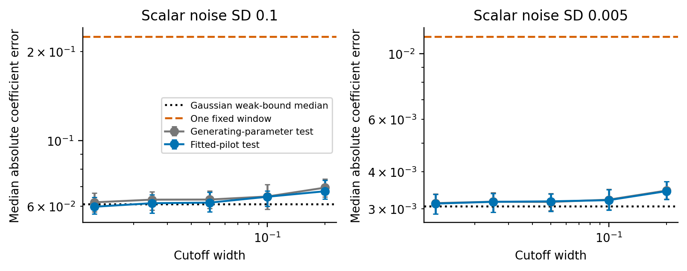

The submission supplement contains the proofs and checks supporting the current paper, numbered consecutively S1-S9. Independent-record GMM, fission, cross-fitting and incidental-state studies are preserved in the separate [Research archive](research_extensions_archive.pdf), whose historical labels are explicitly qualified as research-archive references below. Frozen protocols and original output files retain their original identifiers.

## S1. Continuous and discrete likelihood

All parameters share known positive stationary OU covariance. The innovation transformation separates an independent normal initial observation from a Brownian drift experiment. The translation theorem [@cameron1944] suffices for this common-covariance case; a changing-covariance criterion [@feldman1958] is unnecessary. The family-wide consistency obstruction is classical [@zhang2004]. Unknown initial conditions would enter the sensitivity matrix as nuisance parameters.

For the exponential model, set $q_a(t)=x_0(a+\tau^{-1})e^{at}$ and $\nu^2=2\sigma^2/\tau$. Continuous likelihood is

$$
\log L(a;Y)=\nu^{-2}\left[\int_0^Tq_a(t)(dY(t)+Y(t)dt/\tau)-\frac12\int_0^Tq_a(t)^2dt\right]+\text{constant}.
$$

The initial term is independent of $a$ when $x_0$ is fixed. The exact discrete negative log likelihood, with $e_n(a)=y_n-x_0e^{at_n}$, is

$$
-\log L_h(a)=\frac{e_0(a)^2}{2\sigma^2}+
\frac{\sum_{n=1}^N[e_n(a)-\rho e_{n-1}(a)]^2}{2\sigma^2(1-\rho^2)}+\text{constant}.
$$

The independent validation constrains optimization to $[-2.5,0.5]$ before simulation. Sixty-one parameter-grid points identify candidate local minima, each refined by bounded scalar optimization; endpoints are checked. This is a numerical bounded-likelihood estimate, without a proof that all minima between coarse points are found. It need not be unbiased or attain the Cramér–Rao bound. Its squared error is finite by boundedness. The weak ratio is summarized by quantiles rather than a population MSE.

The separate geometry execution performs deterministic sensitivity quadrature for the scalar example. It computes the joint information for $(a,x_0)$, its Schur complement and the weak influence's normalization and initial-state annihilation. Both identities are verified to $10^{-9}$ on the finest reference grid. Its config, source fingerprint and output archive are retained; this computation adds no stochastic paths and is not an additional Monte Carlo replication.

### S1.1. Proof of Lemma 1

**Proof.** The mean difference belongs to the common Cameron–Martin space, making the path laws equivalent; this is the common-covariance case of Gaussian measure equivalence [@feldman1958]. Under the first law the log likelihood ratio of the second is normal with mean $-d_{\theta\eta}^2/2$ and variance $d_{\theta\eta}^2$. Their total variation is $2\Phi(d_{\theta\eta}/2)-1$. Sampling cannot increase total variation. A nearest-parameter test derived from an estimator can err only if that estimator is at least $\delta/2$ from the generating parameter. The sum of testing errors is at least one minus total variation, giving the probability bound. Multiplying the estimation probability by $\delta^2/4$ gives the risk bound. Both bounds hold at every mesh. $\square$

## S2. Endpoint attribution and generalization protocols

The ablation configuration is `configs/boundary_ablation.json`. Its 500 paired observations are zero-based indices 32–531 of the archived Van der Pol study, with $T=20$, $h=0.005$, $\tau=0.3$, $u=(2,0)$ and 0.5% noise. Four frozen 125-path shards compare initial traces, terminal traces and initial-noise controls individually against their joint archived branch. A new Simpson boundary-free branch shares the quadrature of the endpoint branches. Thus endpoint effects are measured separately from quadrature. The same 30-window bounded covariance pilot, spectral cutoff $10^{-10}$ and full Hermite covariance are used throughout. The clean-mean relative coefficient error gate is $1.4\times10^{-5}$. New observation hashes match the paired archive, and all 500 paths are retained. The first notebook packaging exceeded the platform source-size limit; a second packaging version reduces embedded configuration files without changing the scientific configuration or seeds. Both frozen versions are preserved.

Generalization uses `configs/boundary_generalization.json`. The 5% Van der Pol experiment uses all 128 paired paths from the moderate-noise archive with unchanged noise arithmetic. The Lorenz experiment uses 256 paths, $(s,r,b)=(10,28,8/3)$, $T=4$, $h=0.001$, $\tau=0.1$, $u=(1,1,1)$ and 0.5% coordinate noise. Both add twelve time-only endpoint half-windows to 480 interior windows, with half-window full widths $(3,1.5,0.75,0.375,0.1875,0.09375)$ for Van der Pol and $(0.6,0.3,0.15,0.075,0.0375,0.01875)$ for Lorenz. Initial observation controls are included in the joint branch. The known-initial Lorenz comparator fits exact discrete OU innovations by nonlinear least squares with analytical sensitivities. A positive matched weak-to-known-initial likelihood RMSE gap defines the frozen 50% recovery criterion; a nonpositive gap leaves it undefined. All intervals use 5000 paired bootstrap resamples. First-order and full-Hermite covariance calculations at the true clean design are surrogate geometry checks, distinct from empirical estimator bias and dispersion.

## S3. Prespecified cubic Wald test and refined sparse-selection grid

The primary configuration is `configs/support_wald_v2.json`. A degree-one-through-three polynomial library supplies eighteen unrestricted coefficients, nine per equation. The target is the single prespecified $x^3$ coefficient in the second equation. Its magnitude grid, in units of the boundary-free full-library local two-point reference, is $(0,0.5,1,2,2.5,3,3.5,4)$, with negative signs for bounded alternatives. At each of 0.5% and 5% noise, one hundred seeds are shared across all alternatives and both procedures. Original MSTLS results and input hashes are reused at the five original grid points; the additional three grid points use the same pinned author code and settings. There are 1600 matched weak-GLS fits and 1600 author-reference outcomes, including the original 1000 archived outcomes.

The pilot estimates the five generating-form coefficients by corrected least squares on thirty tests and bounded coefficients, then integrates its fitted trajectory. It receives no generating coefficients. The final estimator solves unpenalized GLS for all eighteen library coefficients on 480 compact windows, with exact polynomial Hermite residual covariance evaluated at that pilot. The two-sided Wald statistic is the target estimate divided by its plug-in fixed-design GLS standard error, with nominal $\alpha=0.05$. It tests one prespecified term; it does not control multiple library searches or establish post-selection inference. The null-calibration gate requires the Wilson 95% interval for null rejection to contain 0.05. Failing this gate precludes a calibrated-power-efficiency claim.

A deterministic preflight in the original high-noise version found target bias $1.4823\times10^{-5}$ at the three-unit alternative, above the unchanged $10^{-5}$ clean-mean coefficient gate. No high-noise Monte Carlo samples were generated by that version. Before inspecting the original low-noise Wald outcomes, the primary second version introduced a pilot-model quadrature-defect correction at every amplitude: subtract the discrete model residual $b_{\mathrm{model}}-A_{\mathrm{model}}\widehat\theta_{\mathrm{pilot}}$ from the observed right-hand side. The ideal clean-pilot preflight checks removal of this deterministic defect; finite-noise performance still uses a fitted pilot. The gate, observations, significance level, covariance model and author selection settings were unchanged. Original notebooks and outputs remain archived separately and are not combined with the amended primary study.

The plotted local Gaussian reference uses the two-sided Wald power $\Phi(-z_{0.975}-a)+1-\Phi(z_{0.975}-a)$, where $a=|\delta|\sqrt{\mathcal I^{\mathrm{eff}}_\delta}$. The parent two-point reference uses equal-prior Bayes error 0.05 and is a different criterion; one reference unit corresponds to local Wald power approximately 0.908. The null information reference is used as a local yardstick, not as a finite-amplitude power identity. Exact residual covariance at a fitted pilot is also distinct from the exact finite-noise covariance of the random-design coefficient estimator. Paired inclusion differences and Wilson intervals are reported without inferring variance ratios from threshold transitions.

### S3.1. Complete rejection intervals and paired differences

Table S1. All targeted-test and sparse-inclusion frequencies. Each count uses one hundred common noise paths. Intervals for individual frequencies are Wilson 95%; difference intervals are conservative pointwise 95% intervals obtained from Bonferroni-projected Clopper–Pearson limits for the two discordant cells. S3.2 defines them; they remain nondegenerate at extreme samples. The nominal Wald size is 5%, with a failed null-calibration gate at 5% noise. MSTLS is a selection procedure without a nominal size parameter.

| Noise | Magnitude | Wald (Wilson 95%) | MSTLS (Wilson 95%) | Difference, percentage points (paired 95%) |
|---|---:|---|---|---|
| 0.5% | 0 | 7/100 (3.4–13.7%) | 0/100 (0.0–3.7%) | 7 (-1.8–15.0) |
| 0.5% | 0.5 | 44/100 (34.7–53.8%) | 0/100 (0.0–3.7%) | 44 (28.5–55.7) |
| 0.5% | 1 | 91/100 (83.8–95.2%) | 0/100 (0.0–3.7%) | 91 (78.2–96.3) |
| 0.5% | 2 | 100/100 (96.3–100.0%) | 0/100 (0.0–3.7%) | 100 (91.4–100.0) |
| 0.5% | 2.5 | 100/100 (96.3–100.0%) | 0/100 (0.0–3.7%) | 100 (91.4–100.0) |
| 0.5% | 3 | 100/100 (96.3–100.0%) | 46/100 (36.6–55.7%) | 54 (38.1–65.3) |
| 0.5% | 3.5 | 100/100 (96.3–100.0%) | 97/100 (91.5–99.0%) | 3 (-3.8–9.4) |
| 0.5% | 4 | 100/100 (96.3–100.0%) | 100/100 (96.3–100.0%) | 0 (-4.3–4.3) |
| 5% | 0 | 23/100 (15.8–32.2%) | 2/100 (0.6–7.0%) | 21 (6.4–33.7) |
| 5% | 0.5 | 62/100 (52.2–70.9%) | 4/100 (1.6–9.8%) | 58 (40.4–70.8) |
| 5% | 1 | 90/100 (82.6–94.5%) | 24/100 (16.7–33.2%) | 66 (47.7–79.0) |
| 5% | 2 | 99/100 (94.6–99.8%) | 58/100 (48.2–67.2%) | 41 (25.7–52.7) |
| 5% | 2.5 | 100/100 (96.3–100.0%) | 68/100 (58.3–76.3%) | 32 (17.6–43.5) |
| 5% | 3 | 99/100 (94.6–99.8%) | 69/100 (59.4–77.2%) | 30 (15.9–41.4) |
| 5% | 3.5 | 98/100 (93.0–99.4%) | 78/100 (68.9–85.0%) | 20 (5.5–32.6) |
| 5% | 4 | 95/100 (88.8–97.8%) | 70/100 (60.4–78.1%) | 25 (9.7–38.0) |

![Figure S1. Paired rejection/inclusion frequencies for the added negative cubic term, with Wilson 95% intervals and 100 paths per point. The dashed curve is the two-sided Gaussian Wald reference computed from null local efficient information; the horizontal scale uses a distinct equal-prior two-point error reference. At one unit its Wald prediction is about 90.8%. The small-noise null-calibration gate passes; the 5% gate fails, so the right-panel Wald frequencies are descriptive. Finite alternatives need not follow the null-local curve.](figures/publication/support_wald_mstls.png)

### S3.2. Boundary-valid intervals for paired frequency differences

Let $p_{10}=P(W=1,M=0)$ and $p_{01}=P(W=0,M=1)$ for the targeted Wald
outcome $W$ and MSTLS inclusion $M$ on the same path. Their frequency
difference is $\Delta=p_{10}-p_{01}$. For $n$ independent paths, the two
discordant counts have binomial marginals; they are not independent of each
other. We construct two-sided Clopper–Pearson intervals [@clopper1934]
$[L_{10},U_{10}]$ and $[L_{01},U_{01}]$, each with confidence
$1-\alpha/2$. Bonferroni then gives simultaneous coverage at least
$1-\alpha$ for these two probabilities, without assuming independence.
Projection yields the conservative pointwise interval

$$
\Delta\in[L_{10}-U_{01},\ U_{10}-L_{01}]\cap[-1,1].
$$

For $\alpha=0.05$, each individual interval has confidence 97.5% and each
tail probability is 0.0125. At $n_{10}=100,n_{01}=0$ the result is
$[0.914252,1]$; at $n_{10}=n_{01}=0$ it is
$[-0.042874,0.042874]$. Thus extreme samples retain uncertainty. These
intervals can be wider than paired score intervals [@newcombe1998]; we use
the conservative construction for an explicit finite-sample guarantee.
Coverage is pointwise for each grid cell, not simultaneous across the
whole alternative grid.

This is a post-study correction of uncertainty reporting prompted by
degenerate percentile bootstrap intervals. All 1600 paired outcomes,
the rejection/inclusion counts, nominal thresholds and Wilson compatibility
gate are unchanged. The original bootstrap results remain archived;
`reports/support_wald_paired_intervals.json` stores both versions and all
four joint-cell counts. The local one-unit difference remains 91 percentage
points, now with interval 78.2–96.3 points. It compares different operating
outcomes, not tests with common size or general structure-selection accuracy.

## S4. Same-path null calibration with random-design and bootstrap SEs

The configuration `configs/wald_se_calibration.json` was frozen before any new SE outcomes; `reports/wald_se_protocol_decision.json` records its timestamp and SHA256 together with the archived-reference hash. All 100 previously evaluated null paths at 5% noise are retained. Five shards contain twenty paths each, assigned by seed modulo five. Their observed input hashes, all eighteen coefficients and nominal standard errors are replayed against the archived reference. The point estimates and $z_{0.975}$ cutoff are common to the three SE branches. No outcome-dependent SE scaling, bias correction or empirical rejection cutoff is introduced. These known null paths provide a paired diagnostic rather than independent confirmation.

### S4.1. Random-design score sandwich

Let $m(\theta)=b-A\theta$, with Hermite-corrected $A$, and fix the observed weights $W=(C+\lambda I)^{-1}$ using the original relative ridge rule. The observed bread is $H=A^\top WA$. Generate OU observations from a null-imposed bounded core-five pilot trajectory $x_0$ with coefficient vector $\theta_0$ in the eighteen-dimensional library. Four fitted background coefficients are retained and the candidate is set to zero; the initial state and stationary OU covariance are supplied. Subtract the clean generating trajectory's deterministic discrete residual $d_0=b(x_0)-A(x_0)\theta_0$. For each model draw, form

$$
\psi^*=e_j^\top H^{-1}(A^*)^\top W\{b^*-d_0-A^*\theta_0\}.
$$

Here $e_j$ selects the candidate at zero-based library index 14. The SE is the centered sample standard deviation of 999 independent $\psi^*$ draws. Random $A^*$ shares the observation noise with $b^*$, so the score variance includes their dependence and polynomial design noise. This is Monte Carlo estimation of a model score covariance, with fixed observed weights and bread. It leaves pilot-weight variability to the full-refit bootstrap branch and leaves score centering errors uncorrected. The recorded average score influence across observed paths is 0.03462; its nonzero value cautions against interpreting the sandwich as an exact finite-noise variance identity. With deterministic $A$, the influence projection reduces algebraically to the fixed-weight GLS map.

### S4.2. Full-refit parametric bootstrap

For each observed path, 399 stationary OU draws are generated around the same null-imposed pilot trajectory, with the original coordinate noise scales. Each draw refits the thirty-window bounded core-five pilot, integrates its fitted trajectory, rebuilds exact Hermite residual covariance and the pilot quadrature correction, and fits all eighteen coefficients on the original 480 windows. The SE is the target's sample standard deviation with denominator $B-1$. It measures variability of this complete fitted procedure under the supplied pilot model. The mean bootstrap target averaged across paths is $-0.006910$; bootstrap bias is recorded but not subtracted from observed estimates.

Bootstrap seeds are $95000000+1000s+b$ and score seeds are $96000000+1000s+b$, for observed seed $s$ and zero-based draw $b$. They occupy disjoint ranges and differ from the observation seeds. The generating pilot restriction and supplied covariance remain substantive assumptions. Any failed integration or fit stops its shard; replicates are never silently removed. A separate one-path numerical smoke with eight score draws and four bootstrap refits validates execution and replay only.

### S4.3. Complete outcomes and audit

Table S2. Null rejection on 100 paired Van der Pol paths at 5% noise. The frozen gate is inclusion of 5% in the Wilson 95% interval. The SE ratio is the median of pathwise ratios to the nominal SE. The paths were previously examined; this is a diagnostic, with independent confirmation outstanding.

| Standard error | Rejections | Wilson 95% | Gate | Median SE ratio |
|---|---:|---|---|---:|
| Nominal | 23/100 | 15.8–32.2% | Fail | 1.00 |
| Random-design sandwich | 2/100 | 0.6–7.0% | Pass | 2.81 |
| Full-refit parametric bootstrap | 5/100 | 2.2–11.2% | Pass | 1.79 |

Table S2 reports the full diagnostic: nominal 23/100 (Wilson 15.8–32.2%), random-design sandwich 2/100 (0.6–7.0%), and full-refit bootstrap 5/100 (2.2–11.2%). Both revised intervals include 5%, satisfying the frozen criterion. Median SEs are 0.04325, 0.12575 and 0.07862 respectively. Median paired ratios are 1, 2.812 and 1.792; ratios of marginal medians are a different statistic. All original target estimates and nominal SEs replay with zero numerical difference. All 39,900 bootstrap targets are retained, their sample SDs are recomputed, and all 300 rejection decisions are checked against the unchanged normal cutoff. All 99,900 score draws were completed. Shard runtimes range from 3.75 to 5.07 hours; aggregate bootstrap and score times are 23.23 and 0.522 aggregate hours.

The byte-preserved outputs and execution logs are in `data/wald_se_calibration/`, with a SHA256 inventory and per-stage frozen-source audits. `python scripts/finish_wald_se_calibration.py --analyze-only` verifies that inventory and regenerates results from the committed bundle without Kaggle access or ODE solves. No alternative-power samples use the new SEs. Wilson compatibility on the previously examined 100 null paths motivates independent confirmation, rather than establishing precise size, efficiency or post-selection validity.

## S5. Additional numerical checks and detailed protocols

These checks preserve the supplementary numerical evidence and implementation details of the condensed main paper. They use the original archived data without new simulations or amended outcomes.

### S5.1. Scalar optimal-test check

The scalar model is $x'=ax$, with $a=-1$, $x_0=2$, $T=4$ and OU correlation time 0.4. Noise standard deviations are 0.1, 0.02 and 0.005. For each amplitude, 1000 independent OU paths are shared across tests. A 30-window weak OLS pilot, clipped to $[-2.5,0.5]$, is substituted into the explicit function of Section 5.3. A quintic cutoff is zero within a quarter of the declared width from either endpoint and reaches one at that width. Widths are 0.2, 0.1, 0.05, 0.025 and 0.0125. Simpson quadrature uses $h=1/16384$. The generating-parameter test is an oracle comparison; the fitted-pilot test receives no true coefficient.

Unguarded weak ratios can have infinite population moments (Section 4.2). Reported scalar RMSE therefore uses the prespecified clipping of final estimates to $[-2.5,0.5]$; unbounded medians are also archived. The clean-moment denominator is reported solely as a diagnostic; every path is retained. Only five final estimates are clipped, all from the one-window comparator at noise SD 0.1; no oracle or fitted-optimal-test estimate is clipped. Every path enters the summaries. Full counts are listed in research archive S8.

Table S3. Scalar coefficient errors at cutoff width 0.0125, with 1000 paired paths per amplitude. Medians are absolute errors; RMSE uses bounded final estimates. The reference is the standard deviation of the efficient Gaussian influence, for local information comparison.

| Noise SD | One-window median | Pilot-test median (95% interval) | Pilot-test RMSE | Weak influence SD |
|---|---:|---:|---:|---:|
| 0.1 | 0.22443 | 0.05981 [0.05662, 0.06437] | 0.09035 | 0.09063 |
| 0.02 | 0.04585 | 0.01248 [0.01159, 0.01331] | 0.01818 | 0.01813 |
| 0.005 | 0.01141 | 0.00312 [0.00289, 0.00336] | 0.00455 | 0.00453 |

At noise SD 0.1, the fitted-pilot median is 0.05981, compared with 0.22443 for the fixed window. The Gaussian absolute-error median at the class bound is 0.06113. These are different statistical summaries; covariance efficiency is assessed separately by linearized variance. At the smallest noise the pilot-test bias is 0.000050 and dispersion 0.004551. The oracle local efficiency relative to the weak-class bound at width 0.0125 is 0.9864. Full width and amplitude dependence is retained in research archive S8.

### S5.2. Original 128-path nested-span check

The largest clean discrete GLS coefficient error is 2.82e-07, below the small-noise error scale. For the feasible test, 128 independent paths at each amplitude are shared by both weights and all three families. Hermite-corrected moments use known marginal variances. A 30-window OLS pilot is clipped to a fixed physical parameter box and integrated from the known initial state. Exact polynomial covariance is evaluated on this fitted model trajectory, and coefficient-dependent weights are updated for at most 100 iterations, with relative tolerance $10^{-7}$. The covariance uses the fitted trajectory. This is a known-support WENDy-like component; the complete author WENDy benchmark is documented separately in research archive S6 and research archive S9.6.

Table S4. Feasible Van der Pol empirical relative RMSE and 95% path bootstrap intervals, with 128 paired paths per row. Bias and dispersion refer to the OU-weighted coefficient errors; their squares sum to empirical MSE. Final coefficient estimates are unbounded; Proposition 3 concerns a distinct guarded routine and supplies no population-moment guarantee for these archived fits.

| Noise | Windows | OU RMSE (95% interval) | iid RMSE (95% interval) | OU bias | OU dispersion |
|---|---:|---:|---:|---:|---:|
| 0.5% | 30 | 0.00200 [0.00181, 0.00220] | 0.00203 [0.00184, 0.00223] | 0.00027 | 0.00198 |
| 0.5% | 120 | 0.00173 [0.00156, 0.00190] | 0.00177 [0.00161, 0.00194] | 0.00010 | 0.00173 |
| 0.5% | 480 | 0.00174 [0.00157, 0.00190] | 0.00178 [0.00161, 0.00194] | 0.00011 | 0.00173 |
| 5% | 30 | 0.02711 [0.02437, 0.02993] | 0.02744 [0.02439, 0.03050] | 0.00900 | 0.02557 |
| 5% | 120 | 0.02545 [0.02277, 0.02810] | 0.02548 [0.02286, 0.02819] | 0.00770 | 0.02426 |
| 5% | 480 | 0.02558 [0.02288, 0.02833] | 0.02551 [0.02295, 0.02799] | 0.00814 | 0.02425 |

At 0.5% noise, OU weighting with 480 windows gives empirical RMSE 0.001737, versus the sharp reference 0.001690. At 5% noise it gives 0.025583, versus 0.016904; bias 0.008143 and dispersion 0.024253 identify finite-noise excess error. The stronger finite-noise assertion that more windows alone would reach 0.016904 is therefore not supported by this feasible implementation. The small-noise result and deterministic geometry support the conditional efficiency mechanism, while the moderate-noise result delimits it.

At 0.5% noise, paired iid-minus-OU RMSE for 480 windows is 0.000038, with 95% interval [-0.000038, 0.000116]. At 5% noise, paired iid-minus-OU RMSE for 480 windows is -0.000075, with 95% interval [-0.001295, 0.001045]. These original 128-path intervals include zero. The planned 2000-path follow-up in Section 7.1 resolves the small-noise weighting comparison. Intervals are pointwise across comparisons. All 1536 final fits meet the stopping tolerance within 23 iterations, and no pilot is clipped; the finite-noise gap persists after this convergence control. Stopping counts are retained in research archive S8; no path is excluded.

### S5.3. Matched author WENDy and moderate-noise likelihood

The pinned author WENDy implementation, including its own noise estimation, test-radius selection, basis construction and stopping rule, is run on exactly the 128 observations used by the feasible weak-GLS experiment at $h=0.005$. The supplied support has the same four free coefficients. This isolates the observation protocol while allowing each pipeline its declared estimator design. The same planned 128 seeds were partitioned across four CPU jobs for throughput; each seed enters the analysis once.

Table S5. Matched Van der Pol comparison at 5% noise, 128 paired paths. Bootstrap intervals resample common seed indices. Bias and dispersion use all coefficient vectors.

| Estimator | RMSE (95% interval) | Bias | Dispersion |
|---|---:|---:|---:|
| Author WENDy | 0.024054 [0.021949, 0.026181] | 0.008557 | 0.022481 |
| OU weak GLS, 480 | 0.025583 [0.022840, 0.028227] | 0.008143 | 0.024253 |
| iid weak GLS, 480 | 0.025509 [0.022987, 0.028270] | 0.008464 | 0.024063 |

The paired OU-GLS-minus-author RMSE difference is 0.001529, with interval [-0.000796, 0.004051]. The author pipeline has a 6.0% lower point RMSE in this cohort, but the paired interval contains zero, leaving the ordering unresolved. Both estimators retain bias of roughly 0.008 in relative coefficient norm; dispersion supplies most of their squared error. The separate complete-pipeline benchmark in research archive S9.6 uses 16 paths, different seeds and $h=0.01$; its WENDy RMSE 0.02154 and WmSINDy RMSE 0.01926 cannot be ranked against the present 128-path result. At 5% noise nonlinear residual and random-design terms, pilot error and estimator bias remain relevant (research archive S3 and research archive S9.3). Their effects remain under exact residual covariance. Adaptive radii and estimator-specific bias handling are possible differences, but no ablation attributes the gap to them. Small-noise efficiency is therefore not a claim of superior practical accuracy at 5%. Full WmSINDy also uses predictive and noise-reconstruction losses; its estimating equation is not restricted to the boundary-free class, so 0.016904 is not asserted as a lower bound for it.

A separate bounded local Gaussian path-likelihood optimization at 5% uses these identical 128 observations and exact stationary OU innovations. With the initial state known, relative RMSE is 0.01421 (95% path-bootstrap interval [0.01290, 0.01549]); jointly fitting its two coordinates gives 0.01720 ([0.01556, 0.01883]). Analytical ODE sensitivities supply the Jacobian. All fits meet the optimizer's stopping conditions, and 0 activate a declared parameter bound. These local likelihood references quantify full-path accuracy at moderate noise separately from the weak component (research archive S19).

On these same 128 records at 5% noise, unknown-initial local likelihood has RMSE 0.0172, author WENDy 0.0241 and weak GLS 0.0256. The weak estimates have approximately 40% and 49% higher RMSE than likelihood, respectively. This finite-noise comparison lies within the same nuisance-initial-state information class; local small-noise efficiency alone does not predict the moderate-noise ordering.

### S5.4. Sensitivity to supplied and fitted OU shape

A separate 128-path Van der Pol check changes temporal weights to $\tau/2$ and $2\tau$, keeping the correction variance known. At 0.5% noise the RMSEs are 0.001747 and 0.001794, versus 0.001737 with the correct shape; at 5% they are 0.026242 and 0.026158, versus 0.025583. A stationary OU residual-profile fit using one known-initial scoring step gives RMSE 0.0017366 and 0.025183 at the two amplitudes. This check assesses a feasible residual plug-in; all fits converge (research archive S12). Fixed-horizon infill identifies the microergodic combination $\sigma_j^2/\tau$, while separate variance and range consistency requires additional acquisition or calibration [@ying1991; @zhang2004].

### S5.5. Detailed protocols for the retained comparisons

**Small-noise weighting and full-path likelihood references**

The follow-up uses 2000 prespecified seeds, including the original 128-path prefix exactly once. Its coefficients reproduce that prefix without numerical discrepancy. All methods share the same observations at 0.5% noise. OU and iid weak GLS retain 480 prescribed windows (479 independent tests). The path-likelihood reference uses exact stationary OU innovations and ODE sensitivities, starting from the feasible OU weak estimate. One Fisher-scoring step holds the known initial state fixed, or jointly updates four coefficients and two initial coordinates from the noisy first observation. It is a local likelihood refinement. The follow-up was planned after inspecting the original 128-path comparison; 5000 paired bootstrap draws quantify Monte Carlo uncertainty without sequential stopping.

OU minus iid weighting is assessed by the paired iid-minus-OU RMSE difference 0.00007426, with 95% interval [0.00005576, 0.00009327]. OU weighting reduces empirical RMSE by 4.22%. On the additional 1872 paths alone, the interval also excludes zero. The main improvement comes from enriching the test span; correct temporal covariance adds a smaller, roughly 4–5% improvement. OU weak RMSE 0.001685 is consistent with the sharp reference 0.001690, within the local reference uncertainty.

The known-initial one-step reference agrees with its information scale. The unknown-initial one-step estimate retains bias 0.000469: initialization at a noisy endpoint leaves appreciable nonlinear remainder at this amplitude. After inspecting that result, two additional scoring steps were computed on the same 2000 observations, giving RMSE 0.001669 and bias 0.000068. This refinement is reported as a likelihood-refinement follow-up on the same observations. The theorem concerns the limiting influence; the scoring implementation also needs a sufficiently accurate local initialization. The information lost when the initial state is known is the projection $\mathcal I_{\theta u}\mathcal I_{uu}^{-1}\mathcal I_{u\theta}$; when it is unknown, weak influences incur no further first-order loss relative to the nuisance-adjusted path likelihood.

**Known-initial information recovery with universal endpoint tests**

For known $u$, extend the corrected residual to tests with nonzero endpoint traces:

$$
m_\phi(\theta)=-\int_0^T[\phi'(t)^TY(t)+\phi(t)^Tf_\theta^H(Y(t))]dt
+\phi(T)^TY(T)-\phi(0)^Tu.
$$

Here $f_\theta^H$ denotes coordinatewise Hermite correction under the supplied sensor variance. Theorem 2 gives the full closed influence class when $u$ is known.

We compare four branches on 1968 identical records, indices 33–2000 of the 0.5% OU-noise study. Model-adjoint tests, integrated at each record's pilot, are combined with the two controls $Y(0)-u$. Their span contains the efficient score directions in first order; agreement with likelihood therefore checks this realization. The primary alternative uses universal time-only tests: the original 480 interior bumps plus twelve endpoint half-bumps of full widths 3, 1.5, 0.75, 0.375, 0.1875 and 0.09375, centered at 0 and 20, together with the same initial controls. Joint $H^1$ orthogonalization retains 491 scalar tests. Exact discretized Hermite covariance includes all endpoint cross terms. Composite Simpson integration gives clean-mean coefficient error $9.68\times10^{-7}$, below the frozen $1.4\times10^{-5}$ gate. The covariance weights still use a directly integrated pilot model; only construction of the universal windows is independent of the ODE.

Before evaluating these endpoint branches, we replaced an absolute screen threshold by two paired relative criteria: model-adjoint RMSE at most 1.05 times the known-initial likelihood reference, and universal tests closing at least 50% of the original weak-to-likelihood RMSE gap. The original absolute threshold failed even for likelihood on the 32-record screen and was unsuitable for that comparison. The amendment and unchanged earlier outcomes are archived. The 1968 records were unused for endpoint fitting; their original weak and likelihood outcomes were already archived, so this is endpoint holdout confirmation rather than an entirely unseen dataset. The likelihood reference is one Fisher-scoring step with known $u$, as in Section 7.1.

Universal endpoint tests close 97.1% of the paired RMSE gap, with a 95% paired-bootstrap interval of 95.5–98.6%; their RMSE is 0.88% above the scoring reference. The model-adjoint/scoring ratio is 0.99954, with interval 0.99815–1.00086. Both frozen point criteria are satisfied. Bootstrap intervals use 5000 shared record resamples. Median online times, including the common 30-window pilot, are 1.51 s for the universal branch and 1.25 s for the model-adjoint branch; archived scoring times were unavailable. The result establishes recovery by this universal test family at small noise. Its model-based covariance pilot prevents interpreting it as a fully ODE-free estimator or a demonstrated computational advantage.

**Endpoint-component attribution**

The frozen ablation uses the same 500 records (indices 33–532). It is component attribution on already evaluated data. All new branches use identical Simpson quadrature and the same covariance-pilot rule; a matched boundary-free branch isolates quadrature from endpoint changes. The full branch and known-initial scoring are archived paired references. For a positive matched baseline-to-scoring gap, the prespecified material-contribution criterion is at least 50% gap recovery, with uncertainty reported separately.

Initial traces alone recover essentially the entire finite-family gap. This is the mechanism already proposed by Brunel et al. [@brunel2014, Section 2.3], with its OU efficiency quantified here. The initial-noise controls provide a measurable standalone improvement, but fail the 50% material-contribution rule. The all-minus-initial RMSE difference is $7.46\times10^{-8}$, with paired interval $[-7.18\times10^{-7},8.55\times10^{-7}]$, giving no resolved improvement over initial traces. Terminal traces alone give no resolved improvement, consistent with the unchanged closed class in Theorem 2. Component gains overlap; their percentages are not additive. The archived trapezoidal boundary-free RMSE is 0.00164343, so quadrature accounts for only 0.16% of the matched gap. All intervals use 5000 shared bootstrap resamples. Recovery percentages can exceed 100% through Monte Carlo variation; they are not clipped.

**Added-term detection and the nuisance-adjusted reference**

An additional $\delta x^3$ term in the second Van der Pol equation gives a bounded structural alternative for negative $\delta$, retaining the stabilizing $-x^2v$ term. Let $s_\delta$ be its sensitivity and let $S_{-\delta}$ collect the other coefficient sensitivities. The local composite likelihood information is $\|s_\delta-\Pi_{S_{-\delta}}s_\delta\|_{\mathcal H}^2$; the boundary-free reference additionally projects on $Z$. The local equal-prior two-point error reference $\Phi(-|\delta|\sqrt{\mathcal I^{\mathrm{eff}}_{\delta}}/2)=0.05$ gives $|\delta|_{\min}=2\Phi^{-1}(0.95)/\sqrt{\mathcal I^{\mathrm{eff}}_{\delta}}$. This profiles nuisance coefficients rather than treating them as known through a raw diagonal information entry.

For the full degree-one-through-three polynomial library in both equations, profiling the 17 other coefficients gives local references 0.01928 with known initial state and 0.01941 for the boundary-free class at 0.5% noise. At 5%, these become 0.19279 and 0.19410. The small difference is direction specific; it differs from the aggregate coefficient-RMSE cost. The complete pinned author's adaptive WSINDy, with unchanged selection settings, was evaluated on 100 paired noise paths at each of five negative alternatives per amplitude. At magnitudes 0, 0.5, 1, 2 and 4 times the local weak reference, inclusion counts are 0, 0, 0, 0 and 100 at 0.5% noise, and 2, 4, 24, 58 and 70 at 5%. Full Wilson intervals and the core-five-coefficient comparison appear in research archive S20. The local Gaussian reference describes regular composite-model information; sparse selection on a fixed background and finite-amplitude alternatives are different experiments. In particular, the large 5% alternatives require nonlinear interpretation. The author's selection curve supplies an algorithmic benchmark, rather than an equality test of the information formula.

**Moderate-noise endpoint confirmation**

The 128-record 5% Van der Pol check uses the same observations as the previous moderate-noise benchmark, with supplied covariance and known $u$. Its primary likelihood comparator therefore fixes $u$; the unknown-initial likelihood result supplies context. All new weak branches share Simpson quadrature, a 480-window interior family and the same 30-window covariance pilot. The universal branch adds the frozen endpoint half-windows and initial controls. Source fingerprints and all paired observation hashes are verified.

The universal branch recovers 32.6% of the matched weak-to-known-initial-MLE RMSE gap, with paired 95% interval 18.3–45.8%. The frozen 50% criterion fails. Thus near-complete small-noise recovery does not extend to this moderate-noise feasible estimator. The archived trapezoidal weak RMSE, 0.0255834, is close to the matched Simpson value.

At the clean design and true coefficients, the first-order covariance reference gives relative RMSE 0.0130935 for the universal span and 0.0169382 for the compact span. Retaining all Hermite orders changes these fixed-clean-design references to 0.0136355 and 0.0170083. Full residual covariance therefore raises the universal surrogate scale by 4.1%, while actual universal dispersion is 0.0211247 and its bias norm is 0.0056954. These quantities distinguish the restored local geometry from finite-noise performance. The covariance-surrogate difference is not an exact decomposition of estimator variance: random designs, same-record pilots and nonlinear fitting remain in the empirical estimate.

**Lorenz endpoint confirmation**

The three-state confirmation uses the supplied Lorenz structure, known $u=(1,1,1)$, 0.5% OU noise and all 256 frozen paired records. The universal family adds twelve time-only endpoint half-windows and three initial controls to 480 interior windows. Its covariance weights use the same bounded 30-window pilot as the matched compact branch. The comparator is fully optimized known-initial likelihood with exact discrete OU innovations and analytical sensitivities. All fits converge; none is excluded. Both clean-mean quadrature errors pass the fixed gate (S2).

Universal endpoints recover 95.5% of the paired compact-to-likelihood RMSE gap, with interval 92.8–98.0%, satisfying the frozen 50% criterion. The first-order universal clean-design reference is 0.00020891 and its full-Hermite counterpart is 0.00020926; the matched compact references are 0.00041358 and 0.00041363. The empirical endpoint dispersion is close to this local geometry. Together with the Van der Pol ablation, this supports small-noise recovery across two supplied polynomial structures. It does not extend the 97.1% Van der Pol percentage to arbitrary systems or moderate noise.

**Prespecified Wald rejection versus sparse inclusion**

We refine the added-cubic grid with 2.5, 3 and 3.5 reference units and compare the author's unchanged MSTLS with a two-sided Wald test of the single prespecified $x^3$ coefficient at nominal 5%. All eighteen library coefficients are fitted without penalization by feasible weak GLS on 480 compact tests. Exact Hermite residual covariance is evaluated at a bounded core-five pilot. Original paired observations and author fits are reused, and intermediate grid points share their noise seeds. S3 documents a pilot-model correction of deterministic quadrature defects, fixed before inspecting the first version's noisy Wald outcomes. No significance or selection thresholds were tuned.

At 0.5% noise, null rejection is 7/100 (Wilson interval 3.4–13.7%), passing the prespecified compatibility gate for nominal 5%. One reference unit gives 91% rejection (83.8–95.2%), consistent with the 90.8% null-local Gaussian Wald prediction. MSTLS includes no target at that magnitude and reaches 46% at three units and 97% at 3.5 units. The paired one-unit difference is 91 percentage points, with conservative paired interval 78.2–96.3 points (S3.2). These supplied-candidate frequencies are consistent with the local small-noise reference; they require independent size and power confirmation. With only 100 null paths, passing the gate establishes compatibility, rather than precise size calibration or efficiency over a growing library.

At 5% noise, null Wald rejection is 23/100 (15.8–32.2%), failing the gate. The target's empirical null RMSE is 0.07578, versus median reported standard error 0.04325; these are diagnostic scales, not an exact variance ratio. The nominal standard errors leave finite-noise random-design and pilot effects insufficiently calibrated. Higher alternative rejection therefore gives no calibrated-power advantage at this amplitude. MSTLS null inclusion is 2/100 (0.6–7.0%); it has no nominal test size parameter. Both panels are retained without repair based on their outcomes. The comparison separates prespecified statistical testing from library-wide sparse selection and post-selection inference.

## S6. Supplementary local-estimation details

These details specialize classical estimating-equation and efficient-score arguments [@godambe1960; @bickel1993; @vandervaart1998]. Continuous-record linear estimation and its discrete approximation are established by Dette, Konstantinou and Zhigljavsky [@dette2017]; the main paper restricts their local regression geometry through the dynamical adjoint range.

### S6.1. Scalar path information and weak-ratio diagnostics

For $x_a(t)=x_0e^{at}$ with known $x_0$, $s(t)=x_0te^{at}$ and

$$
\mathcal I_T(a)=\frac{\tau x_0^2}{2\sigma^2}
\int_0^Te^{2at}[1+(a+\tau^{-1})t]^2\,dt.
$$

On a uniform grid, exact innovations give

$$
\mathcal I_h(a)=\frac{s(0)^2}{\sigma^2}+
\frac{\sum_{n=1}^N[s(t_n)-\rho s(t_{n-1})]^2}{\sigma^2(1-\rho^2)}
\longrightarrow\mathcal I_T(a),\qquad\rho=e^{-h/\tau}.
$$

Nested grids give increasing information bounded by $\mathcal I_T$. The limit follows from a Riemann sum of squared sensitivity innovations. Statistical saturation therefore concerns the full experiment.

For $D_\phi=\int\phi x_a\ne0$, a scalar weak ratio has limit

$$
\widehat a_h=\frac{-\mathcal Q_h(\phi'Y)}{\mathcal Q_h(\phi Y)}
\longrightarrow a+\frac{N_\phi}{D_\phi+E_\phi},\qquad
N_\phi=\int(-\phi'-a\phi)\eta_C,\quad E_\phi=\int\phi\eta_C.
$$

OU path continuity gives almost sure convergence of the quadratures. The weights $\phi$ and $-\phi'-a\phi$ are independent: dependence would make a nonzero compactly supported function solve a homogeneous first-order equation. The OU kernel is strictly positive on nonzero weights, so $(N_\phi,E_\phi)$ is nondegenerate Gaussian. Positive conditional variance of $N_\phi$ given $E_\phi$ and positive denominator density at zero imply infinite absolute and squared error moments of the unguarded ratio. Its empirical summaries should use quantiles or explicit guards.

The influence $\ell=(-\phi'-a\phi)/D_\phi$ has Gaussian variance

$$
V_\phi=\iint\ell(s)C(s,t)\ell(t)dsdt.
$$

 Differentiating the weak identity gives $\int\ell s=1$. Cauchy–Schwarz in the covariance RKHS gives

$$
1\leq V_\phi\mathcal I_T(a),\qquad
\operatorname{Eff}_\phi=[\mathcal I_T(a)V_\phi]^{-1}\leq1.
$$

This efficiency concerns the Gaussian linearization.

### S6.2. Proof of the conditional dense-span proposition

The main proposition separates estimator regularity from projection geometry. Its sufficient assumptions are:

- (P1) For each fixed finite family, the corrected weak solution has expansion $\widehat\theta_{K,\epsilon}-\theta=\epsilon P_K r_K+o_p(\epsilon)$, with $r_K$ centered Gaussian of covariance $\Sigma_K$, and full-column-rank $D_K$.
- (P2) Feasible pilots and covariance weights change $P_K=(D_K^\top\Sigma_K^{-1}D_K)^{-1}D_K^\top\Sigma_K^{-1}$ by $o_p(1)$. Deterministic quadrature error is $o(\epsilon)$.
- (P3) The squared norms of $\epsilon^{-1}(\widehat\theta_{K,\epsilon}-\theta)$ are uniformly integrable. Distributional convergence alone does not imply covariance convergence. Stable local solves with bounded fallback and bad-event probability $o(\epsilon^2)$ are one possible sufficient implementation.
- (P4) The deterministic, nested influence spans are dense in $\mathcal M$ in covariance norm, and $\mathcal I_{e,C}$ is positive definite.

**Proof.** Under (P1) and (P2), Slutsky's lemma gives the centered Gaussian limit with covariance $P_K\Sigma_KP_K^\top=(D_K^\top\Sigma_K^{-1}D_K)^{-1}=V_K$. To see the moment conclusion, let $X_\epsilon=\epsilon^{-1}(\widehat\theta_{K,\epsilon}-\theta)$. Assumption (P3) and the continuous-mapping theorem give convergence of each first and second coordinate moment: $|X_iX_j|\leq\|X_\epsilon\|^2$ supplies the necessary uniform integrability. Hence $E X_\epsilon\to0$ and $\operatorname{Cov}(X_\epsilon)\to V_K$. No risk conclusion is drawn for an unguarded ratio lacking (P3).

Let $t_i=C^{-1}R_i\in\mathcal M$ be the efficient dual representers of the coefficient sensitivities from the boundary-free theorem, and let $Q_K$ be covariance-orthogonal projection onto the finite influence span. Because every test influence annihilates $Z$, its pairing with $S_i$ equals its pairing with $R_i$. The finite-family information is therefore

$$
(D_K^\top\Sigma_K^{-1}D_K)_{ij}
=\langle Q_Kt_i,Q_Kt_j\rangle_C.
$$

By (P4), $Q_Kt_i\to t_i$ in covariance norm. Cauchy–Schwarz then gives entrywise convergence to $\langle t_i,t_j\rangle_C=(\mathcal I_{e,C})_{ij}$. The nested projected information matrices increase in Loewner order, and positive definiteness makes matrix inversion continuous at the limit. Consequently $V_K\to\mathcal I_{e,C}^{-1}$. These are two sequential limits. A joint $K,\epsilon$ limit requires uniform controls absent from (P1)–(P4). The proof is a specialization of classical estimating-equation linearization and efficient-score projection [@godambe1960; @bickel1993; @vandervaart1998, Chapters 5 and 25]. $\square$

### S6.3. Parameter-dependent weak likelihood

The same leading map arises from a parameter-dependent Gaussian weak likelihood of the form studied by WENDy-MLE [@rummel2025], provided the covariance shape is correct and the local solution is regular. For fixed dimension write $r(\theta)=\epsilon r_1+o_p(\epsilon)$, $\partial_\theta r=-D+o_p(1)$ and $\Sigma_\epsilon(\theta)=\epsilon^2\Sigma_0(\theta)$, with smooth positive definite $\Sigma_0$. The objective $\log\det\Sigma_\epsilon+r^T\Sigma_\epsilon^{-1}r$ has covariance-derivative and log-determinant score terms of order $O_p(1)$ in an $O_p(\epsilon)$ neighborhood; its mean-residual score is of order $O_p(\epsilon^{-1})$. The local score equation therefore gives

$$
\widehat\theta-\theta=\epsilon
(D^T\Sigma_0^{-1}D)^{-1}D^T\Sigma_0^{-1}r_1+o_p(\epsilon).
$$

Thus the log determinant and covariance derivatives distinguish finite-noise weak likelihood from frozen GLS, while both share the correct-covariance leading influence under these assumptions. This connects Proposition 3 to a regular local weak-likelihood estimator; its assumptions concern a regular local optimizer and consistent covariance calibration.

### S6.4. Raw features and linear-time temporal covariance application

For correction variance $\widehat v$, define

$$
\bar f=\exp\left[\frac12\sum_j(v_j-\widehat v_j)\partial_j^2\right]f.
$$

The exponential terminates for polynomials. Using $\bar f$ in $c$ gives covariance, while mean residual is $\int\phi_k[f_i(x)-\bar f_i(x)]dt$. Raw monomials use $\widehat v=0$. Mean bias and covariance are separate outputs.

On a uniform grid, collect weighted coefficients into an $N\times Kd$ matrix $\mathsf B_\alpha$. Each term is $\alpha!v^\alpha \mathsf B_\alpha^TR_{q,h}\mathsf B_\alpha$, where $(R_{q,h})_{nm}=\rho_q^{|n-m|}$ and $\rho_q=e^{-qh/\tau}$. For a computational vector $w$,

$$
a_n=w_n+\rho_qa_{n-1},\qquad z_n=w_n+\rho_qz_{n+1},\qquad
R_{q,h}w=a+z-w,
$$

with zero exterior initialization. Each multi-index costs $O(N(Kd)^2)$ time and $O(NKd+(Kd)^2)$ memory, avoiding an $N\times N$ temporal matrix. An independent fixed-variance nugget has additional diagonal-in-time covariance; its linear weak contribution is $O(h)$. The exact mixed-noise formula is in the supplement.

### S6.5. Explicit scalar OU optimal test

For scalar exponential dynamics, $z=e^{at}$, $s=x_0te^{at}$, $k=\mathcal I_{au}/\mathcal I_{uu}$ and $g=e^{at}(x_0t-k)$. Define

$$
A_0=\frac{(1-\tau^2a^2)x_0}{2\sigma^2\tau},\qquad
B_0=\frac{-(1-\tau^2a^2)k-2\tau^2ax_0}{2\sigma^2\tau},
$$

$$
q_0=\frac{-k-\tau(x_0-ak)}{2\sigma^2},\qquad
F_j(t)=\int_0^t s^je^{2as}ds.
$$

Then

$$
\phi_*(t)=-\frac{e^{-at}}{\mathcal I_e}
[q_0+A_0F_1(t)+B_0F_0(t)].
$$

For $a\ne0$, $F_0=\operatorname{expm1}(2at)/(2a)$ and $F_1=[e^{2at}(2at-1)+1]/(4a^2)$; their continuous limits at $a=0$ are $t$ and $t^2/2$. A pilot coefficient substitutes into this expression before a compact cutoff is applied. The explicit multivariate fundamental-matrix expression is an analytical identity whose numerical inversion depends on conditioning; strongly contracting dynamics can make that inversion ill-conditioned.

## S7. Archived regularization and a constructive guarded variant

### S7.1. What the archived solver actually approaches

In `src/weak_efficiency.py`, `gls_map` adds
$\lambda_\epsilon I=\rho\,\operatorname{tr}(\widehat\Sigma_\epsilon)I/m$
to the physical residual covariance, with fixed relative $\rho=10^{-10}$
in the primary protocols. If
$\epsilon^{-2}\widehat\Sigma_\epsilon\to\Sigma_1>0$, its normalized limit is

$$
W_\rho=\left[\Sigma_1+\rho\operatorname{tr}(\Sigma_1)I/m\right]^{-1}.
$$

Thus fixed relative ridge is not removed by small-noise scaling. Whenever a
regular local expansion exists, the corresponding leading map and covariance
are

$$
P_\rho=(D^\top W_\rho D)^{-1}D^\top W_\rho,\qquad
V_\rho=P_\rho\Sigma_1P_\rho^\top.
$$

For the ideal map $P_0$, both maps satisfy $P_\rho D=P_0D=I$ and

$$
V_\rho-V_0=(P_\rho-P_0)\Sigma_1(P_\rho-P_0)^\top\succeq0.
$$

Indeed, $P_0\Sigma_1=V_0D^\top$ annihilates the cross terms because
$(P_\rho-P_0)D=0$. Equality holds only when the two maps coincide; a small
numerical ridge alone gives no theorem-level equality. Its impact also
depends on conditioning. The archived final fits are unbounded and their
bounded covariance pilots do not control inverse random-design tails.
Neither uniform integrability nor exact ideal-GLS efficiency of these
archived algorithms is claimed. Their finite mesh and fixed spectral cutoff
also differ from the sequential limit in Proposition 3.

### S7.2. A specified algorithm for which the fixed-family assumptions follow

The separate routine `src/guarded_gls.py` specifies a bounded vanishing-ridge
variant. It retains fixed, deterministic test functions and the known sensor
covariance model. It divides physical residual covariance by $\epsilon^2$,
uses relative ridge $\rho_\epsilon=\epsilon^2$, and rejects a numerical solve
when normalized covariance or column-scaled normal-matrix relative minimum
eigenvalues fall below $10^{-8}\epsilon^2$. A rejected solve returns the
fixed coefficient-box midpoint. A successful solve is projected onto that
same compact box. These safeguards leave a regular local solution unchanged
asymptotically. This routine is a new analytically specified variant; none
of the reported Monte Carlo outcomes uses it.

**Proposition 3 (guarded fixed-family weak GLS; detailed assumptions).** Consider a correctly
specified polynomial vector field linear in its $p$ coefficients, known
initial state and supplied independent-coordinate OU covariance shape
with a common correlation time. Fix a finite deterministic family of
boundary-free tests. Assume:

- (G1) The true coefficient lies inside the final compact box. Its clean
  trajectory and nearby pilot-model trajectories exist on $[0,T]$ and
  depend smoothly on the pilot coefficients on a common bounded region.
- (G2) The clean corrected design $D$ and the clean design of a fixed
  finite-window pilot both have full column rank. The pilot's declared
  structural family contains the truth. Clipping the pilot to a compact
  convex box containing the truth is allowed, including truth on its boundary.
- (G3) The first-order residual covariance $\Sigma_1$ of this finite family
  is positive definite after exact dependencies are removed. The model
  covariance is evaluated from the full Hermite formula at the pilot,
  with known marginal correction variances.
- (G4) Deterministic quadrature weights have uniformly bounded total
  absolute mass for each test and converge to their continuum integrals.
  Their clean residual and pilot-design errors are $o(\epsilon)$.
  Any subtracted pilot-model quadrature defect has value $o(\epsilon)$
  and derivative $o(1)$ uniformly near the truth. Tests and their first
  derivatives are bounded and have the required quadrature regularity.

Build the pilot by corrected least squares on its stated family, using a
fixed bounded fallback if its design is singular. Construct the full
Hermite covariance at the integrated pilot, and apply the guarded routine
above to the final corrected moments. Then, for fixed family size,

$$
\epsilon^{-1}(\widehat\theta_\epsilon^{\mathrm{guard}}-\theta)
\Rightarrow N(0,V_K),\qquad
\epsilon^{-2}\operatorname{Cov}(\widehat\theta_\epsilon^{\mathrm{guard}})
\longrightarrow V_K=(D^\top\Sigma_1^{-1}D)^{-1}.
$$

The squared scaled errors are uniformly integrable. If this construction is
applied to nested dense admissible families satisfying (G1)–(G4) separately,
the subsequent family limit gives the boundary-free covariance reference
of Theorem 1. This is a sequential result; it supplies no uniform rate in
family size and no conclusion for an unchanged fixed mesh or ridge.

**Proof.** Write $Y=x+\epsilon\eta$ and $M=\|\eta\|_\infty$. For each OU
coordinate,

$$
\eta_j(t)=e^{-t/\tau_j}
\left[\eta_j(0)+\sqrt{2\sigma_{0,j}^2/\tau_j}
\int_0^t e^{s/\tau_j}dW_j(s)\right].
$$

The stochastic integral is a martingale with a Gaussian terminal value of
finite variance. Doob's $L^q$ inequality for $q>1$ bounds its supremum moment
by $(q/(q-1))^q$ times its terminal moment. Hence $E M^q<\infty$ for every
$q>1$, uniformly over evaluation grids, and
$P(M>c/\epsilon)=O(\epsilon^q)$ for every such $q$.

Polynomial corrected moments are locally Lipschitz in the path supremum norm;
their polynomial correction terms start at order $\epsilon^2$. By (G2),
pilot least squares is locally regular at the clean path. On
$\epsilon M<c$ for a sufficiently small fixed $c$, it gives
$\widetilde\theta-\theta_{\mathrm{pilot},0}=O(\epsilon M+o(\epsilon))$.
Projection onto the pilot box is nonexpansive and fixes the truth, so the
same bound survives clipping, including clipping at a true boundary value.
By (G1) and (G3), local continuity of the integrated trajectory and covariance
then gives

$$
\epsilon^{-2}\widehat\Sigma_\epsilon
=\Sigma_1+O_p(\epsilon)+o(1).
$$

Higher Hermite orders contribute $O(\epsilon^2)$ or smaller to this
normalized covariance. Consequently the model weights are consistent; this
is derived from pilot regularity and the covariance formula, rather than
assumed as a separate conclusion. By (G4), the final moment residual at
truth is $\epsilon r_1+o_p(\epsilon)$, with centered Gaussian $r_1$ of
covariance $\Sigma_1$, while the design converges to $D$.

The positive eigenvalues in (G2)–(G3) bound local inverses uniformly. Since
both guard thresholds and normalized ridge vanish, the guards are inactive
on a sufficiently small neighborhood of the clean path for all sufficiently
small $\epsilon$. In that neighborhood the final solve yields

$$
\widehat\theta_\epsilon-\theta
=\epsilon(D^\top\Sigma_1^{-1}D)^{-1}D^\top\Sigma_1^{-1}r_1
+o_p(\epsilon).
$$

The final box projection is inactive there because the truth is interior.
This proves the local distributional assertion for the specified algorithm.

For moment control, on the same good event local inverse bounds and (G4)
give $\|\epsilon^{-1}(\widehat\theta_\epsilon-\theta)\|
\leq C(1+M)$ with a constant depending on the fixed family. Its fourth
moment is bounded. Outside that event both estimate and truth are in the
fixed compact box, so the fourth scaled-error contribution is bounded by
$C\epsilon^{-4}P(M>c/\epsilon)=O(\epsilon^4)$, using $q=8$.
Thus scaled errors have bounded fourth moments, proving uniform
integrability of their squares and convergence of covariance. Finally,
S6.2's projection argument proves the separate dense-family limit. $\square$

This result strengthens the existence of a realizable efficient procedure
under verifiable clean-rank, trajectory and quadrature conditions. It neither
certifies the archived unguarded algorithm nor validates the Wald selector,
misspecified pilots or finite-noise SEs. Independent size and power studies
remain necessary for the reported testing procedure.

### S7.3. Fixed-ridge geometry on actual archived spans

The frozen `archived_ridge_check.json` protocol uses the archived basis cutoff,
480 compact windows, original endpoint half-window widths, covariance routines
and quadrature rules. It evaluates first-order residual covariance at the clean
truth for six Van der Pol families and two Lorenz families. Zero-ridge Cholesky
is used for the ideal map; no extra eigenvalue cutoff is introduced. Unit-noise
scaling cancels from the relative ridge comparison. This is a deterministic
matrix calculation, without new observation paths.

Table S6. Relative local RMSE increments for the archived relative ridge
of $10^{-10}$. The PSD increment is computed as $(P_\rho-P_0)\Sigma_1(P_\rho-P_0)^\top$
rather than subtracting almost equal covariance matrices.

| System and family | Relative RMSE increment |
|---|---:|
| vdp compact trapezoid 480 | 7.041e-21 |
| vdp compact simpson | 7.023e-21 |
| vdp initial | 3.906e-19 |
| vdp terminal | 6.876e-21 |
| vdp initial control | 8.001e-20 |
| vdp full | 4.745e-19 |
| lorenz compact simpson | 7.882e-18 |
| lorenz full | 6.695e-15 |

The largest value is $6.70\times10^{-15}$ for the Lorenz endpoint/control
family; the largest relative map change is $9.13\times10^{-8}$.
Normalization errors are below $4.3\times10^{-13}$.
These negligible local increments address regularization cost, not the
existence of finite-noise estimator moments. Tables 1?6 retain their
original finite-sample outcomes; they are not relabelled as guarded fits.
Original output bytes, maps and covariance matrices are preserved in
`data/archived_ridge_check`; the frozen source audit passes for all eight
families. The calculation took 24.3 seconds on Kaggle.

## S8. Constructive full-library efficiency under a jet condition

### S8.1. General proof of Theorem 3

Use the estimator defined in main §5.6, including even uniform grids,
known Hermite correction variances, the specified guards and projection
to a fixed coefficient box. Write $C$ for the unit-amplitude covariance
of $\eta$. The true trajectory is analytic on the full compact interval,
so it and all derivatives needed below are bounded. Constants in this
proof may depend on the fixed spline level and trajectory, but not on
$\epsilon$ or the observation grid. No uniform growing-level assertion
is made.

**Step 1: the jet condition gives clean rank.** Put
$G(t)=(g_1(x_0(t)),\ldots,g_m(x_0(t)))^\top$. If $c^\top G(t)$ vanishes
on any open subinterval, analyticity extends that identity to the whole
interval. Differentiation at $t_*$ through order $m-1$ and the nonzero
jet determinant give $c=0$. Since $w>0$ on $(1/2,T-1/2)$,

$$
c^\top\left(\int wGG^\top dt\right)c
=\int w(c^\top G)^2dt>0\quad(c\ne0).
$$

The clean feature-instrument pilot design contains $d$ copies of this
positive matrix. Hence it is invertible without a separate rank
assumption. The final design contains this block and has full column
rank as well.

**Step 2: the combined Gram and residual covariance are positive.**
Suppose a linear combination $w c^\top G$ equals a cubic-spline
combination. On the support interior the former is analytic. Across
every interior spline knot, analyticity forces adjacent cubic pieces
to have equal derivatives of all orders, and hence to be one cubic
polynomial. At $t=1/2$ the analytic trajectory is bounded and $w$ has
an order-four zero. The polynomial and its first three derivatives
therefore vanish at that edge, forcing it to be zero. Step 1 gives
$c=0$, and independence of the cardinal splines gives zero for their
coefficients. Thus the full clean $H^1$ Gram has a positive minimum
eigenvalue at every fixed level.

For vector tests the adjoint $D^*\phi=-\phi'-J^\top\phi$ is injective
on $H_0^1$: a homogeneous solution with zero initial trace is zero
by uniqueness for the linear equation. Each OU coordinate covariance
is strictly positive on nonzero $L^2$ weights, as its spectral density
$2\sigma_{0,j}^2\tau/(1+\tau^2\omega^2)$ is positive. Consequently the
first-order covariance $\Sigma_1$ of any independent finite test family
is positive definite. Both covariance and design inverse bounds are
available in a neighbourhood of the clean data.

**Step 3: proxy and raw instruments converge.** Couple the observations
on successive grids to one continuous unit-amplitude OU path and write
$M=\|\eta\|_\infty$. The OU representation as a Gaussian initial value
plus a time-changed Brownian martingale and the maximal inequality give
$E M^q<\infty$ for every finite $q$. Linear interpolation has clean
uniform error $O(h^2)$ and noise bounded by $M$. Kernel symmetry and
its unit mass give, on the support of $w$,

$$
\|z-x_0\|_{C^1}
\leq C(b^2+h^2/b+\epsilon M/b),\qquad
\|z\|_{C^3}\leq C(1+h^2/b^3+\epsilon M/b^3).
$$

The kernel never meets reflected boundaries on this support.
On the entire interval reflection introduces only $O(b)$ clean bias,
so the proxy remains uniformly consistent there. With
$b=\epsilon^{1/10}/4$ and $h^2=o(\epsilon)$, the first bound tends to
zero in every fixed finite moment. Polynomial composition and its
chain rule imply convergence of the feature instruments to $wG$ in
$H^1$. The cubic tests are deterministic. The combined raw Gram
therefore converges to its positive clean Gram.

**Step 4: adaptive tests contribute no clean first-order residual.**
For every boundary-free test, including the random raw instruments,
the continuous clean identity is exactly
$b_\phi(x_0)-G_\phi(x_0)\theta_0=0$. Its derivative with respect to
$\phi$ is zero. Polynomial Hermite expansion of the data residual gives

$$
m_\epsilon(\theta_0)
=\epsilon r_{\Phi_0}(\eta)+o_{L^2}(\epsilon),\qquad
r_\phi(\eta)=-\int(\phi'^\top\eta+\phi^\top J\eta)dt.
$$

Before whitening, replacing $\Phi_\epsilon$ by $\Phi_0$ in the linear
term has scaled error bounded by
$C\|\Phi_\epsilon-\Phi_0\|_{H^1}M$, whose second moment tends to zero
by Step 3 and the Gaussian maximal moments. Higher Hermite orders are
finite polynomials multiplied by at least $\epsilon^2$; their scaled
remainders vanish in $L^2$. For quadrature, the clean residual defect
is $O(h^2)$ on bounded-$C^3$ instrument neighbourhoods. Simpson weights
have bounded total mass. OU path continuity makes noise quadrature
errors converge to zero after scaling by $\epsilon$, with domination
by a fixed polynomial in $M$. One may first restrict to such
neighbourhoods and then use the Gaussian moment bounds to remove the
restriction. Thus no rate of differentiability of the OU path is
assumed. The clean pilot inverse from Step 1 now gives
$\widetilde\theta-\theta_0=O_P(\epsilon)$. The pilot projection is
locally inactive because the truth is strictly interior to its box.

**Step 5: weights, cutoff and guards converge.** The normalized exact
Hermite covariance at the proxy and pilot converges to $\Sigma_1$.
This follows from their consistency and continuity of the polynomial
coefficient weights and OU integrals; the order-$q\geq2$ terms carry
$\epsilon^{2q-2}$ after normalization and vanish. By Step 2 the
spectral cutoff eventually retains every row at fixed level.
For analysis, whitening can use the continuous symmetric inverse
square root of the Gram. The implemented eigenvector whitening differs
by an orthogonal row transformation, to which GLS, trace ridge and
the guards are invariant. Repeated eigenvalues therefore create no
extra eigenvector-consistency hypothesis.

The relative ridge and guard thresholds tend to zero, while the clean
matrix gaps stay positive. The final map is consequently

$$
\epsilon^{-1}(\widehat\theta-\theta_0)
=P_0 r_{\Phi_0}(\eta)+o_P(1),\qquad
P_0=(D^\top\Sigma_1^{-1}D)^{-1}D^\top\Sigma_1^{-1}.
$$

Here $D$ and $\Phi_0$ are expressed in the same clean whitened coordinates.
The Gaussian leading term has covariance
$V_k=(D^\top\Sigma_1^{-1}D)^{-1}$. This derives the expansion and weight
consistency, rather than assuming them.

**Step 6: moment convergence follows from the bounded estimator.**
For a fixed sufficiently small $c$, let the good event be
$\epsilon b^{-3}M\leq c$. On it, proxy derivatives, clean-neighbourhood
inverses and test transformations are uniformly bounded for sufficiently
small $\epsilon$. Since $\epsilon M\leq c b^3$, the finite polynomial
remainders and the quadrature bounds yield
$\epsilon^{-1}\|\widehat\theta-\theta_0\|\leq C(1+M)$.
The complement implies $M>C\epsilon^{-7/10}$. The box bounds the
unscaled output error on that event, including all guard failures.
Using the twelfth maximal moment,

$$
E[\epsilon^{-4}\|\widehat\theta-\theta_0\|^4;\mathrm{bad}]
\leq C\epsilon^{-4}\epsilon^{(7/10)12}
=C\epsilon^{22/5}\to0.
$$

The good-event fourth moment is bounded by $C E(1+M)^4$. The squared
scaled errors are therefore uniformly integrable. Together with the
Gaussian distributional limit, this proves the asserted second-moment
and covariance limits.

**Step 7: dense spans give the weak-class bound.** Interior cardinal
cubic spaces are nested under their refinement relation. Approximate
an $H_0^1$ function by a smooth compactly supported function, then
apply cubic quasi-interpolation on a sufficiently fine mesh; its
support remains interior. This proves density in $H_0^1$. The adjoint
is continuous into the covariance-dual norm, so Proposition 2 gives
density of the corresponding weak influences. Adding the fixed clean
feature instruments preserves density. The efficient information is
positive: if $S a=Z c$, evaluating at zero gives $c=0$, and the
sensitivity equation and Step 1 give $a=0$. The finite-span projection
argument of Theorem 1 therefore gives
$V_k\to\mathcal I_{e,C}^{-1}$ after the fixed-level small-noise limit.
All constants may depend on $k$, so this establishes a sequential
limit, not a joint growth rate. The concrete verification below checks
the jet hypothesis for Van der Pol; it is not used as a premise in
this general proof.

### S8.2. Verified Van der Pol instance

This section verifies the small-noise assumptions for a specified guarded
procedure, rather than placing them among the hypotheses. It concerns
`src/self_instrumented_gls.py`, not the archived fixed-relative-ridge solver.
The independent numerical study checks the specified implementation.

**Proposition S8.2.** Let the true trajectory solve
$x'=v$, $v'=-x+v-x^2v$, $(x(0),v(0))=(2,0)$ on $[0,20]$.
Observe $Y=x_0+\epsilon\eta$, where the two coordinate OU processes are
independent, have known positive scales and known range $\tau>0$.
Fit all eighteen coefficients in the two-equation library
$g=(x,v,x^2,xv,v^2,x^3,x^2v,xv^2,v^3)$, in the box $[-3,3]^{18}$.
For each fixed dyadic spline level $k\geq3$, use the procedure below with
$h^2=o(\epsilon)$ and $h\to0$. Then its pilot is root-$\epsilon$
consistent, its normalized covariance weights are consistent, and

$$
\epsilon^{-1}(\widehat\theta_{k,\epsilon}-\theta_0)
\ \Rightarrow\ N(0,V_k),\qquad
\epsilon^{-2}E[(\widehat\theta_{k,\epsilon}-\theta_0)
(\widehat\theta_{k,\epsilon}-\theta_0)^\top]\to V_k.
$$

Here $V_k$ is the optimal covariance in the stated finite span of
boundary-free tests. In the sequential limit,
$V_k\to\mathcal I_{e,C}^{-1}$ as $k\to\infty$.
This is a small-noise statement at this identifiable trajectory. It gives
neither an exact finite-noise Wald size nor a simultaneous growing-$k$ limit.

#### Algorithm in the verified instance

Interpolate the observations linearly and convolve with
$K_b(s)=b^{-1}(315/256)(1-(s/b)^2)_+^4$, $b=\epsilon^{1/10}/4$.
Reflect the interpolant at the endpoints. Denote the proxy by $z$.
Let $w(t)=[1-((t-10)/9.5)^2]_+^4$ and form nine tests
$w g_j(z)$ and their analytic derivatives. Fit the eighteen coefficients
by ordinary least squares in these eighteen weak equations, using the
known-variance Hermite corrections. Clip the pilot to the coefficient box.
No generating support or ODE solution is supplied to this pilot.

Append the cardinal cubic splines
$B_3(t/a-j)$, $a=20/2^k$, $j=2,\ldots,2^k-2$.
Whiten their combined $H^1$ Gram matrix, retaining eigenvalues above
$10^{-10}\epsilon^{1/10}$ times its largest eigenvalue.
Compute the exact polynomial Hermite covariance at the proxy and clipped
pilot. Normalize this covariance by $\epsilon^2$, add relative ridge
$\epsilon^2\operatorname{tr}(\widehat\Sigma_1)/m$, and perform GLS.
The pilot and final normal matrices use relative minimum-eigenvalue guards
$10^{-8}\epsilon^2$; the normalized covariance has the corresponding guard.
Any failure returns the box midpoint. Clip the final estimate to the box.
These are the choices in the implementation, including its bounded fallback.

### S8.3. Exact identifiability and existence

Put $L=v\partial_x+(-x+v-x^2v)\partial_v$. Exact integer arithmetic gives

$$
\det\big[(L^r g_j)(2,0)\big]_{r=0,\ldots,8;\ j=1,\ldots,9}
=-65265167726360395776\ne0.
$$

The script `scripts/verify_vdp_jets.py` constructs every entry and verifies
the determinant without integrating an ODE. The true solution is global:
for $E=(x^2+v^2)/2$, $E'=v^2(1-x^2)\leq2E$, and Gronwall prevents finite-time
escape. Polynomial ODE solutions are analytic on their interval of
existence. If a linear combination of $g_j(x_0(t))$ vanishes on an open
interval, analytic continuation and the displayed determinant imply that
all its coefficients vanish. Thus
$\int w(t)g(x_0(t))g(x_0(t))^\top dt$ is positive definite. The clean
full-library pilot design consists of two copies of this matrix and is
invertible. This proves rank instead of assuming it.

The combined clean test Gram is also positive definite. To see this,
suppose $w\sum c_jg_j(x_0)$ equals a linear combination of the cubic
splines. On $(0.5,19.5)$ the left side is analytic. A piecewise cubic
function that is analytic across its knots is one cubic polynomial there.
At $0.5$ the left side has a zero of order at least four, so this polynomial
is zero. Analytic independence gives $c=0$; independence of the cardinal
splines then gives zero for their coefficients. This argument works at
every fixed level, including knots at the support edges.

For vector tests, the adjoint $D^*\phi=-\phi'-J^\top\phi$ is injective
on $H_0^1$: $D^*\phi=0$ with $\phi(0)=0$ has the unique zero solution.
The OU covariance is strictly positive on nonzero $L^2$ functions.
Consequently the finite-family first-order residual covariance $\Sigma_1$
is positive definite. The final design has full column rank because it
contains the invertible pilot block. The full efficient information is
positive definite as well: a parameter sensitivity in the initial-state
span must have zero initial value, hence zero initial-state coefficient;
its differential equation and library independence then force its parameter
coefficient to vanish.

### S8.4. Pilot and covariance expansions

Write $M=\|\eta\|_\infty$. All moments of $M$ are finite, by the OU
representation as a Gaussian initial value plus a time-changed Brownian
martingale and the maximal inequality. On the support of $w$ the kernel
does not encounter a reflected boundary. Linear interpolation and kernel
moment cancellation give

$$
\|z-x_0\|_{C^1(\operatorname{supp}w)}
\leq C(b^2+h^2/b+\epsilon b^{-1}M).
$$

The proxy is uniformly consistent on the full interval too, with a
boundary bias of order $b$. Its first three derivatives on the support
are bounded by $C(1+h^2/b^3+\epsilon b^{-3}M)$.
Since $h^2=o(\epsilon)$ and $b=\epsilon^{1/10}/4$, all these statements
hold with errors tending to zero on events of probability tending to one.
Thus the random instruments converge in $H^1$ to $w g_j(x_0)$.

Crucially, for every zero-trace test $\phi$, including a data-dependent
one, the clean continuous weak residual is identically zero. Its variation
with respect to the test is therefore zero. Expanding the Hermite-corrected
residual gives $\epsilon r_{\Phi_0}(\eta)+o_{L^2}(\epsilon)$.
The random-instrument perturbation contributes only
$\epsilon\,O(\|\Phi-\Phi_0\|_{H^1}M)$, and the Hermite terms of order
at least two contribute $O(\epsilon^2(1+M^3))$ locally.
The clean composite-quadrature defect is $O(h^2)$ because the test derivatives
are piecewise smooth with bounded relevant derivatives. The noise
Riemann sums converge to their continuous integrals by OU path
continuity, with domination by $C M$. Hence their scaled errors vanish
in $L^2$. Rank stability now gives the pilot expansion and root-$\epsilon$
consistency. Clipping is inactive with probability tending to one, because
the true coefficients are strictly inside the box.

Continuity of the exact Hermite covariance, proxy consistency and pilot
consistency yield $\epsilon^{-2}\widehat\Omega\to\Sigma_1$.
The higher Hermite orders vanish after this normalization. For a fixed
level the clean Gram gap is positive, so the vanishing spectral cutoff
eventually retains every test. The whitening is an invertible row change;
GLS is invariant to it before ridge is added. Its limiting ridge is zero.
All the guards are consequently inactive with probability tending to one.
It follows directly that

$$
\epsilon^{-1}(\widehat\theta-\theta_0)
= (D^\top\Sigma_1^{-1}D)^{-1}D^\top\Sigma_1^{-1}
r_{\Phi_0}(\eta)+o_P(1).
$$

The sign of $r$ follows the convention $b-G\theta$. This linear Gaussian
map has covariance $V_k=(D^\top\Sigma_1^{-1}D)^{-1}$.

### S8.5. Moment control and dense-span limit

For fixed $k$, choose a fixed small $c>0$ and the good event
$\epsilon b^{-3}M\leq c$. For sufficiently small $\epsilon$, all inverse
matrices there are uniformly bounded, all required test derivatives are
bounded, and the residual polynomial bounds give
$\epsilon^{-1}\|\widehat\theta-\theta_0\|\leq C(1+M)$.
On its complement, clipping bounds the unscaled error by the box diameter.
Since the complement implies $M>C\epsilon^{-7/10}$, Markov's inequality
with the twelfth moment gives

$$
E[\epsilon^{-4}\|\widehat\theta-\theta_0\|^4;
\text{bad event}]\leq C\epsilon^{-4}\epsilon^{(7/10)12}
=C\epsilon^{22/5}\to0.
$$

The good-event fourth moment is bounded by $C E(1+M)^4$.
Thus the squared scaled errors are uniformly integrable; covariance
convergence follows from the distributional limit. This supplies the
missing moment argument for the bounded estimator.

The retained interior cardinal cubic spline spaces are nested under the
cubic refinement relation. Their union is dense in $H_0^1$: first
approximate by smooth compactly supported functions, then apply cubic
spline quasi-interpolation on a sufficiently fine grid. The adjoint map
is continuous from $H_0^1$ to the OU covariance norm, so their weak
influences are dense in the boundary-free class identified in Proposition 2.
Adding the nine feature instruments preserves density. The finite-span
optimal covariances therefore converge to the sharp boundary-free bound.
The order of limits is essential: first $\epsilon\to0$ for each fixed
level, then the level tends to infinity. No statement about the old
fixed-ridge estimates follows from this proposition.

## S9. Interpretation of the independent validation rule

The new calibration study uses fresh observations, unchanged estimators,
fixed sample counts and frozen seed ranges. Its primary size rule requires
a two-sided 95% Clopper--Pearson interval wholly within $[0.03,0.07]$.
The small-noise power rules require their intervals wholly within five
percentage points of the specified local Gaussian predictions; those
rules are interpreted only after size validation. These are tolerance-band
checks at specified models, not proofs of exact size 5% or uniform validity.

For a conjunctive declaration that all such cells pass, the probability
of falsely declaring that all their true probabilities belong to their
bands is at most 5%. Indeed, if any probability lies outside its band,
the declaration implies that this cell's exact 95% interval excludes its
true probability. That event has probability at most 5%. This is an
intersection--union argument; dependence between paired power cells
does not invalidate it. The individual intervals remain pointwise, and
are not claimed to form a simultaneous 95% confidence set.

### S9.1. Completed independent small-noise confirmation

The four frozen `iq_nom` shards are complete, with 1000 records each.
Their executed-source hashes and full protocols match their frozen
notebook archives. Every prescribed seed is retained exactly once in
each cell: 2000 null observations and 1000 observations per alternative.
The seed namespace is disjoint from the original 100-path study and
from the two numerical smoke runs. No estimator, critical value, sample
count or acceptance band was changed after primary outputs.

Table S7. Independent Wald validation at 0.5% noise. Magnitudes refer to
the same null-local two-point reference as the original candidate comparison; alternatives are
negative. Exact intervals are pointwise 95% Clopper–Pearson intervals.
The size band is 3–7%; power bands are the Gaussian prediction plus or
minus five percentage points. Passing requires the entire interval to
belong to the band. MSTLS was not rerun on these new paths.

| Magnitude | Rejections | Exact interval | Gaussian prediction | Frozen band | Criterion |
|---:|---:|---:|---:|---:|---|
| 0 | 105/2000 (5.25%) | 4.31–6.32% | 5.00% | 3.00–7.00% | Pass |
| 0.5 | 410/1000 (41.00%) | 37.93–44.12% | 37.65% | 32.65–42.65% | Fail |
| 1 | 929/1000 (92.90%) | 91.13–94.41% | 90.82% | 85.82–95.82% | Pass |

The half-unit point difference is 3.35 percentage points; failure means
the interval does not establish membership in the tolerance band, not
that the true difference has been proved larger than five points.
At both alternatives the exact interval lies above the Gaussian point
prediction, so exact power equality is not established even where the
tolerance criterion passes. The conjunction of all three criteria fails.
This independently validates the stated size tolerance at the supplied
model and covariance, while delimiting the finite-perturbation power
approximation. It gives no general sparse-selection or post-selection
guarantee. The 5% bootstrap confirmation and the full five-level guarded
geometry study remain incomplete; partial rejection rates are withheld.

### S9.2. Matched geometry of the constructive estimator

The separate deterministic protocol `guarded_geometry_reference.json`
evaluates the limiting tests $w g_j(x_0)$ and their exact chain-rule
derivatives, together with all 125 level-seven cubic splines. It uses
the same full eighteen-coefficient library and unit-amplitude OU
scales as the five archived geometry studies. Smoothed proxies at
nonzero bandwidth are not substituted for the limiting tests.
The finite-span design $D$ and first-order covariance $\Sigma_1$ give
$V_k=(D^\top\Sigma_1^{-1}D)^{-1}$ without ridge or rank truncation.

At sampling intervals 0.005, 0.00015625 and 0.000078125, the respective
$\sqrt{\operatorname{tr}V_k}$ values are 9.81502334, 9.81439622 and
9.81439576. The last relative change is $4.68\times10^{-8}$.
All 134 test rows are retained; the fine-grid first-order residual
covariance minimum eigenvalue is 0.00117261, and the scaled normal-matrix
condition number is $1.40\times10^6$. The identity $P\Sigma_1P^\top=V_k$
is checked with relative discrepancy below $2.6\times10^{-11}$.
The calculation took 35.0 seconds on Kaggle. Its executed-source hash
and protocol match the frozen notebook; original bytes are preserved
in `data/guarded_geometry_reference`.

Table S8. Distinct estimator scopes. Theorem 3 does not transfer its
conclusions to either of the other procedures.

| Procedure | Applicable result | Empirical evidence |
|---|---|---|
| Archived model-pilot weak GLS | Class bound; fixed-ridge limit in S7 | Information cost and endpoint Tables 1–6 |
| Guarded full-library smoothed-data GLS | Constructive Theorem 3; no supplied generating support | Five-level Table 7 matched to its finite-span $V_k$ |
| Targeted Wald with core-five pilot | Prespecified candidate test, estimator-level SE calibration | Original Table S1; independent size/power Table S7; incomplete 5% follow-up |

For Table 7, fixed-seed resampling of the 100 archived coefficient-error
vectors produces pointwise risk-ratio intervals. Empirical covariance
relative Frobenius discrepancies from $V_k$ are 0.254, 0.233, 0.167,
0.129 and 0.176 in decreasing noise order. The corresponding mean
reference Mahalanobis losses divided by eighteen are 5.765, 1.049,
1.082, 0.987 and 0.978. The 100-path covariance sampling variation and
finite-noise bias prevent interpreting these as exact matrix equality.
At the smallest amplitude the spectral cutoff retains 133 tests on 65 paths and 132 on 35; the four other amplitudes retain 134 on all paths. The reference is for the full limiting span, so this finite-amplitude rank variation qualifies its interpretation.

The lower-noise risk ratios support the stated finite-family prediction;
they do not empirically establish a growing-span limit. Bootstrap
resampling here is postprocessing, unrelated to the expensive full-refit
bootstrap SE procedure in S4.

## References
